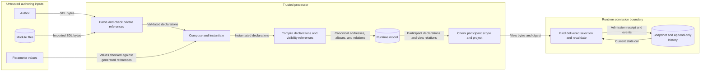

# Issue #301 — Reusable participant tool profiles

Date: 2026-10-13. Requirement: ACT-619 (traceability only).

## Decision

A `ParticipantBehaviorSpecification` supplies one participant tool profile.
Its `tool_affordances` and participant/role selectors define that profile.
There is no new section, model family, or contract name.
The ADR-076 address `participant.behavior-specification.<name>` identifies the profile.
Each binding keeps `participant.behavior-specification.<name>.tool-affordance.<id>`.
The version uses the existing `semantic_version` and `lifecycle_state`.
The profile's own selectors and ADR-053 module imports support reuse.

A binding gains two optional selector lists: `participant_refs` and `participant_role_refs`.
Their items use the existing selector shape.
Both lists require unique, nonblank items in the model and published schemas.
Empty lists mean that the binding applies to every selected participant.
Bindings gain no nested map or restriction id.
They gain no constraint, condition, policy, metadata, or extension field.
Two roles can use different bindings for one tool.
Those bindings share one `tool_ref`.
SEM-219 row A permits this: "one content identity exposes separately keyed action affordances".
The #294 rule also permits several bindings for one tool identity.

## Compared designs

1. One specification per role (existing reuse). It works today but fails "two
   roles using one profile" and duplicates the profile's identity, version, and
   shared bindings per role.
2. ADR-053 parameterized import once per role. Import parameters bind scalar
   variables, so they cannot give roles different action or boundary sets. Each
   import also yields its own specification and namespaced contracts, so this is
   two profiles, as in 1.
3. A top-level `tool_profiles` section referenced by specifications. It is a
   second availability authority and a parallel stack, which the #206 preflight
   reserves for "a later ADR" and the #294 preflight rejects.
4. A trait-style binding set included by specifications. It would remove the
   behavior coupling below, but it needs a new authored section with its own
   identity, version, import, namespace, and rename rules, which #294 and #206
   rule out without a later ADR. It also does not deliver role-specific
   bindings on its own: it still needs the selectors chosen here, or an
   include-time exclusion, which is an override operator.
5. A nested per-binding restriction map. One address would carry
   participant-dependent relations that every `affordance_refs`,
   exposure-policy, workflow-step, and manifest consumer would have to read per
   participant. It expresses nothing that separately keyed bindings do not.
6. Relative (parent-scoped) binding selectors. Rejected because #297 fixes the
   meaning of `participant_role_refs` ("selects all matching participants";
   roles "are not module-local identities"; "No new participant root, model,
   scope switch, or runtime selector is introduced"). Absolute semantics also
   keeps a later relaxation backward compatible.
7. A specification-level selection map from selectors to binding ids. It adds a
   second keyed structure with its own coverage rules away from the binding
   seam that #294 names.
8. Silently narrowing role-wide bindings. Rejected by #297 and SEM-219 row B.
9. Overrides with precedence (deny-overrides, last-wins, `extends`,
   include-time exclusion). They are order-dependent, deny is a constraint and
   not a negative grant, and overlays conflict with ADR-053.
10. Constraint bodies on a binding. They duplicate SEM-211 contracts and would
    collide with the ADR-108 control profiles.
11. New v2 surface fields such as a profile version, or an omission rule for
    hidden affordances. Both change ADR-095 v2 meaning.

The selected design is the smallest change that meets the issue: it adds no
map, id, module, runtime dataclass, or model error, and every binding address
keeps one fixed meaning.

Its main cost is behavior coupling.
`behavior_mode`, `autonomous_execution`, `mixed_control`, and `realization_profile_ref` apply to every selected participant.
PI-06 ownership uses that same selection.
Participants that need different values require separate profiles.

## Reconciliation with the #294 preflight

The [#294 preflight](issue-294-sem-219-participant-tool-affordance-preflight.md)
says that "The containing behavior specification supplies participant/role
scope". It also says that participant or role scope "remain[s] on the owning
`ParticipantBehaviorSpecificationRuntime`" and is reached through that address
"rather than copied into every affordance". This design is consistent with both
clauses:

- The SEM-219 formal text already names the participant branch: "An affordance
  binding relates: ... participant or behavior-specification scope"
  ([participant semantics](../../specs/formal/participant-semantics/README.md)).
  #294 realized the behavior-specification branch, and these selectors add the
  participant branch as a narrowing only.
- Dev already has a nested binding with its own participant scope under the
  specification: `participant_inject_deliveries.*.participant_ref` is "fatal
  dangling or outside the owning behavior specification"
  ([references](../../specs/sdl/references.md)), is rewritten through the agent
  symbol map, and compiles to `participant_address`. The binding selectors
  follow that shape.
- The #294 extensibility seam projects for `(participant, episode, order point,
  policy revision)` and says that "A per-phase or conditional availability
  variant adds a typed selection-context or condition reference at the binding
  seam". A participant selector is that selection context.
- A narrowing selector is not copied scope. An unscoped binding compiles with
  empty selector fields and reaches the specification's scope through
  `behavior_specification_address`. A scoped binding records only its own
  authored narrowing, as it already records its own action and boundary
  subsets.
- SEM-219 row B is preserved, not redefined (ADR-083 section 7). Its positive
  case "affordance remains within one behavior spec and every resolved
  participant" still holds with "resolved participant" read as the participants
  of `Sel(f) ⊆ Sel(S)`.

## Semantics

Rules TP-1 to TP-9 and conflict classes K1 to K5 are normative in the
[ACT-619 section](../../specs/formal/participant-behavior-model/README.md).
The points a reviewer most needs:

- Scoped is syntactic. A binding is scoped iff either authored selector list
  is non-empty. The validator, compiler, v1 refusal, v2 filter, and docs decide
  this from the raw lists, never from resolved addresses. A scoped binding that
  resolves to nobody is offered to nobody.
- Absolute selector semantics. `Sel(f)` and `Sel(S)` use the same resolver.
  Both resolve over the whole composed scenario.
  `Sel(f)` must be a subset of `Sel(S)`.
  For example, `S` selects `participant_refs: [analyst, observer]`.
  A binding selects `participant_role_refs: [blue]`.
  The root then adds another blue participant under a different specification.
  The binding fails with `participant.tool-affordance-participant-widens-parent`.
  The profile itself did not change.
  A twice-imported module has the same problem with role-scoped bindings over module-local actions.
- Conflicts. K2 duplicate relations ignore selectors; the canonical form is one
  binding with the combined selector. K5: two specifications may select one
  participant. A surface projected for `(p, S)` carries exactly the bindings of
  `S` that select `p`, and nothing copies or merges bindings across
  specifications. #301 adds no rule for choosing which specification's surface
  is projected for `p`.
- The participant filter runs before the one-disposition check, so only the
  participant whose own binding disagrees with the action fails to project.
- TP-9. A selector that covers exactly `Sel(S)` gives the same validation
  result, v2 entries, affordance refs, and participant-view digest as no
  selector. The compiled binding record also differs in its dependencies and
  dumped spec, and v1 refuses the scoped form.

Diagnostic codes. The validator emits `participant.tool-affordance-participant-unbound`,
`participant.tool-affordance-role-unbound`, and
`participant.tool-affordance-participant-widens-parent`. The compiler, a defense
for direct callers, emits `participant.tool-affordance-participant-ref-unbound`,
`participant.tool-affordance-participant-role-ref-unbound`, and the same
`participant.tool-affordance-participant-widens-parent`. The split follows the
existing pairs `participant.behavior-spec-participant-unbound` (validator) and
`participant.behavior-specification-participant-ref-unbound` (compiler). The
compiler's selector resolution also makes that existing compiler diagnostic
reachable for a specification with a dangling explicit participant ref.

## Projection, admission, and evidence

- `participant-decision-surface-v1` refuses a specification that contains a
  scoped binding ("participant-scoped tool affordances require
  participant-decision-surface-v2"). ADR-095 section 3 keeps v1 for historical
  validation and migration, and no historical v1 record can contain a scoped
  binding.
- A profile does not gate admission.
  A participant may invoke an action that it declares and its specification admits.
  This holds with or without a binding.
  A binding names the offered tool affordance and the bound action contract.
  It does not restrict other actions (SEM-219 row D; ADR-083 section 1).
  A role-specific tool profile is not a permission profile.
- Evidence identifies the profile by its address.
  The v2 assurance carries `behavior_specification_address`.
  The participant-view digest includes each role's `affordance_refs`.
  Admission binds that digest.
  The pinned instantiated snapshot identifies the profile's version label and content.
  Its `canonical_instantiated_sdl_digest` must equal `trial_provenance.instantiated_scenario_digest`.
  No control-plane contract changes.
- `semantic_version` is an authored label that nothing checks, imported or
  local. ADR-053 compares an import's requested version with the module
  descriptor's version, and compares bytes only under a digest pin.

## Repository-wide preflight guardrails

Preflight reviewed 2026-10-26 against the current repository. The models,
selectors, compiler records, projection, publication entries, and #301 tests
already exist. Subsequent work must build on those incumbents; this review
adds no implementation or new design authority. ADR-083, ADR-095, and the
normative TP/K rules above remain the semantic contract. The
[#294 preflight](issue-294-sem-219-participant-tool-affordance-preflight.md)
supplies the broader tool-affordance security boundary; the table below names
the current owners and the additional profile-specific obligations.

| Layer | Canonical incumbent and required boundary |
| --- | --- |
| Source | Keep `raes/parser.py`, `_yaml_loader.py`, `_source_profile.py`, `SDLModel`, and `ParticipantToolAffordance`. Keep safe YAML and source limits. Keys remain portable. Extra fields remain forbidden. Selector items must be unique and nonblank. Bindings have no free-form command, constraint, environment, credential, or provider-options map. |
| Identity | Reuse `raes.semantics.participant_behavior.select_participants` and [#1338](issue-1338-participant-identity-assignment-preflight.md). The `agents` key supplies identity. A direct role takes precedence. Only one affiliation permits the existing role fallback. Accounts, HTTP roles, affiliations, and implementation identities cannot replace participant identity. None grants selector authority. |
| Modules | `raes/composition/_behavior.py` rewrites explicit participant and binding refs through symbol maps. Roles stay global. `_behavior_authoring.validate_authored_behavior_references` rejects authored private refs. Exact generated refs remain valid. `instantiate_scenario()` and `admit_instantiated_scenario()` repeat checks after substitution. A parameter cannot mint a private ref. |
| Semantic checks | Keep `analyze_participant_behavior()`, `_tool_affordance.py`, the shared reference index, and `_participant_tool_affordance_renderers.py`. They resolve and narrow selectors. They check each participant's actions and boundaries. They reject duplicate relations and report errors. Do not hide an overbroad selector through intersection. Schema success does not prove these relations. |
| Compiler | Keep `raes_processor/compiler/participant_behaviors.py`, address helpers, and `ParticipantToolAffordanceRuntime`. Retain authored selectors, resolved addresses, dependencies, and the owning specification. Direct callers receive dangling-reference and widening errors. Do not copy action constraints. Add no profile IR family, resource, or backend payload. |
| Views | `models/decision_surface.py` supplies the shared filter for `decision_surface_v2.py`. Filter before visibility checks. Keep explicit specification selection, boundary, epoch, trusted anchor, and policy revision. An empty scoped selection offers nothing. v1 refuses all scoped bindings. This includes selectors that cover the whole parent. |
| Admission | Keep `raes_contracts/participant_binding_v2.py`, `participant_decision_surface_delivery.py`, and `raes_runtime/participant_decision_surface_control_v2.py`. They check view digests, delivery, argument shapes, apparatus, and live anchors. Repeat checks inside `control_plane_mutation` before `admit_participant_action`. A projected surface is not permanent authority. Action, time, information-flow, and control gates keep their separate authority. |
| Secrets | Keep `ControlPlaneConfiguration`, `ParticipantImplementationManifestModel.configuration_registry`, and `ConfigurationTargetDeclarationModel.validate_value`. Reuse `realize_participant_configuration()` and `validate_participant_configuration_selection()`. Secret targets accept only `SecretReferenceBindingValueModel` with `SecretReferenceId`. Preserve reference identity, value kind, and the complete target set. Profiles add no option override, environment binding, secret lookup, or credential resolver. |
| API | Add no profile route. Keep `create_control_plane_app()` and `ControlPlaneSecurityConfig.strict_defaults()`. Retain bearer and verified-proxy checks. Keep target/run roles and sealed route authority. Retain request-size guards, no-store responses, audit, and idempotency. Scenario roles grant no caller privileges. |
| Errors | Keep `SDLParseError`, collected `SDLValidationError`, `SDLInstantiationError`, and `Diagnostic`. Add no profile exception family. HTTP receipts use `portable_diagnostic_payload()` and `DiagnosticModel`. Keep JSON-Pointer addresses and the 512-character message limit. Bound reference lists before transport. Address conversion does not shorten messages. Keep redacted envelopes in `_responses._conflict_detail` and `_operation_routes`. Never expose raw provider errors, Pydantic inputs, full SDL, hidden context, or secrets. |
| Records | Keep SDL phase artifacts, typed IR, `RuntimeSnapshot`, and `ControlPlaneStore`. Keep operation receipts, behavior history, `control_plane_audit.py`, and trial provenance. Preserve CAS, idempotency, and append-only history. Profile identity uses specification/binding addresses and snapshot/view digests. Add no database, cache, audit stream, or raw-payload log. Do not rewrite evidence. A log proves neither visibility nor invocation. |
| Host | Profiles remain inert data. They add no process, listener, executable lookup, filesystem execution, or environment export. A `tool_ref` is never a command, URL, package install, or argv value. Adapters keep their launch and secret-injection contracts. Selectors cannot bypass those contracts or cause shell interpolation. |
| Contracts | Published schemas under `contracts/schemas/` remain normative. Reuse `raes_contracts.contracts.schema_bundle()` and the publication manifest. Keep per-contract records under `contracts/schema-publication/entries/`. Retain schema checks, catalog parity, and migration rules. Do not weaken closed readers or reinterpret v1. Ownership stays with `raes`, `raes_processor`, `raes_contracts`, and `raes_runtime`. Add no compatibility implementation or parallel workflow. |

These are required boundaries, not a claim that every downstream security case
has been verified by this documentation review. The shared boundary repairs
below address the reproduced projection and authoring gaps. Preserve
the runtime admission checks even when projection succeeds; do not work around
those gaps by broadening declarations or treating visibility as permission.

### Extension seam and non-goals

Keep the stable binding address and the existing projection inputs for
participant, specification, boundary, epoch/state cut, and policy revision as
the extension seam. A different apparatus is supplied through the existing
argument-shape, apparatus, delivery, and exposure resolvers, not a tool-kind
switch in the binding. Conditional or phase-specific availability would require
a separately governed typed selection-context/condition reference at that seam,
with validation and evidence semantics; it must not overload role strings or
change today's absolute selection. No such syntax is authorized here.

ACT-619 is not a permission-profile language, credential broker, executor,
backend-support declaration, new API, store, visibility model, or control
profile under ADR-108. Do not merge specification surfaces, add precedence or
overrides, duplicate SEM-211 constraints, or infer grants from installation,
capability, affiliation, exposure, or version labels. The unsupported cases and
shared boundary decisions in this note remain explicit implementation boundaries.

### Verification and governance boundary

Reuse `test_issue_301_participant_tool_profiles.py`,
`test_issue_301_participant_tool_profile_conflicts.py`, and
`tool_profile_support.py` for behavior evidence. Relevant adjoining cases are
the #1338 identity/role tests, #297 authoring/composition tests, v2 anchor and
delivery tests, schema parity, and portable diagnostic/API-envelope tests.
Do not add tests that merely mirror selector implementation or claim runtime
permission enforcement from successful schema validation.

Follow `.ground-control.yaml`, `.gc/plan-rules.md`, the canonical nox lanes,
and `tools/check_repo_policy.py`. Set `RAES_REQUIREMENT_UID=ACT-619` when the
branch has no UID; run only changed-file policy checks and explicit relevant
tests or `verify-fast-feedback` locally. CI owns full policy, integration,
fuzz, and completion suites. New syntax or compatibility claims require the
existing publication/migration and lineage gates and accurate IMPLEMENTS/TESTS
traceability; this guidance-only review does not activate the requirement or
claim those gates have passed. No changelog, version, deployment, or external
service change belongs to this preflight.

## Capability requirements for #304

#301 adds no manifest field or vocabulary. Which rows need a new field stays
with #304.

| Req | Feature | Existing surface #304 evaluates |
| --- | --- | --- |
| R1 | Parse and validate binding selectors, K3/K4, and the `__private` scan in `sdl-authoring-input-v1` | `processor-manifest-v2` `capabilities.supported_sdl_versions`; the id is unchanged, and the schema-publication ledger records the change |
| R2 | Compile selectors into `ParticipantToolAffordanceRuntime` | `capabilities.supported_features` value `compilation` |
| R3 | Participant-filtered v2 projection, fail closed | no `participant-decision-surface-*` id in processor or backend manifests; `participant-implementation-manifest-v1` lists v2 on the consumer side |
| R4 | v1 refuses any specification with a scoped binding | as R3; a candidate disclosed limitation |
| R5 | New derived documents carry the two keys; older closed readers reject them | schema-publication ledger and compatibility rules |
| R6 | Backend realization of bindings | none: the binding stays compiler IR only (#294), and `backend-manifest-v2` `realization_support` is unchanged |

## Unsupported cases

- a per-surface profile-version field;
- conditional or phase-dependent availability;
- `extends`, inheritance, cross-module overlays, or patches;
- per-binding authority scope or constraint bodies;
- omission of hidden affordances from a surface;
- v1 projection of scoped bindings;
- any tie between `semantic_version` and the module version or content, and
  any immutability check;
- one profile across participants that need different behavior modes,
  autonomy, mixed control, or realization profiles;
- carrying one specification's bindings onto another specification's surface;
- profile-gated admission;
- relative binding selectors;
- role-scoped bindings in a module imported more than once with module-local
  actions;
- backend support claims, which #304 owns.

## Shared boundary repairs

The 2026-10-26 assessment reproduced #1498 and #1570 through #1572.
The user authorized all four repairs before ACT-619 activation.
These decisions extend the existing profile design.

### Projection scope

Both surface versions require the participant's own action and boundary declarations.
The selected specification must also declare each action and boundary.
Missing participant records fail closed.
One participant cannot acquire another participant's actions through a shared specification.
Ordinary runtime admission retains its independent checks.

A binding participates only at its declared observation boundaries.
The existing shared binding filter checks participant, action, and boundary together.
Filtering occurs before visibility and disposition checks.
A matching hidden binding still causes projection to fail.
This rule adds no omission rule for hidden bindings.

### Visibility reference compilation

The compiler uses the shared declaration index to resolve authored visibility references.
It maps those declarations to runtime addresses, including qualified tool-affordance references.
It retains ambiguous candidates when it builds the visibility index.
Compiled observation lists, rules, transitions, and timelines use the resolved runtime addresses.
Canonical addresses identify known items in new runtime records.
Incoming authored aliases must pass the same visibility checks as canonical addresses.
The original boundary specification retains the authored references.
Unknown information references retain their existing meaning.
Ambiguous references fail closed.
Aliases with conflicting initial dispositions fail closed.
Transitions must start from the current disposition after alias resolution.
Equivalent aliases with equal dispositions identify one item.
Canonical runtime references remain valid.

Each boundary stores the aliases used by its policy.
The existing address index supplies this map.
History checks resolve each name before they check visibility and evidence.
This applies to observation details, action results, attribution, and outcome provenance.
Ambiguous aliases fail closed.
Unknown external references retain the existing rules.
The alias map remains internal and does not enter the participant view.
History records retain their producer-supplied spelling and original bytes.

This changes compiled reference meaning without adding authored syntax or schema fields.
New compilation uses the corrected meaning.
Stored historical evidence retains its original bytes.
Migration guidance describes the removal of duplicate classifications.

### Private module references

The existing authoring guard rejects the reserved `__private` segment before composition.
The guard covers participant affiliations, actions, boundaries, starting conditions, and operating scope.
It also checks initial knowledge and interactive-access references.
It also covers binding participant, action, boundary, and tool references.
Nested inject-delivery participant, inject, and boundary references receive the same check.
Inject occurrence, controller, temporal, and evidence references receive this check.
Source locations identify each rejected field.
Post-substitution checks compare references with the exact generated composition output.
Generated private references remain valid.
A parameter cannot create a new private reference.
Module exports remain an authoring boundary; they do not grant runtime authority.

### Security and data flows

The protected assets are module exports, participant declarations, hidden information, and evidence integrity.
The authoring boundary treats SDL and parameter values as untrusted inputs.
The projection boundary treats requested actions and boundaries as untrusted inputs.

| Threat and boundary | Control | Behavioral verification |
| --- | --- | --- |
| Authored access to unexported declarations | Existing private-reference guard before composition and after substitution | Reject importing-file references; retain generated references |
| Shared-profile scope expansion | Check participant declarations before projection | Reject undeclared actions and boundaries in both surface versions |
| Classification outside a binding's boundary | Filter bindings before visibility checks | Project at an alternate boundary without the unrelated binding |
| Alias confusion or hidden-information disclosure | Compile aliases once; resolve incoming history refs before authorization | Authored-only projection, transitions, alias conflicts, and hidden-reference rejection in each history channel |
| Stale or altered selection evidence | Existing view digest, delivery, state-cut, and admission checks | Existing ACT-619 admission and evidence tests |

No new service, credential, logger, store, or executor is required.
The existing typed models and compiler functions remain the architecture boundaries.
Policy checks retain ownership, publication, and traceability enforcement.
ADR-053, ADR-076, ADR-083, ADR-095, and ADR-109 remain applicable.
These repairs enforce their existing boundaries and require no new ADR.

The design review used [ASD-STE100 Issue 9](https://www.asd-ste100.org/assets/files/ASD-STE100_ISSUE9.pdf), rules 1.1, 4.1, 5.1, 6.1, and 9.4.
Project identifiers retain their defined technical meanings.
The new text separates decisions, controls, flows, and verification.
The issue plan records implementation tasks and commands.

[CWE-180](https://cwe.mitre.org/data/definitions/180.html) describes the risk of checking names too early.
The checks must use each name's final form.
The model declares each selector constraint.
The [Pydantic JSON Schema](https://docs.pydantic.dev/latest/concepts/json_schema/) generator publishes those constraints.

## Precedents

- N. Schärli, S. Ducasse, O. Nierstrasz, A. P. Black, "Traits: Composable Units
  of Behaviour", ECOOP 2003, LNCS 2743, pp. 248-274, Springer,
  doi:10.1007/978-3-540-45070-2_12. Composition order is irrelevant and
  conflicts are disambiguated explicitly.
- S. Ducasse, O. Nierstrasz, N. Schärli, R. Wuyts, A. P. Black, "Traits: A
  mechanism for fine-grained reuse", ACM TOPLAS 28(2):331-388, 2006,
  doi:10.1145/1119479.1119483, cited for the formal model only.
- R. S. Sandhu, E. J. Coyne, H. L. Feinstein, C. E. Youman, "Role-Based Access
  Control Models", IEEE Computer 29(2):38-47, 1996,
  <https://csrc.nist.gov/CSRC/media/Projects/Role-Based-Access-Control/documents/sandhu96.pdf>:
  permissions from several
  roles combine as a union, and denial is a constraint, not a negative
  permission.
- AWS IAM User Guide, "Policy evaluation logic",
  <https://docs.aws.amazon.com/IAM/latest/UserGuide/reference_policies_evaluation-logic.html>:
  a permissions boundary can
  only reduce. Deny-overrides is the rejected alternative.
- Kubernetes documentation, "Using RBAC Authorization",
  <https://kubernetes.io/docs/reference/access-authn-authz/rbac/>: "Permissions are purely
  additive (there are no 'deny' rules)."
- Model Context Protocol specification 2025-06-18, "Tools",
  <https://modelcontextprotocol.io/specification/2025-06-18/server/tools>: discovery and
  invocation are separate, and listing is not permission.
- E. Debenedetti et al., "Defeating Prompt Injections by Design" (CaMeL),
  arXiv:2503.18813, 2025, <https://arxiv.org/abs/2503.18813>: policy is enforced
  at each tool call, independently
  of what the model sees.
- T. Preston-Werner, "Semantic Versioning 2.0.0",
  <https://semver.org/spec/v2.0.0.html>, rule 3: released contents
  must not change. Here that is an authoring convention that nothing checks.
