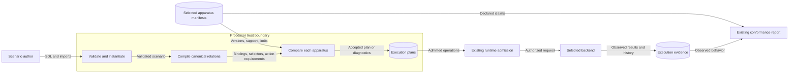

# Participant tool-profile support

API-414 keeps authored meaning, apparatus declarations, admission, and execution separate.
ADR-041, ADR-060, ADR-083, ADR-095, and ADR-115 retain their existing authority.
The [preflight](issue-304-participant-tool-support-preflight.md) supplies the boundary assessment.

## Components and contracts

The authored profile remains a behavior specification with tool-affordance bindings.
Its semantic version identifies authored content, not a processor protocol revision.
The instantiated snapshot digest identifies the exact content.

The portable semantics revision is `participant-tool-profile/v1`.
This revision covers ACT-619 TP-1 through TP-9 and conflict rules K1 through K5.
Processor capabilities add an optional `participant_tools` declaration.
It carries semantic revisions, API-407 feature support, and optional positive integer capacity limits.
Backend participant-runtime capabilities add optional `tool_profiles` revision and capacity coordinates.
Backend support levels remain in the existing `feature_support` list.
Missing coordinates declare no tool-profile support.
Root `constraints` remains descriptive text.

| Authored feature | Processor claim | Backend claim |
| --- | --- | --- |
| Identity, lifecycle, imports, reuse, binding relation, conflict rejection | `compilation`, authoring v1, `tool_affordances` | `tool_affordances` |
| Participant and role selectors, including whole-parent selectors | `scoped_tool_affordances` | `scoped_tool_affordances` |
| Action and observation references | Preserve compiler relations | `action_contracts`, `observation_boundaries` |
| Bound action preconditions and temporal requirements | Preserve action contracts | Existing `preconditions`, `temporal_contracts` when used |
| Profile content version and evidence | Preserve authored version and snapshot | Behavior-history v1 and episode contracts |
| Visibility and invocation authority | Preserve existing projection and admission | Support never grants visibility or permission |

The two new feature terms use the existing governed participant behavior vocabulary.
They require explicit support entries and evidence references.
They do not enter the runtime information-flow policy feature set.
No new processor feature enum member is needed.

## Admission and capacity

One processor helper derives requirements from the compiled, instantiated tool bindings.
The planner always calls it, including direct Python, CLI, and MCP planning.
Trial compilation calls the same helper for every selected apparatus before sealing an entry.
Trial realization passes the selected processor declaration to planning.
No component can borrow another component's support.
Tool-free scenarios retain their existing behavior.

Admission requires the declared semantics revision and each feature actually used.
It checks each profile's binding count and each binding's resolved participant count.
Limits apply independently to each profile and binding.
Bindings with raw selectors require scoped support even when their resolved selection equals the parent.

Exact support can declare finite capacity.
Bounded support means exact profile semantics within the declared capacity.
Its constraint references must name the applicable typed capacity fields.
Admission evaluates those fields before accepting bounded support.
Weak and unsupported support cannot satisfy this semantics revision.
No implicit downgrade or arbitrary constraint resolver is introduced.
Unsupported revisions and exceeded capacity produce bounded planner diagnostics.

## Systems security

Assets are participant scope, hidden observations, selected apparatus identity, and evidence integrity.
Declarations are untrusted inert data.
Existing closed contract models, vocabulary checks, and manifest adapters validate them.
Comparison revalidates caller-owned declarations and does not cache them as authority.

| Threat and boundary | Control | Verification |
| --- | --- | --- |
| Capability grants unintended participant authority | Keep selectors, projection, and live admission independent | Existing ACT-619 tests and rejected plan with no dispatch |
| Missing or contradictory apparatus claim | Require explicit feature, version, evidence, and presence agreement | Model, adapter, and planning negative cases |
| Capacity claim hides unsupported behavior | Evaluate only typed positive limits; reject weak support | Inside-limit and exceeded-limit cases |
| One backend masks another backend's gap | Compare each selected apparatus independently | Selected-apparatus tests |
| Declaration becomes execution evidence | Static conformance leaves effective support unset | Report serialization assertions and failed runtime probe |
| Diagnostic exposes authored secrets | Use fixed messages and bounded counts | Portable diagnostic contract validation |

No new endpoint, credential access, environment binding, store, or executable lookup is needed.
Existing authentication, actor/run scope, live state fences, and secret-reference handling remain applicable.
Native tool behavior remains the backend owner's responsibility.
A finite successful probe cannot prove every possible invocation.

## Data flow

This DFD also supplies the component diagram.
No deployment change is needed because all new comparisons are in-process.
Existing typed models and planner diagnostics supply architecture-as-code.
Existing vocabulary, schema publication, package boundary, and requirement checks supply policy-as-code.
No ADR amendment is needed because the existing authority boundaries remain valid.

## Compatibility and sources

The [migration note](../migration/participant-tool-support.md) defines omission and closed-reader behavior.
Changed draft manifest schemas retain their current suffix with publication ledger entries and generator parity.
Stable contracts are unchanged.

- [MCP tools](https://modelcontextprotocol.io/specification/2025-06-18/server/tools), revision 2025-06-18, capability declarations and security considerations: declarations do not authorize execution.
- [NIST SP 800-207](https://nvlpubs.nist.gov/nistpubs/specialpublications/NIST.SP.800-207.pdf), August 2020, sections 2.1 and 3: separate capability inputs, decisions, and enforcement.
- [JSON Schema Core](https://json-schema.org/draft/2020-12/json-schema-core), draft 2020-12, sections 7.6 and 7.7: distinguish assertions from descriptive annotations.
- [ASD-STE100](https://www.asd-ste100.org/assets/files/ASD-STE100_ISSUE9.pdf), Issue 9, sections 1, 5, 6, and 9: short sentences and consistent technical names.

The document review uses one fact per sentence and consistent repository technical nouns.
Descriptions stay within 25 words; procedures stay within 20 words.
The review distinguishes design facts from implementation tasks and automated prose checks.
