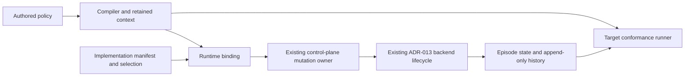

# Participant episode runtime binding

Issue #309 links an authored episode policy to the existing ADR-013 lifecycle.
The policy states intent. ADR-013 still owns episode state and history.
This change adds no state machine, endpoint, or schema family.

## Owners and interfaces

`raes_processor` owns the compiled policy and its participant addresses.
`raes_runtime.participant_episode_binding` owns `ParticipantEpisodeRuntimeBinding`.
The binding takes a compiled model. It also takes one manifest selection per governed participant.
It reuses the existing manifest, selection, and selection validator.
The binding checks the original compiler context.
It rejects missing, unsupported, or duplicate selections.

The control plane accepts the binding through its `participant_episode` option.
Its existing mutation owner checks reset actions and terminal reasons before dispatch.
The backend still owns the ADR-013 lifecycle calls.
Those calls initialize, reset, restart, or end an episode.
The binding also checks restored history and successful backend results.

`raes_conformance` owns the target runner and its recorded-history result.
The runner takes a compiled model and recorded snapshot as evidence.
It reports missing history as unsupported.
It reports an absent episode capability as not applicable.
It checks snapshot integrity and the policy bounds together.
These checks prove no native execution or condition evaluation.

The shared history check lives in `raes_processor.models.participant_episode_validation`.
Runtime and conformance both use it.
Runtime does not import conformance.
The legacy runtime manager has no episode binding.
It refuses these plans before execution.

The module model is `tools/policy/adr_policy.yaml`.
It declares `raes.participant_episode_policy` as a public compiler input.
It also declares `raes_runtime.participant_episode_binding` as a public conformance input.
No new package dependency is needed.

## Invariants and security

- Each participant has one episode policy and one implementation selection.
- Manifest identity, digest, decision mode, and episode contracts must agree.
- An invalid binding fails before a backend effect.
- Reset and restart keep the participant identity.
- Each reset or restart creates a new episode generation.
- Reset actions and terminal reasons stay within the authored bounds.
- Existing authorization, idempotency, audit, and mutation owners remain in use.
- Diagnostics remain operator evidence. No new participant view is added.
- The binding copies caller-owned models and selections before use.

The existing authored schema already holds the required intent.
Schema regeneration follows current contract ownership and publication rules.
No new service, credential, or data transfer is required.

## Verification

Targeted tests cover all four governed implementation kinds.
Agent variants cover RL and LLM selections.
Tests run lifecycle calls and check reset lineage.
They reject missing contracts, duplicate bindings, and forged compiler context.
Runner tests pass in invalid history and require a failing report.
Negative tests also cover missing evidence and absent episode support.
Mutation checks remove admission and runner checks one at a time.
The matching tests must fail.
Full verification runs in the PR's isolated CI.

The design follows ADR-013 and ADR-095.
It also follows the issue #122 episode model and the existing inject-delivery binding.

## Review evidence

The three targeted mutations were killed by test assertions.
They removed pre-effect admission, manifest digest checks, and runner policy observation.
File-local policy, requirement governance, catalog parity, and schema checks pass.
The design passes Vale with the repository configuration.
Maintained guide edits preserve existing heading links and technical terms.

The reference pages retain exact contract terms and source titles.
Their reading scores exceed the prose threshold: fixture 15.02, lineage 16.63, sections 13.05, ACT-623 12.04, and DSL-120 14.05.
Exact-file metric exceptions preserve those terms. Other writing checks remain enabled.
Headings use sentence case while preserving acronyms and existing anchor names.
Sources are the compiled policy, runtime binding, shared history check, and target-runner tests named above.
