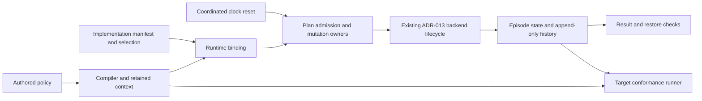

# Participant episode runtime binding

Issue #309 (ACT-623) links an authored episode policy (DSL-120, issue #307) to the existing ADR-013 lifecycle.
The policy states intent. ADR-013 still owns episode state and history.
This change adds no state machine, endpoint, or schema family.

## Owners and interfaces

`raes_processor` owns the compiled policy, its participant addresses, and the aggregate `episode_policy_address`.
`raes_processor.compiler.addresses.participant_episode_policy_address` renders that address for the policy and the aggregate.
`raes_runtime.participant_episode_binding` owns `ParticipantEpisodeRuntimeBinding`.
The binding takes a compiled model and one manifest selection for each governed participant.
It reuses the existing manifest, selection, and selection validator.
It checks the original compiler context and rejects missing, unsupported, or duplicate selections.

The control plane accepts the binding through its `participant_episode` option.
Plan admission refuses a plan with episode policies unless the installed binding holds the exact compiled model of that plan.
The same rule applies to apply, run-program admission, planner authorization, and trial admission.

The existing mutation owners check reset actions and terminal reasons before dispatch.
This covers ordinary participant dispatch, mixed-control lifecycle dispatch, and coordinated clock resets.
The backend still owns the ADR-013 lifecycle calls.

After dispatch, the runtime checks returned history against the policy.
Ordinary and mixed dispatch record an indeterminate operation when the history violates the policy.
The composed-result validator refuses time and scheduler results that violate it, and keeps the previous snapshot.
The control plane also refuses restored history that violates the policy.

`raes_conformance` owns the target runner and its recorded-history case.
The runner compiles the probe scenario once and gives that model to the episode case.
It reports missing history as unsupported, and an absent episode capability as not applicable.
These checks prove no native execution or condition evaluation.

The shared history check is in `raes_processor.models.participant_episode_validation`.
Runtime and conformance both use it. Runtime does not import conformance.

The module model is `tools/policy/adr_policy.yaml`.
It declares `raes_runtime.participant_episode_binding` as a public conformance input.
No new package dependency is needed.

## Invariants and security

- Each participant has one episode policy and one implementation selection.
- Manifest identity, digest, decision mode, and episode contracts must agree.
- An invalid binding fails before a backend effect.
- A plan with episode policies runs only under the binding of its exact compiled model.
- Reset and restart keep the participant identity. Each one creates a new episode generation.
- Reset actions and terminal reasons stay within the authored bounds on every dispatch path, including clock resets.
- Existing authorization, idempotency, audit, and mutation owners remain in use.
- The binding copies caller-owned models and selections. Request and history checks use only its private state.

## Verification

Targeted tests cover the governed implementation kinds, including RL and LLM agent selections.
They run lifecycle calls and check reset lineage.
They reject missing contracts, duplicate bindings, and forged compiler context.

Admission tests apply a governed autonomous plan with and without its binding.
Clock-reset tests show that a reset outside the policy is refused before the time runtime is called.
They also show that an admitted reset keeps the governed history valid.

Runner tests supply invalid history and require a failing report.
Other tests cover missing evidence, absent episode support, and reuse of the probe model.
Full verification runs in the PR's isolated CI.

The design follows ADR-013, ADR-095, the issue #122 episode model, and the existing inject-delivery binding.
