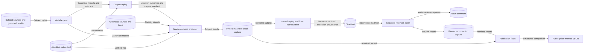

# Participant-crossing evidence identity and publication

Requirements: SEM-232, ASR-535.
Issue #976 publishes the reproduced finite participant-crossing result.
The [preflight note](issue-976-reproduced-crossing-publication-preflight.md) records the guardrails.
This document describes the resulting evidence identity, admission, and publication design.
[ADR-100](adrs/adr-100-participant-crossing-bisimulation.md) remains the semantic authority.

## Problem

The issue #973, #974, and #975 records bound large shared source sets into reproducible bytes.
These sets included every `raes_contracts` module, `noxfile.py`, and the Python and tooling locks.
They also included the tool-admission validators and every committed package module.
Admission rebuilt each manifest from the current checkout.
An unrelated library change therefore made the retained records invalid.
The required `model-check` job failed for the same reason.
The retained reproduction record already failed on `dev` after issues #1761 and #1762.
The publication also needs a catalog revision and a new assessment.
Both changes edit shared library modules.

## Decision

Each retained record separates its subject identity from its execution provenance.
This follows the subject and provenance split in SLSA Provenance v1.0.

| Part | Content | Use |
| --- | --- | --- |
| Subject identity | Compared models, mutations, witnesses, decisions, claim, profile, projection, catalog, tool identity, command, limits, and subject sources | Reproducible bytes. Admission and replay compare them exactly. |
| Execution provenance | Source revision, host, native packages, Python closure, and lock digests | Run record. Replay does not compare it. |
| Apparatus stability | Every source that the run executes | The run checks these sources before and after native execution. |

A subject source is a file whose bytes define the compared models or the evidence composition.
It is also a normative specification that those files implement.
Shared libraries, tool-admission code, locks, command-line modules, and staging code are apparatus.
Native replay detects any apparatus change that alters a subject byte.
The source revision identifies every apparatus byte of a run.

## Subject sources

| Record | Subject sources |
| --- | --- |
| Model bundle | `abstract.py`, `concrete.py`, `graph.py`, `aut.py`, `export.py`, `participant-crossing-models.md`, `information-flow-control.md` |
| Counterexample corpus | The model sources, plus `counterexample_mutations.py`, `counterexample_witnesses.py`, and `counterexample_corpus.py` |
| Machine check | The corpus sources, plus `machine_check.py`, `machine_check_evidence.py`, the profile, the corpus pin, and `participant-crossing-machine-check.md` |
| Reproduction measurement | `reproduction.py`, `reproduction_checks.py`, and `reproduction_sandbox.py` |

The profile also binds `abstract.py`, `concrete.py`, and the models specification by digest.
The runtime crossing modules are not subject sources.
Runtime realization is a separate axis with its own source-bound mapping record.
That record pins the mapping test drivers, not every repository test.
This matches its specification and keeps its manifest within the repository file-size limit.

## Components and interfaces

| Component | Owner | Public interface | Responsibility |
| --- | --- | --- | --- |
| Model export | `participant_crossing.export` | `build_bundle`, `SUBJECT_SOURCE_PATHS` | Builds both models and binds model subject sources. |
| Corpus | `participant_crossing.counterexample_corpus` | `build_bundle`, `admit_bundle`, `load_retained` | Replays mutations and calibrations and binds corpus subject sources. |
| Machine check | `participant_crossing.machine_check` | `build_bundle`, `admit_bundle`, `load_retained`, `publish` | Produces and admits the finite decision. |
| Evidence metadata | `participant_crossing.machine_check_evidence` | `result`, `manifest`, `subject_pins` | Builds the closed result and subject manifest. |
| Hosted publication | `participant_crossing.machine_check_publication` | `publish`, `execution_record` | Replays natively and records execution provenance. |
| Reproduction | `participant_crossing.reproduction` | `measure`, `admit_measurement` | Measures a fresh replay. |
| Reproduction record | `participant_crossing.reproduction_record` | `admit_record`, `admit_capture`, `retain` | Admits the retained record and retains a reviewed capture. |
| Review attestation | `participant_crossing.reproduction_attestation` | `verify_review_records` | Binds the review references to GitHub records before retention. |
| Publication facts | `participant_crossing.publication` | `publication_facts` | Composes the two admitted records into the published facts. |

`admit_record` replaces the joins that a test asserted before.
It admits the pinned reproduction capture against the current machine-check pin.
It validates the measurement, execution record, and review record.
`retain` writes a new capture only after the same admission passes.
It then checks the review references against GitHub records.
A reviewer still updates the reproduction pin in a reviewed change.

## Admission and replay

Admission checks integrity and joins without native execution.
It verifies the pin, the inventory, and every artifact digest.
It rebuilds the expected subject metadata from the current subject sources.
Replay runs the native checker from the current checkout.
It must reproduce every subject byte exactly.
The hosted `model-check` job runs replay and a fresh reproduction on each change.
A subject source change fails both until a new record is produced, reproduced, and reviewed.
An apparatus change that keeps every subject byte passes both.

## Reproduction measurement and review

Measurement schema `participant-crossing-reproduction-measurement/v2` removes the producer and reviewer references.
A measurement records machine facts only.
The review record names the producer, the reviewer, the reviewer role, and the acceptance comment.
The reviewer and the producer use different run references.
The reviewer role is `implementation-agent`.
Both runs use one repository account.
So the record claims run separation, not principal separation.
No human review or cryptographic authenticity is claimed.

At retention, each reference must resolve to a GitHub record.
Each record author must hold repository write authority.
The reviewer and acceptance comments must follow the producer record on one issue.
One author writes both, and the acceptance states one explicit decision for that reviewer run.
The acceptance comment must name the measurement, execution, claim, and subject digests and the qualified run.
The run head revision, model-check job result, artifact digest, and merge parents must match the review.
Offline admission rechecks the retained bytes and joins only.

The review binds the measurement, execution, and claim digests and the mutation review subject.
It binds the qualified run, source revision, parent revisions, and artifact digest.
The decision is `accepted-bounded-reproduction`.
A measurement without an admitted review does not establish independent reproduction.

## Publication

Catalog revision `rev14` records the finite model-check axis for `divergence-preserving-branching-bisimulation`.
The proof axis remains `deliberately-unproved`.
Revision `rev13` moves to the retained catalog history.
The result claim keeps its taxonomy `rev8` binding and its original nonclaims.
The publication composes that claim with the separately admitted review.

Assessment revision `2026-10-31` adds the result as evidence for `behavioral-relation-taxonomy`.
The packaged loader selects that assessment.
The `2026-07-12` assessment remains unchanged.
The `participant-action-observation` concern remains `partial`.

The public participant-control guide shows the claim and the publication facts as marked JSON.
A repository test compares each marked value with `publication_facts`.
The test does not compare prose with prose.

## Data flows and trust boundaries

The native sandbox is a trust boundary.
It receives synthetic models and the verified tool tree as read-only inputs.
It receives no network, credentials, home directory, or runtime authority.
The CI artifact boundary accepts only the closed result inventory.
The reviewer boundary separates measurement from acceptance.
The public documentation boundary receives only allowlisted identifiers, counts, revisions, and digests.

## Security and verification

| Threat and boundary | Control | Verification |
| --- | --- | --- |
| Changed model, mutation, witness, or claim source | Subject source digests in the reproducible manifest | Admission and replay refuse a changed subject source. |
| Apparatus change that alters a result | Native replay compares every subject byte | A changed result fails the `model-check` job. |
| Apparatus change during a run | Before-and-after stability digests | Drift during a run publishes nothing. |
| Substituted native tool | Archive, executable, and installed-tree digests in the subject | A changed tool identity fails admission. |
| Self-approved reproduction | Separate review record with distinct run references | Admission refuses a missing, joined, or self-referential review. |
| Forged review references | Retain-time check against GitHub comment, author authority, run, job, artifact, and commit records | Retention refuses a missing, reordered, unauthorized, undecided, unbound, or mismatched record. |
| Stale or substituted reproduction subject | Capture target must equal the current machine-check pin | Admission refuses a capture for another subject. |
| Published fact drift | Structured comparison with admitted records | The publication test refuses any changed digest, count, or nonclaim. |
| Claim promotion | Exact claim binding, catalog axes, and nonclaims | Proof, runtime, backend, noninterference, and opacity claims stay absent. |
| Host data disclosure | Allowlisted provenance fields and bounded readers | Public facts contain no host path, environment value, or raw tool output. |

## Architecture and policy constraints

ADR-071 keeps integrity, review, and authenticity separate.
ADR-081 keeps each assurance axis separate.
ADR-117 governs the formal package interfaces.
No new ADR, public schema, service, store, or workflow is needed.
The existing claim validator, catalog loader, assessment model, assurance map, and semantic-coverage check supply policy as code.
The subject inventories, admission joins, and the publication test supply architecture as code.
The canonical CI graph keeps the required `model-check` job and its pinned actions.

## References

- [SLSA Provenance v1.0](https://slsa.dev/spec/v1.0/provenance): subject, build definition, and run details.
- [Reproducible Builds definition](https://reproducible-builds.org/docs/definition/): bit-identical specified artifacts and excluded ancillary outputs.
- [mCRL2 202607.0 ltscompare](https://www.mcrl2.org/web/user_manual/tools/release/ltscompare.html): relation modes, hiding, and input order.
- [Bubblewrap](https://github.com/containers/bubblewrap/blob/main/README.md): namespace and mount isolation.
- [ASD-STE100 Issue 9](https://www.asd-ste100.org/assets/files/ASD-STE100_ISSUE9.pdf): sections 1, 4, 5, and 6.

## Document review

The review applies STE sections 1, 4, 5, and 6.
It checks technical names, sentence limits, and one fact per sentence.
This document describes the system and its decisions.
The issue plan holds implementation tasks.
