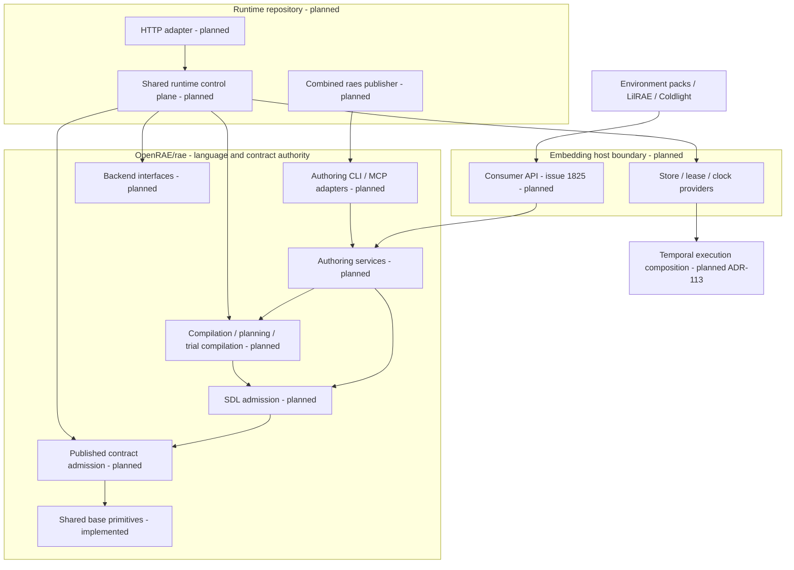
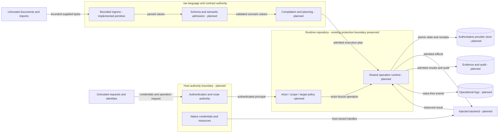
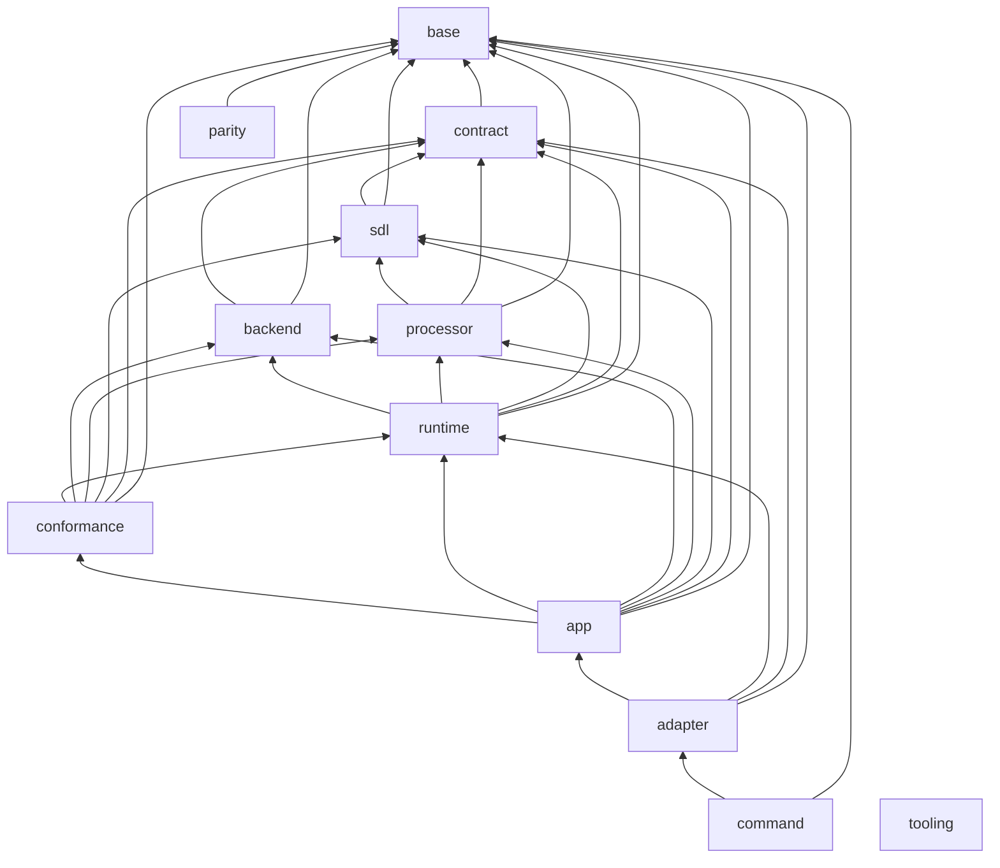

# Current Go architecture

This is the current system view for the Go port.
[The model](../../implementations/architecture.json) owns package placement, dependencies, build contexts and intended interfaces.
[ADR-122](../decisions/adrs/adr-122-go-architecture-model.md) owns the checking rules.
The generated view lists the code that exists now.
An empty layer is planned, not implemented.
Python remains the behavioral reference for components not yet ported.

The [runtime repository split](../decisions/issue-1891-runtime-repository-boundary.md) takes effect at the common #1804 Go launch.
`OpenRAE/rae` retains SDL, processor, canonical contracts, portable backend interfaces/stubs and pure conformance.
The planned runtime repository owns execution, control-plane/HTTP/store/worker behavior and live conformance.
Runtime imports released public `rae` APIs; `rae` product modules never import runtime.
The [complete source inventory](../decisions/issue-1891-runtime-extraction-inventory.json) pins the current baseline and mixed responsibilities.
No destination or source transfer is approved by this plan.

## Components and consumer boundary

Environment packs and LilRAE consume the relevant public language/processor/contract/backend APIs.
Coldlight embeds the shared runtime from its planned new repository owner.
[Issue #1825](https://github.com/OpenRAE/rae/issues/1825) owns their public package design and compatibility policy.
No product package is downstream-importable today.
The `public` flag is for layers.
It does not bypass Go's `internal` rule.
The tooling module is a development dependency, not the consumer product API.

Consumers need bounded SDL reads.
They also need checks, edits, errors, locks and digests.
They also include normalized contract round trips, artifact admission, compilation, planning and runtime result admission.
Diagnostics preserve code, pointer, source range, stage and severity.
Typed handles and caller validators cannot be replaced with JSON-only shims.
RAES owns semantic admission, defaults, schemas, vocabulary and address grammar.
Consumer adapters must not call Python.
They must not copy core checks.

Coldlight embeds the shared runtime selected by ADR-104 and ADR-113, using the new runtime repository's released API after cutover.
Its planned API includes actor-bound submissions, idempotent receipts, snapshots, participant transitions and audit.
It also includes store, lease and clock interfaces and Temporal execution adapters.
ADR-104's P0/P1/P2 profiles describe reference capabilities, not proof of Go delivery.
P3 coordinated multi-process, multi-tenant service remains a nonclaim.

## Data flows and protection boundaries

| Asset / threat | Boundary and control | Evidence / verification |
| --- | --- | --- |
| Source containment and parser exhaustion | Bounded supplied sources; strict ingress before semantic admission | Base ingress tests; published contracts; #1782/#1785 remain planned |
| Cross-actor operations | Transport authenticates; core binds actor, scope, target and idempotency | ADR-104; future runtime conformance tests |
| Confused transport authority | One route authority; invalid bearer credentials cannot fall back to proxy headers | ADR-104; reference security configuration and route tests |
| Uncertain effects and corrupt state | Backend admission, atomic terminal commits, CAS and leases | ADR-104 and ADR-113; Go runtime remains planned |
| Secret disclosure | Logical secret references; native credentials stay in the host | ADR-115 and ADR-116; future adapter redaction tests |
| Audit confusion | Operational logs carry no values and cannot replace evidence or audit | ADR-066 and ADR-116 |
| Architectural drift | Exact typed API, package graph, design commitments and source-bound view checks | ADR-122; arch and archcheck negative tests |

Snapshots prove structural consistency. They do not prove semantic equivalence or service readiness.
Review checks these trust explanations whenever bound evidence changes.

## Ownership and reuse

| Concern | Canonical owner / reuse decision |
| --- | --- |
| Strict bounded JSON | `base/ingress.Parse`; standard encoding/json alone does not enforce the published ingress policy |
| Canonical bytes | `base/canonjson`; JCS and sorted Python JSON are distinct compatibility profiles |
| Digests | `base/digest`; reuse crypto/sha256, not local digest wrappers in each slice |
| Random streams | `base/randstream`; admitted BLAKE3 adapter preserves profiles and seek behavior |
| Addresses and pointers | `base/address` and `base/jsonpointer`; published grammars remain authoritative |
| URI safety | `base/urisafety`; standard URL parsing plus documented Unicode and error-precedence compatibility |
| Clock and timestamp policies | `base/clock` and `base/timestamp`; inject wall-clock reads and reuse the four named grammars |
| Errors and logging | `base/fault` and `base/logrecord`; value-free codes and bounded log records through standard error wrapping and log/slog |
| Graphs | `base/graph`; shared iterative cycle, ordering and component operations |
| Versions and scalar domains | `base/softwareversion` and `base/domain`; closed typed descriptors and bounded comparisons |
| Snapshot values | `base/value`; bounded closed JSON values without foreign callbacks |
| Secret reference identities | `base/secretref`; bounded inert identities, with no secret resolution |
| Contract admission and defaults | Planned contract layer; reuse published schemas and concept authority, not transport validators |
| Operation and persistence semantics | Planned runtime layer; transports and embedders share the same core |
| Architecture checks | Tooling `arch`; standard Go types and existing model/findings, no product-internal imports |

These primitive owners stay in `rae`.
Required consumer types become importable under #1825/#1892; the model's `public` flag does not override Go `internal` visibility.
Pure conformance, authoring services and MCP remain in `rae`; live conformance, execution services, HTTP and combined `raes` publication belong with runtime.
The current model graph below still describes this checkout before extraction.
Its layer descriptions and bound split decision define future ownership; no moved package is claimed as delivered.

Compatibility reasons and parity evidence:
[canonical JSON](../decisions/issue-1779-canonical-json-design.md),
[ingress and URI](../decisions/issue-1779-ingress-design.md),
[random streams](../decisions/issue-1779-random-streams-design.md), and
[parity harness](../decisions/issue-1778-parity-corpus-design.md).
The architecture check does not alter those semantics.
The [shared-primitives completion design](../decisions/issue-1779-shared-primitives-completion.md) owns the newly merged base helpers and their compatibility reasons.

## Maintenance

Each port slice changes the model before code.
Do not copy shared helpers.
Use the owner listed above.
Keep source limits in place.
Keep secrets out of logs.
It records typed APIs and updates the owning design's API commitment.
It reviews this overview when source commitments change.
`archcheck -view` prints the generated section for review; it does not overwrite the overview.
`archcheck -api` prints actual interfaces for comparison; it does not approve them.
The existing go-architecture CI job checks documentation and code changes.

<!-- go-view -->

| Layer | Status | Allowed dependencies |
| --- | --- | --- |
| `base` | implemented packages |  |
| `contract` | planned | base |
| `sdl` | planned | contract, base |
| `processor` | planned | sdl, contract, base |
| `backend` | planned | contract, base |
| `runtime` | planned | backend, processor, sdl, contract, base |
| `conformance` | planned | runtime, backend, processor, sdl, contract, base |
| `app` | planned | conformance, runtime, backend, processor, sdl, contract, base |
| `adapter` | planned | app, runtime, contract, base |
| `command` | planned | adapter, base |
| `parity` | implemented packages | base |
| `tooling` | implemented packages |  |

| Package owner | Layer | Cross-layer visibility | Consumer importable | Actual dependencies |
| --- | --- | --- | --- | --- |
| `implementations/go/internal/base/address` | base | true | false | implementations/go/internal/base/fault |
| `implementations/go/internal/base/canonjson` | base | true | false | implementations/go/internal/base/fault |
| `implementations/go/internal/base/digest` | base | true | false |  |
| `implementations/go/internal/base/ingress` | base | true | false | implementations/go/internal/base/fault |
| `implementations/go/internal/base/jsonpointer` | base | true | false |  |
| `implementations/go/internal/base/randstream` | base | true | false | implementations/go/internal/base/fault |
| `implementations/go/internal/base/urisafety` | base | true | false | implementations/go/internal/base/fault |
| `implementations/go/internal/parity` | parity | false | false | implementations/go/internal/base/address, implementations/go/internal/base/canonjson, implementations/go/internal/base/digest, implementations/go/internal/base/ingress, implementations/go/internal/base/jsonpointer, implementations/go/internal/base/randstream, implementations/go/internal/base/urisafety, implementations/go/internal/base/clock, implementations/go/internal/base/domain, implementations/go/internal/base/fault, implementations/go/internal/base/graph, implementations/go/internal/base/logrecord, implementations/go/internal/base/secretref, implementations/go/internal/base/softwareversion, implementations/go/internal/base/timestamp, implementations/go/internal/base/value |
| `implementations/tooling/go/arch` | tooling | false | true |  |
| `implementations/tooling/go/cmd/archcheck` | tooling | false | false | implementations/tooling/go/arch |
| `implementations/tooling/go/cmd/raesvet` | tooling | false | false | implementations/tooling/go/lint/getprefix, implementations/tooling/go/lint/gotwant, implementations/tooling/go/lint/wrapverb |
| `implementations/tooling/go/cmd/regressiontest` | tooling | false | false |  |
| `implementations/tooling/go/lint/getprefix` | tooling | false | true |  |
| `implementations/tooling/go/lint/gotwant` | tooling | false | true |  |
| `implementations/tooling/go/lint/wrapverb` | tooling | false | true |  |
| `implementations/go/internal/base/clock` | base | true | false |  |
| `implementations/go/internal/base/fault` | base | true | false |  |
| `implementations/go/internal/base/timestamp` | base | true | false | implementations/go/internal/base/fault |
| `implementations/go/internal/base/softwareversion` | base | true | false | implementations/go/internal/base/canonjson, implementations/go/internal/base/digest, implementations/go/internal/base/fault |
| `implementations/go/internal/base/domain` | base | true | false | implementations/go/internal/base/softwareversion, implementations/go/internal/base/fault |
| `implementations/go/internal/base/value` | base | true | false | implementations/go/internal/base/fault, implementations/go/internal/base/canonjson |
| `implementations/go/internal/base/logrecord` | base | true | false | implementations/go/internal/base/fault |
| `implementations/go/internal/base/graph` | base | true | false | implementations/go/internal/base/fault |
| `implementations/go/internal/base/secretref` | base | true | false | implementations/go/internal/base/fault |

| Trust-view evidence | SHA-256 |
| --- | --- |
| `contracts/schemas/experiment-core/materialization-archive-record-v1.json` | `fb61b1d9bb70ffedf7fec94325c3751a29ef7db7f6e8bea8fc96c064d101ba90` |
| `docs/decisions/adrs/adr-036-sdl-processor-runtime-module-boundaries.md` | `8b23019d17144225d08d6a38301a62a3eb2490c122a3d2ed36a67ab0804d84fa` |
| `docs/decisions/adrs/adr-066-observability-evidence-plane-separation.md` | `938ce2443ce7bd9e5cfa151d9740610ac23fa4338efa48c3cb022c7543bab24a` |
| `docs/decisions/adrs/adr-104-runtime-control-plane-architecture.md` | `790d2c4119d2c37562aaad3d5cee3ffa4740ac150511f035f3376dd46d28e4b0` |
| `docs/decisions/adrs/adr-113-reusable-execution-machinery.md` | `6d904befc0d37d44b07ed083d297c7a0e3ba0d520d79f9ddce1999477c78e91d` |
| `docs/decisions/adrs/adr-115-concrete-backends-owned-outside-raes.md` | `e7994a017f64937bfa48edfb8600b933e2acca330a2d5ebaef8a6ae95fcc91be` |
| `docs/decisions/adrs/adr-116-shared-exceptions-and-operational-logging.md` | `a4e20904762d23ff25162b910ab91032fdaac84b38ef727401c7fe501dde6ffa` |
| `docs/decisions/adrs/adr-122-go-architecture-model.md` | `5c481df8a3f5bfc4f56af8701c94fe7ac66a9257c8895a3c98d01691b631c2c5` |
| `docs/decisions/issue-1775-go-architecture-model-design.md` | `d12f71c98e4bcad11f42db41338d2d93e9d9ed21731e5e4a1b9ed6fbbba1d2c8` |
| `docs/decisions/issue-1778-parity-corpus-design.md` | `c3197d51b64c8b2684096ad8d4ed4df223457b2e811a16e68bf31e9babc15830` |
| `docs/decisions/issue-1779-canonical-json-design.md` | `c68392c70e55eabd39a1d1b287c082fc98b40aea2a50a90a43384f34aea752a3` |
| `docs/decisions/issue-1779-ingress-design.md` | `21fe1ede3a371941bd13605037cf6e378a6f442d9622dbc9fa716e952cbad281` |
| `docs/decisions/issue-1779-random-streams-design.md` | `dae79083acb2909a63a43849e9aeb0ddf4594d3e7d54d118b2a1dd54f68cdb8b` |
| `docs/decisions/issue-1779-shared-primitives-completion.md` | `6db76f93cc860d13e966bd591fc4d4c4fc3d2c27789aafe1c1bd30dcc57d657e` |
| `docs/decisions/issue-1859-go-architecture-contract-design.md` | `7a90a0ef49ec5024dfde3cdac2f99266e8a0db0148327e81dde8517dee422cf6` |
| `docs/decisions/issue-1891-runtime-repository-boundary.md` | `09d95d1cb10d821fc452544be8f621f4612de1913dcee0456a656be1c9ef8bfa` |
<!-- go-component base 35001c1ef27e772296d239cf26579696b944020402539b5dbe0614495c536bef -->
<!-- go-component contract 9bb24b23b24dd9634323fef7b9dc6e35558b92e70451188c7ed8381e38f8a831 -->
<!-- go-component sdl d1d67576ad56fe43867a4a4dfbe6657c2c4e5c6a6ef3bc2c760ad194de8a4be9 -->
<!-- go-component processor 46a46c7512040e467fef3228f0c8cf7a0d283f029a934b4feca3f676b926b018 -->
<!-- go-component backend bf131c11dcf1f5ef49c64771c5d6f22ca51a8d97996499a4b71b15d249fccfd1 -->
<!-- go-component runtime a3b7ea8addca2ad447d8e1f6257f4408fcd053d6dde7809e71373016148aa772 -->
<!-- go-component conformance c4ee4d4afa73d9562d49b2984194af3a61e6b93ebac9a0f05cff5f4f34911674 -->
<!-- go-component app 0dbeae6e9ad67288f4ce8d956732456cdaa5ef1004bde4c284da8d206ca669ae -->
<!-- go-component adapter 76df4c43a6b4e09960b390bd39ed77face3e89ea86346688977ccfe9805080cd -->
<!-- go-component command 4b9f391835428e774344bfca1fe0a8a93dfc9dee516a3dc2d99668f8e29b7198 -->
<!-- go-component parity 89bb449798cdf8366d3e5e36030d5b9e69d807a74800910d7e5eb8aaf35e938a -->
<!-- go-component tooling bebffbdaf7fb0a87b4fa04b29307aeb83a825166da7aae6c4fce56fc7a82c976 -->

<!-- /go-view -->
