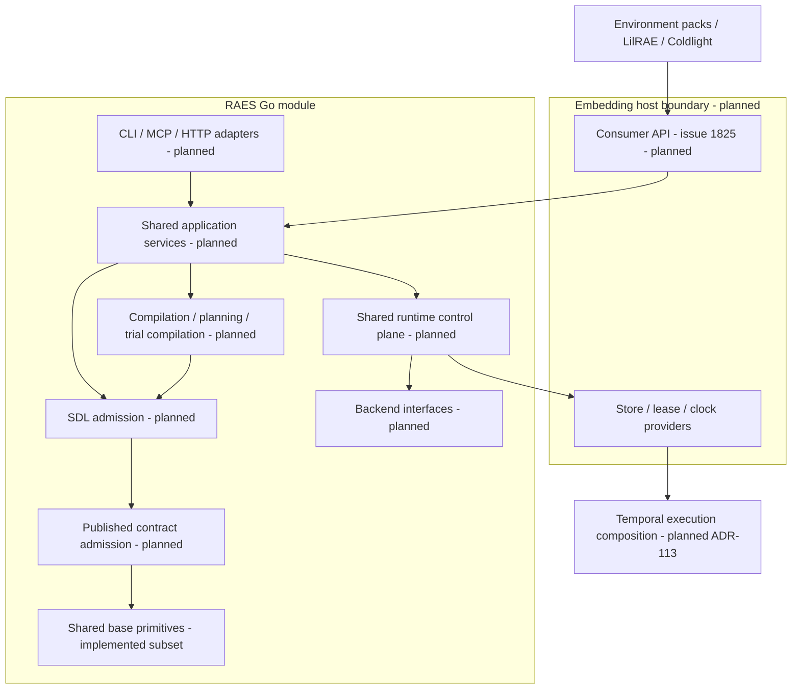
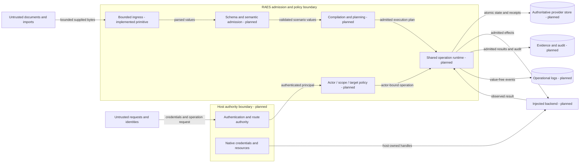
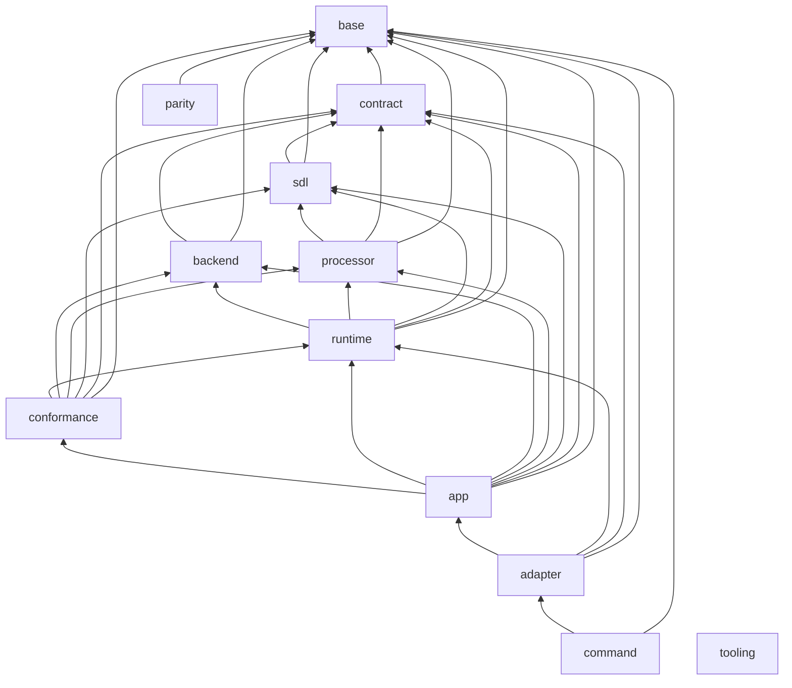

# Current Go architecture

This is the current system view for the Go port.
[The model](../../implementations/architecture.json) owns package placement, dependencies, build contexts and intended interfaces.
[ADR-122](../decisions/adrs/adr-122-go-architecture-model.md) owns the checking rules.
The generated view lists the code that exists now.
An empty layer is planned, not implemented.
Python remains the behavioral reference for components not yet ported.

## Components and consumer boundary

Environment packs, LilRAE and Coldlight use the Go module.
[Issue #1825](https://github.com/OpenRAE/rae/issues/1825) owns their public package design and compatibility policy.
No product package is downstream-importable today.
The `public` flag is for layers.
It does not bypass Go's `internal` rule.
The tooling module is a development dependency, not the consumer product API.

Consumers need bounded SDL reads.
They also need checks, edits, errors, locks and digests.
They also include normalized contract round trips, artifact admission, compilation, planning and runtime result admission.
Diagnostics preserve code, pointer, source range, stage and severity.
Typed handles and caller validators cannot be replaced with JSON-only shims.
RAES owns semantic admission, defaults, schemas, vocabulary and address grammar.
Consumer adapters must not call Python.
They must not copy core checks.

Coldlight embeds the shared runtime selected by ADR-104 and ADR-113.
Its planned API includes actor-bound submissions, idempotent receipts, snapshots, participant transitions and audit.
It also includes store, lease and clock interfaces and Temporal execution adapters.
ADR-104's P0/P1/P2 profiles describe reference capabilities, not proof of Go delivery.
P3 coordinated multi-process, multi-tenant service remains a nonclaim.

## Data flows and protection boundaries

| Asset / threat | Boundary and control | Evidence / verification |
| --- | --- | --- |
| Source containment and parser exhaustion | Bounded supplied sources; strict ingress before semantic admission | Base ingress tests; published contracts; #1782/#1785 remain planned |
| Cross-actor operations | Transport authenticates; core binds actor, scope, target and idempotency | ADR-104; future runtime conformance tests |
| Confused transport authority | One route authority; invalid bearer credentials cannot fall back to proxy headers | ADR-104; reference security configuration and route tests |
| Uncertain effects and corrupt state | Backend admission, atomic terminal commits, CAS and leases | ADR-104 and ADR-113; Go runtime remains planned |
| Secret disclosure | Logical secret references; native credentials stay in the host | ADR-115 and ADR-116; future adapter redaction tests |
| Audit confusion | Operational logs carry no values and cannot replace evidence or audit | ADR-066 and ADR-116 |
| Architectural drift | Exact typed API, package graph, design commitments and source-bound view checks | ADR-122; arch and archcheck negative tests |

Snapshots prove structural consistency. They do not prove semantic equivalence or service readiness.
Review checks these trust explanations whenever bound evidence changes.

## Ownership and reuse

| Concern | Canonical owner / reuse decision |
| --- | --- |
| Strict bounded JSON | `base/ingress.Parse`; standard encoding/json alone does not enforce the published ingress policy |
| Canonical bytes | `base/canonjson`; JCS and sorted Python JSON are distinct compatibility profiles |
| Digests | `base/digest`; reuse crypto/sha256, not local digest wrappers in each slice |
| Random streams | `base/randstream`; admitted BLAKE3 adapter preserves profiles and seek behavior |
| Addresses and pointers | `base/address` and `base/jsonpointer`; published grammars remain authoritative |
| URI safety | `base/urisafety`; standard URL parsing plus documented Unicode and error-precedence compatibility |
| Graphs, clock, errors and logging | Planned shared base owners; use standard libraries before adding adapters |
| Contract admission and defaults | Planned contract layer; reuse published schemas and concept authority, not transport validators |
| Operation and persistence semantics | Planned runtime layer; transports and embedders share the same core |
| Architecture checks | Tooling `arch`; standard Go types and existing model/findings, no product-internal imports |

Compatibility reasons and parity evidence:
[canonical JSON](../decisions/issue-1779-canonical-json-design.md),
[ingress and URI](../decisions/issue-1779-ingress-design.md),
[random streams](../decisions/issue-1779-random-streams-design.md), and
[parity harness](../decisions/issue-1778-parity-corpus-design.md).
The architecture check does not alter those semantics.

## Maintenance

Each port slice changes the model before code.
Do not copy shared helpers.
Use the owner listed above.
Keep source limits in place.
Keep secrets out of logs.
It records typed APIs and updates the owning design's API commitment.
It reviews this overview when source commitments change.
`archcheck -view` prints the generated section for review; it does not overwrite the overview.
`archcheck -api` prints actual interfaces for comparison; it does not approve them.
The existing go-architecture CI job checks documentation and code changes.

<!-- go-view -->

| Layer | Status | Allowed dependencies |
| --- | --- | --- |
| `base` | implemented packages |  |
| `contract` | planned | base |
| `sdl` | planned | contract, base |
| `processor` | planned | sdl, contract, base |
| `backend` | planned | contract, base |
| `runtime` | planned | backend, processor, sdl, contract, base |
| `conformance` | planned | runtime, backend, processor, sdl, contract, base |
| `app` | planned | conformance, runtime, backend, processor, sdl, contract, base |
| `adapter` | planned | app, runtime, contract, base |
| `command` | planned | adapter, base |
| `parity` | implemented packages | base |
| `tooling` | implemented packages |  |

| Package owner | Layer | Cross-layer visibility | Consumer importable | Actual dependencies |
| --- | --- | --- | --- | --- |
| `implementations/go/internal/base/address` | base | true | false |  |
| `implementations/go/internal/base/canonjson` | base | true | false |  |
| `implementations/go/internal/base/digest` | base | true | false |  |
| `implementations/go/internal/base/ingress` | base | true | false |  |
| `implementations/go/internal/base/jsonpointer` | base | true | false |  |
| `implementations/go/internal/base/randstream` | base | true | false |  |
| `implementations/go/internal/base/urisafety` | base | true | false |  |
| `implementations/go/internal/parity` | parity | false | false | implementations/go/internal/base/address, implementations/go/internal/base/canonjson, implementations/go/internal/base/digest, implementations/go/internal/base/ingress, implementations/go/internal/base/jsonpointer, implementations/go/internal/base/randstream, implementations/go/internal/base/urisafety |
| `implementations/tooling/go/arch` | tooling | false | true |  |
| `implementations/tooling/go/cmd/archcheck` | tooling | false | false | implementations/tooling/go/arch |
| `implementations/tooling/go/cmd/raesvet` | tooling | false | false | implementations/tooling/go/lint/getprefix, implementations/tooling/go/lint/gotwant, implementations/tooling/go/lint/wrapverb |
| `implementations/tooling/go/cmd/regressiontest` | tooling | false | false |  |
| `implementations/tooling/go/lint/getprefix` | tooling | false | true |  |
| `implementations/tooling/go/lint/gotwant` | tooling | false | true |  |
| `implementations/tooling/go/lint/wrapverb` | tooling | false | true |  |

| Trust-view evidence | SHA-256 |
| --- | --- |
| `contracts/schemas/experiment-core/materialization-archive-record-v1.json` | `fb61b1d9bb70ffedf7fec94325c3751a29ef7db7f6e8bea8fc96c064d101ba90` |
| `docs/decisions/adrs/adr-066-observability-evidence-plane-separation.md` | `938ce2443ce7bd9e5cfa151d9740610ac23fa4338efa48c3cb022c7543bab24a` |
| `docs/decisions/adrs/adr-104-runtime-control-plane-architecture.md` | `b8a790286f92fa21777e4220ec25a321273fe2c6741345732d9aa14bc448e2cf` |
| `docs/decisions/adrs/adr-113-reusable-execution-machinery.md` | `6d904befc0d37d44b07ed083d297c7a0e3ba0d520d79f9ddce1999477c78e91d` |
| `docs/decisions/adrs/adr-115-concrete-backends-owned-outside-raes.md` | `d01cea802cfd206bcdc42ad7f92403fd3f070cfc41ecb5b7b7fdf1e5c5798558` |
| `docs/decisions/adrs/adr-116-shared-exceptions-and-operational-logging.md` | `a4e20904762d23ff25162b910ab91032fdaac84b38ef727401c7fe501dde6ffa` |
| `docs/decisions/adrs/adr-122-go-architecture-model.md` | `478e8d6587a2c040bb50d4ba5a53e5f31fe989d78e53157079f5d003efcbe464` |
| `docs/decisions/issue-1775-go-architecture-model-design.md` | `d12f71c98e4bcad11f42db41338d2d93e9d9ed21731e5e4a1b9ed6fbbba1d2c8` |
| `docs/decisions/issue-1778-parity-corpus-design.md` | `fdc174151432ffe652719e78d1a2130122fe420f7563f133221f2621e4e1b809` |
| `docs/decisions/issue-1779-canonical-json-design.md` | `8df6451302931bcc55628a23d36b3aebf31cf03137a7c3f2042e4c856db51961` |
| `docs/decisions/issue-1779-ingress-design.md` | `52a547a89ef489bc9d12a250be847371a63ad18fd19b6ccd5e33ff6ea589317a` |
| `docs/decisions/issue-1779-random-streams-design.md` | `850d73b2d32ea454d2af63e8e93be42bec208cc556ccf952863780efccb98a60` |
| `docs/decisions/issue-1859-go-architecture-contract-design.md` | `7f440261b189b26d20a58b76e274c0c88abd4fe143bfb082af4052e62233d1cb` |
<!-- go-component base 4b4cbe76498b720dea364dcc45b5b6231ef2e999ecfae22ce9e56d6d23cda04a -->
<!-- go-component contract 73456b0fd891eb0f12e88e5b908543485ce88dd5ecf9ffd3fad2f11d43442ba2 -->
<!-- go-component sdl 5f24f094b1396c387dbebc76bbb8ccac321c8077d3dd4b86e65cff4c1becc5f5 -->
<!-- go-component processor 67d657825919c49435a674786c5b568d5c6b6cd6301eed1ff71a140283fe3ad8 -->
<!-- go-component backend 8353b06cebcdadc197150193ba0c035b7e7192d5b10cad52f75a74b8b08353bf -->
<!-- go-component runtime 1c47ae5c89419e657068b1d88d8184d5932c3605f36c0f646c10e09e857c7e4d -->
<!-- go-component conformance d17880b0d22976692b5c53ff4a90b6d23f4ff1cf5cccd0935d94488e7cc4b3b2 -->
<!-- go-component app 3bd024b7ada7444f2456ca3ca7d6510cc8465fe8f98e6fde4073d65ee3225387 -->
<!-- go-component adapter eb90a6db82025d7e128ade08ed1d81dad672b8682b2e368ea2d3738d3de67051 -->
<!-- go-component command ab864875bb74f1c05d1cdcab2db92a0a82cd280b590a8b5435e31fbad1acd6cf -->
<!-- go-component parity bc593d5b7f247f33227beef46ec9e041e49f4e7017ce5f2015155f827ca2c388 -->
<!-- go-component tooling cd020e622c76370595e8b1fce01d274f20c71efc88697b38b37f5e8b3aad352d -->

<!-- /go-view -->
