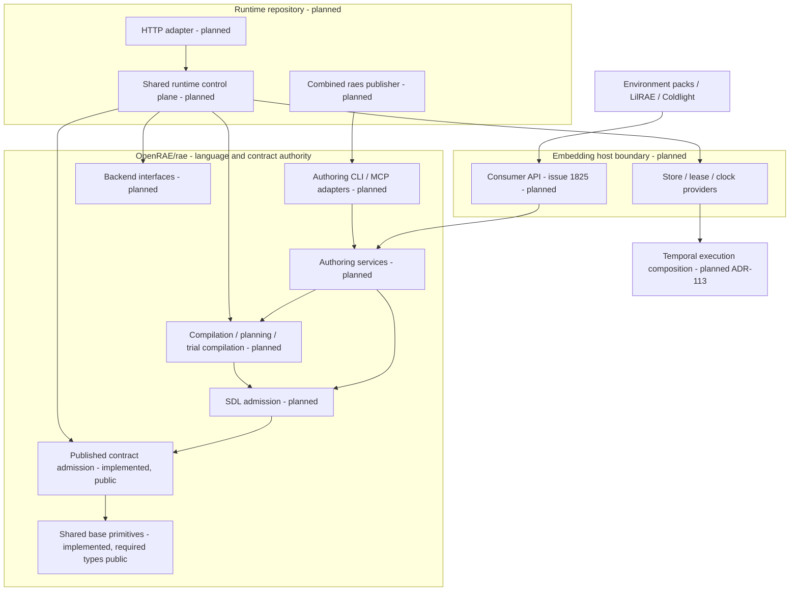
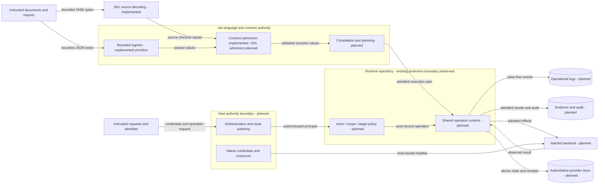
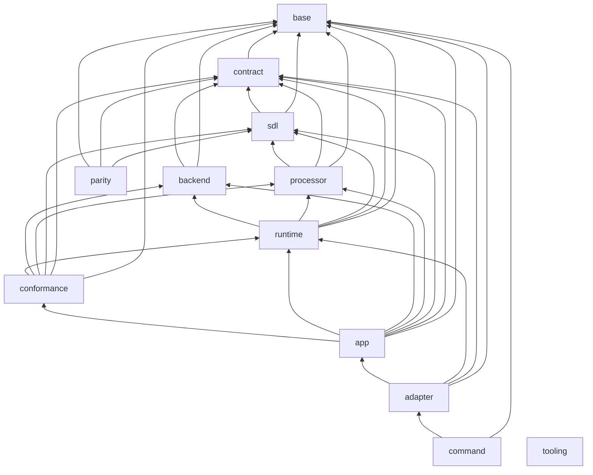

# Current Go architecture

This is the current system view for the Go port.
[The model](../../implementations/architecture.json) owns package placement, dependencies, build contexts and intended interfaces.
[ADR-122](../decisions/adrs/adr-122-go-architecture-model.md) owns the checking rules.
The generated view lists the code that exists now.
An empty layer is planned, not implemented.
Python remains the behavioral reference for components not yet ported.

The [runtime repository split](../decisions/issue-1891-runtime-repository-boundary.md) takes effect at the common #1804 Go launch.
`OpenRAE/rae` retains SDL, processor, canonical contracts, portable backend interfaces/stubs and pure conformance.
The planned runtime repository owns execution, control-plane/HTTP/store/worker behavior and live conformance.
Runtime imports released public `rae` APIs; `rae` product modules never import runtime.
The [complete source inventory](../decisions/issue-1891-runtime-extraction-inventory.json) pins the current baseline and mixed responsibilities.
No destination or source transfer is approved by this plan.

## Components and consumer boundary

Environment packs and LilRAE consume the relevant public language/processor/contract/backend APIs.
Coldlight embeds the shared runtime from its planned new repository owner.
[The consumer API reference](../decisions/issue-1825-public-go-api.md) names their package owners, operations, command composition and compatibility policy.
The nine packages that #1892 moved are downstream-importable at their public paths.
These are `base/fault`, `base/ingress`, `base/canonjson`, `base/digest`, `base/address`, `base/clock`, `contract/binding`, `contract/validation` and `contract/admission`.
All other product packages stay below `internal`.
The `public` flag is for layers.
It does not bypass Go's `internal` rule.
The tooling module is a development dependency, not the consumer product API.

Published contract admission is implemented.
It compiles the packaged schemas offline and checks family rules against explicit owner records.
Caller payloads cannot create trusted context, and validation performs no network retrieval.
The [contract design](../decisions/issue-1780-contract-validation-design.md) records its interfaces and failure controls.

The [source decoder](../decisions/issue-1782-source-loading-design.md) now lives in `internal/sdl/source`.
It bounds YAML work, collects key conflicts, retains source ranges and emits YAML presentation.
It returns decoded source, without granting model, semantic or import admission.
Those operations retain their later port owners.

Consumers need bounded SDL reads.
They also need checks, edits, errors, locks and digests.
They also include normalized contract round trips, artifact admission, compilation, planning and runtime result admission.
Diagnostics preserve code, pointer, source range, stage and severity.
Typed handles and caller validators cannot be replaced with JSON-only shims.
RAES owns semantic admission, defaults, schemas, vocabulary and address grammar.
Consumer adapters must not call Python.
They must not copy core checks.

Coldlight embeds the shared runtime selected by ADR-104 and ADR-113, using the new runtime repository's released API after cutover.
Its planned API includes actor-bound submissions, idempotent receipts, snapshots, participant transitions and audit.
It also includes store, lease and clock interfaces and Temporal execution adapters.
ADR-104's P0/P1/P2 profiles describe reference capabilities, not proof of Go delivery.
P3 coordinated multi-process, multi-tenant service remains a nonclaim.

## Data flows and protection boundaries

| Asset / threat | Boundary and control | Evidence / verification |
| --- | --- | --- |
| Source containment and parser exhaustion | Bounded supplied sources; strict ingress before semantic admission | Base ingress and SDL source tests; source parity vectors; model and composition admission #1783/#1785 remain planned |
| Cross-actor operations | Transport authenticates; core binds actor, scope, target and idempotency | ADR-104; future runtime conformance tests |
| Confused transport authority | One route authority; invalid bearer credentials cannot fall back to proxy headers | ADR-104; reference security configuration and route tests |
| Uncertain effects and corrupt state | Backend admission, atomic terminal commits, CAS and leases | ADR-104 and ADR-113; Go runtime remains planned |
| Secret disclosure | Logical secret references; native credentials stay in the host | ADR-115 and ADR-116; future adapter redaction tests |
| Audit confusion | Operational logs carry no values and cannot replace evidence or audit | ADR-066 and ADR-116 |
| Architectural drift | Exact typed API, package graph, design commitments and source-bound view checks | ADR-122; arch and archcheck negative tests |

Snapshots prove structural consistency. They do not prove semantic equivalence or service readiness.
Review checks these trust explanations whenever bound evidence changes.

## Ownership and reuse

| Concern | Canonical owner / reuse decision |
| --- | --- |
| SDL source decoding and presentation | `internal/sdl/source`; ordered YAML graph, Core scalars, key diagnostics, copied sources and request budgets |
| Strict bounded JSON | `base/ingress.Parse`; standard encoding/json alone does not enforce the published ingress policy |
| Canonical bytes | `base/canonjson`; JCS and sorted Python JSON are distinct compatibility profiles |
| Digests | `base/digest`; reuse crypto/sha256, not local digest wrappers in each slice |
| Random streams | `base/randstream`; admitted BLAKE3 adapter preserves profiles and seek behavior |
| Addresses and pointers | `base/address` and `base/jsonpointer`; published grammars remain authoritative |
| URI safety | `base/urisafety`; standard URL parsing plus documented Unicode and error-precedence compatibility |
| Clock and timestamp policies | `base/clock` and `base/timestamp`; inject wall-clock reads and reuse the four named grammars |
| Errors and logging | `base/fault` and `base/logrecord`; value-free codes and bounded log records through standard error wrapping and log/slog |
| Graphs | `base/graph`; shared iterative cycle, ordering and component operations |
| Versions and scalar domains | `base/softwareversion` and `base/domain`; closed typed descriptors and bounded comparisons |
| Snapshot values | `base/value`; bounded closed JSON values without foreign callbacks |
| Secret reference identities | `base/secretref`; bounded inert identities, with no secret resolution |
| Contract admission and defaults | `contract/admission` and `contract/validation`; published schemas, full family rules and explicit trusted context |
| Operation and persistence semantics | Planned runtime layer; transports and embedders share the same core |
| Architecture checks | Tooling `arch`; standard Go types and existing model/findings, no product-internal imports |

These primitive owners stay in `rae`.
The model's `consumer_api` section declares the public imports.
#1892 moved the required existing packages to their public paths; later port issues implement their named interfaces.
The other base helpers and `contract/corpus` stay below `internal`.
The model's `public` flag does not override Go `internal` visibility.
Pure conformance, authoring services and MCP remain in `rae`; live conformance, execution services, HTTP and combined `raes` publication belong with runtime.
The current model graph below still describes this checkout before extraction.
Its layer descriptions and bound split decision define future ownership.
The generated consumer tables show the public package plan and the sole executable publishers.
ARCH-015 keeps implemented runtime code on public `rae` packages and keeps `rae` consumer packages away from runtime code.
The [external consumer fixture](../../implementations/go/testdata/consumer) imports the public packages at a pinned module version.
The [#1892 design](../decisions/issue-1892-public-go-packages-design.md) records the moves and their controls.

Compatibility reasons and parity evidence:
[canonical JSON](../decisions/issue-1779-canonical-json-design.md),
[ingress and URI](../decisions/issue-1779-ingress-design.md),
[random streams](../decisions/issue-1779-random-streams-design.md), and
[parity harness](../decisions/issue-1778-parity-corpus-design.md).
The architecture check does not alter those semantics.
The [shared-primitives completion design](../decisions/issue-1779-shared-primitives-completion.md) owns the newly merged base helpers and their compatibility reasons.

## Maintenance

Each port slice changes the model before code.
Do not copy shared helpers.
Use the owner listed above.
Keep source limits in place.
Keep secrets out of logs.
It records typed APIs and updates the owning design's API commitment.
It reviews this overview when source commitments change.
`archcheck -view` prints the generated section for review; it does not overwrite the overview.
`archcheck -api` prints actual interfaces for comparison; it does not approve them.
The existing go-architecture CI job checks documentation and code changes.
Before running the architecture checker or its consumer API tests, run `go -C implementations/go mod download`.
This prepares the pinned product dependencies for offline type inspection.
The tooling test job and architecture job run this preparation before their checks.
Contract admission's independent model tests retain their recorded inputs in `admission/testdata/retained-model-inputs`.
Parity corpus refreshes preserve these original test baselines.
Product CI decodes and scans this retained store before running its Go tests.

<!-- go-view -->

| Layer | Status | Allowed dependencies |
| --- | --- | --- |
| `base` | implemented packages |  |
| `contract` | implemented packages | base |
| `sdl` | implemented packages | contract, base |
| `processor` | planned | sdl, contract, base |
| `backend` | planned | contract, base |
| `runtime` | planned | backend, processor, sdl, contract, base |
| `conformance` | planned | runtime, backend, processor, sdl, contract, base |
| `app` | planned | conformance, runtime, backend, processor, sdl, contract, base |
| `adapter` | planned | app, runtime, contract, base |
| `command` | planned | adapter, base |
| `parity` | implemented packages | base, contract, sdl |
| `tooling` | implemented packages |  |

| Package owner | Layer | Cross-layer visibility | Consumer importable | Actual dependencies |
| --- | --- | --- | --- | --- |
| `implementations/go/base/address` | base | true | true | implementations/go/base/fault |
| `implementations/go/base/canonjson` | base | true | true | implementations/go/base/fault |
| `implementations/go/base/digest` | base | true | true |  |
| `implementations/go/base/ingress` | base | true | true | implementations/go/base/fault |
| `implementations/go/internal/base/jsonpointer` | base | true | false |  |
| `implementations/go/internal/base/randstream` | base | true | false | implementations/go/base/fault |
| `implementations/go/internal/base/urisafety` | base | true | false | implementations/go/base/fault |
| `implementations/go/internal/parity` | parity | false | false | implementations/go/base/address, implementations/go/base/canonjson, implementations/go/base/clock, implementations/go/base/digest, implementations/go/base/fault, implementations/go/base/ingress, implementations/go/contract/admission, implementations/go/contract/validation, implementations/go/internal/base/domain, implementations/go/internal/base/graph, implementations/go/internal/base/jsonpointer, implementations/go/internal/base/logrecord, implementations/go/internal/base/randstream, implementations/go/internal/base/secretref, implementations/go/internal/base/softwareversion, implementations/go/internal/base/timestamp, implementations/go/internal/base/urisafety, implementations/go/internal/base/value, implementations/go/internal/sdl/authoring, implementations/go/internal/sdl/source |
| `implementations/tooling/go/arch` | tooling | false | true |  |
| `implementations/tooling/go/cmd/archcheck` | tooling | false | false | implementations/tooling/go/arch |
| `implementations/tooling/go/cmd/raesvet` | tooling | false | false | implementations/tooling/go/lint/getprefix, implementations/tooling/go/lint/gotwant, implementations/tooling/go/lint/wrapverb |
| `implementations/tooling/go/cmd/regressiontest` | tooling | false | false |  |
| `implementations/tooling/go/lint/getprefix` | tooling | false | true |  |
| `implementations/tooling/go/lint/gotwant` | tooling | false | true |  |
| `implementations/tooling/go/lint/wrapverb` | tooling | false | true |  |
| `implementations/go/base/clock` | base | true | true |  |
| `implementations/go/base/fault` | base | true | true |  |
| `implementations/go/internal/base/timestamp` | base | true | false | implementations/go/base/fault |
| `implementations/go/internal/base/softwareversion` | base | true | false | implementations/go/base/canonjson, implementations/go/base/digest, implementations/go/base/fault |
| `implementations/go/internal/base/domain` | base | true | false | implementations/go/internal/base/softwareversion, implementations/go/base/fault |
| `implementations/go/internal/base/value` | base | true | false | implementations/go/base/fault, implementations/go/base/canonjson |
| `implementations/go/internal/base/logrecord` | base | true | false | implementations/go/base/fault |
| `implementations/go/internal/base/graph` | base | true | false | implementations/go/base/fault |
| `implementations/go/internal/base/secretref` | base | true | false | implementations/go/base/fault |
| `implementations/go/internal/contract/corpus` | contract | true | false |  |
| `implementations/go/contract/binding` | contract | true | true |  |
| `implementations/go/contract/validation` | contract | true | true | implementations/go/internal/contract/corpus, implementations/go/contract/binding, implementations/go/base/ingress, implementations/go/base/fault, implementations/go/base/canonjson, implementations/go/internal/base/jsonpointer |
| `implementations/tooling/go/contractgen` | tooling | false | true |  |
| `implementations/tooling/go/cmd/contractgen` | tooling | false | false | implementations/tooling/go/contractgen |
| `implementations/go/contract/diagnostic` | contract | true | true | implementations/go/base/fault |
| `implementations/go/contract/concept` | contract | true | true | implementations/go/base/digest, implementations/go/base/fault, implementations/go/base/ingress, implementations/go/contract/diagnostic, implementations/go/contract/validation, implementations/go/internal/base/urisafety, implementations/go/internal/contract/corpus, implementations/go/internal/contract/packaged |
| `implementations/go/contract/profile` | contract | true | true | implementations/go/base/fault, implementations/go/base/ingress, implementations/go/contract/binding, implementations/go/contract/concept, implementations/go/contract/diagnostic, implementations/go/contract/validation, implementations/go/internal/contract/corpus, implementations/go/internal/contract/domainprofile, implementations/go/internal/contract/packaged |
| `implementations/go/internal/contract/domainprofile` | contract | false | false | implementations/go/base/canonjson, implementations/go/base/digest, implementations/go/internal/base/urisafety |
| `implementations/go/internal/contract/packaged` | contract | false | false | implementations/go/base/ingress, implementations/go/contract/validation |
| `implementations/go/contract/admission` | contract | true | true | implementations/go/contract/validation, implementations/go/contract/binding, implementations/go/base/canonjson, implementations/go/base/digest, implementations/go/internal/base/timestamp, implementations/go/internal/base/graph, implementations/go/internal/base/urisafety, implementations/go/base/address, implementations/go/internal/base/jsonpointer, implementations/go/internal/base/value, implementations/go/internal/base/domain, implementations/go/internal/base/randstream, implementations/go/base/fault, implementations/go/base/ingress, implementations/go/contract/concept, implementations/go/contract/profile, implementations/go/internal/contract/domainprofile, implementations/go/internal/base/softwareversion |
| `implementations/go/internal/sdl/source` | sdl | true | false | implementations/go/base/fault, implementations/go/internal/base/jsonpointer |
| `implementations/go/internal/sdl/authoring` | sdl | true | false | implementations/go/base/canonjson, implementations/go/base/digest, implementations/go/base/fault, implementations/go/base/ingress, implementations/go/contract/admission, implementations/go/contract/concept, implementations/go/contract/validation, implementations/go/internal/base/jsonpointer, implementations/go/internal/contract/corpus, implementations/go/internal/sdl/source |

| Consumer repository owner | Module |
| --- | --- |
| rae | `github.com/OpenRAE/rae/implementations/go` |
| runtime | `RUNTIME` (approval pending #1893) |

| Planned public package | Owner | Operations / types | Public dependencies | Consumers | Delivery issues |
| --- | --- | --- | --- | --- | --- |
| `github.com/OpenRAE/rae/implementations/go/base/fault` | rae | Error, Category, CategoryOf, New |  | environment-packs, lilrae, runtime | #1892 |
| `github.com/OpenRAE/rae/implementations/go/base/ingress` | rae | Limits, Parse | rae:base/fault | environment-packs, lilrae, runtime | #1892 |
| `github.com/OpenRAE/rae/implementations/go/base/canonjson` | rae | JCS, Sorted | rae:base/fault | environment-packs, lilrae, runtime | #1892 |
| `github.com/OpenRAE/rae/implementations/go/base/digest` | rae | SHA256, NewChecksum |  | environment-packs, lilrae, runtime | #1892 |
| `github.com/OpenRAE/rae/implementations/go/base/address` | rae | Valid, Render, PlanRoot | rae:base/fault | environment-packs, lilrae, runtime | #1892 |
| `github.com/OpenRAE/rae/implementations/go/base/clock` | rae | Clock, Read, System |  | environment-packs, lilrae, runtime | #1892 |
| `github.com/OpenRAE/rae/implementations/go/contract/binding` | rae | Field, MaterializationArchiveRecordV1, RuntimeSnapshotV1, BackendManifestV2, AdmittedTrialPlanV1, BackendRuntimeDescendantsV1 |  | environment-packs, lilrae, coldlight, runtime | #1892 |
| `github.com/OpenRAE/rae/implementations/go/contract/validation` | rae | New, Validator, Value, Validator.CheckSchema, Validator.DecodeSchema, Validator.Defaulted, Value.JSON, Value.Transport | rae:base/ingress | environment-packs, lilrae, coldlight, runtime | #1892 |
| `github.com/OpenRAE/rae/implementations/go/contract/admission` | rae | New, Validator, Validator.Validate, Validator.CheckPortable, AssociatedArtifactsContext, MaterializationCompiler, MaterializationInventoryContext, SDLPhaseOwner, AssociatedArtifactLimits, DefaultAssociatedArtifactLimits, LoadAssociatedManifest, ValidateAssociatedManifest, AssociatedArtifactSetDigest, EvaluateRealizationConstraint, ParticipantConfigurationValidator, MaterializationArchive, RestoreMaterializationArchive, Fragment, FragmentProfile, ImplementationIdentity, BindingOwner, BindingValue, ControlContextAssetReference, ControlContextSelection, ConfigurationOverride, RealizedConfigurationValue, ParticipantConfiguration, ParticipantControlContextValidator, ParticipantConfigurationRequest, ParticipantManifestKey, ApparatusManifestKey, ApparatusManifest, ScenarioBindingResolution, ScenarioBindingTargetResolver, AdmitFragment, RealizeParticipantConfiguration, ValidateParticipantConfigurationSelection, ValidateExperimentBindingTargets, ConstraintLimits, DefaultConstraintLimits, ConstraintLimits.Validate, ParsePythonPattern, PythonPatternSyntax, PythonPatternSyntax.NamedCharacter | rae:base/ingress, rae:contract/binding, rae:contract/validation | environment-packs, lilrae, coldlight, runtime | #1892, #1788, #1781, #1963 |
| `github.com/OpenRAE/rae/implementations/go/contract/concept` | rae | Load, Authority, Document, Authority.Documents, Vocabulary, Authority.Vocabulary, Authority.ScopeVocabulary, Authority.Permits, Authority.CheckScope, Family, Authority.Family, Authority.Families, Relation, RelationCatalog, RelationCatalog.Relation, Authority.RelationCatalog, Authority.CurrentRelationCatalog, Subject, SnapshotTerm, SchemeSnapshot, BindingResolution, ResolutionOutcome, ResolutionOutcome.Admitted, Authority.AdmitBindings, Authority.PinnedSnapshots | rae:contract/diagnostic, rae:contract/validation | environment-packs, lilrae, runtime | #1781 |
| `github.com/OpenRAE/rae/implementations/go/contract/profile` | rae | Load, Profiles, Profiles.Documents, RelationProfile, BehavioralClaim, Profiles.RelationProfileIDs, Profiles.RelationProfile, Profiles.CheckBehavioralClaim, ValidationCatalog, ValidationProfile, Profiles.ValidationCatalog, Profiles.SelectValidationProfile, CompletenessTaxonomy, CompletenessAssessment, CompletenessResult, Profiles.CompletenessTaxonomy, Profiles.CompletenessAssessment, EvaluateCompleteness, ComparisonProfile, Profiles.ComparisonProfile, DomainLimits, DefaultDomainLimits, DomainLimits.Validate, DomainCoordinate, DomainResolution, DomainAdmissionReport, DomainAdmissionReport.Admitted, DomainDefinitionDigest, Profiles.ResolveDomainProfile, Profiles.AdmitDomainBindings, Profiles.ParseDomainBinding | rae:contract/binding, rae:contract/concept, rae:contract/diagnostic, rae:contract/validation | environment-packs, lilrae, runtime | #1781 |
| `github.com/OpenRAE/rae/implementations/go/contract/diagnostic` | rae | Diagnostic, Range, Error | rae:base/fault | environment-packs, lilrae, coldlight, runtime | #1781, #1782, #1783 |
| `github.com/OpenRAE/rae/implementations/go/sdl` | rae | Scenario, InstantiatedScenario, Limits, DefaultLimits, Parse, ParseSources, ParseFile, AuthoredScenario, Validate, Instantiate, AdmitInstantiated, AdmitFamily, CanonicalDigest, ConceptSubjects, ArtifactRequirements, Requirement, ResolveRealizationDesignation, MigrationPolicy, ParseOptions, SourceContext, DefaultParseOptions, ParseContext, ValidateExperimentSelectionAgainstFamily, Limits.Validate, ParseOptions.Validate | rae:contract/admission, rae:contract/binding, rae:contract/concept, rae:contract/diagnostic, rae:sdl/module | environment-packs, lilrae, runtime | #1782, #1783, #1784, #1785 |
| `github.com/OpenRAE/rae/implementations/go/sdl/module` | rae | LockfileName, Lockfile, TrustPolicy, LoadLockfile, ResolveLock, LockRecord, VerificationFacts, RegistryTrust, Policy, DefaultPolicy, Policy.AdmitModule |  | environment-packs, lilrae, runtime | #1785 |
| `github.com/OpenRAE/rae/implementations/go/sdl/language` | rae | Edit, EditResult, ApplyEdit, Completions, Diagnostics, Format | rae:contract/diagnostic, rae:sdl | environment-packs, lilrae | #1786 |
| `github.com/OpenRAE/rae/implementations/go/processor` | rae | Compilation, Compile, CompileInstantiated, RuntimeModel, TimeModelContract, ScenarioComponentOptions, ComponentOptions, CompiledComponentOptions | rae:contract/binding, rae:contract/diagnostic, rae:sdl | environment-packs, lilrae, runtime | #1787 |
| `github.com/OpenRAE/rae/implementations/go/processor/planning` | rae | Plan, Result, PlanWithManifest, ExecutionPlan, Scope, Closure, ApparatusDefaultResolver, ArtifactAvailability, MixedControlAdmission, Options, RequirementKey, PlanningContext, NewMixedControlAdmission | rae:contract/admission, rae:contract/binding, rae:contract/diagnostic, rae:contract/validation, rae:processor | environment-packs, lilrae, runtime | #1787 |
| `github.com/OpenRAE/rae/implementations/go/processor/trial` | rae | Request, Compile, PlanBatchSchedule, ScheduledEntry, BatchSchedule, ParticipantManifestKey, ApparatusManifestKey, ConfigurationValidatorKey, Limits, MixedCompositionLimits, Result, DefaultLimits, DefaultMixedCompositionLimits, Limits.Validate, MixedCompositionLimits.Validate, RealizationInputs, Realization, RealizationOptions, InstantiateEntry, RealizeEntry | rae:contract/admission, rae:contract/binding, rae:contract/diagnostic, rae:contract/validation, rae:processor/planning, rae:sdl | environment-packs, lilrae, runtime | #1788 |
| `github.com/OpenRAE/rae/implementations/go/processor/realization` | rae | ProjectConcern, ConcernDescriptors, HasRequiredObservationSupport, Descriptor | rae:contract/admission | environment-packs, lilrae, runtime | #1787 |
| `github.com/OpenRAE/rae/implementations/go/processor/analysis` | rae | Analyze, Request, Result | rae:contract/diagnostic, rae:processor | lilrae, runtime | #1789 |
| `github.com/OpenRAE/rae/implementations/go/backend` | rae | Provisioner, Orchestrator, Evaluator, ParticipantRuntime, Manifest, LoadProfile, PreparingProvisioner, TimeRuntime, AutonomousActionBinding, AutonomousParticipantRuntime, ControlledAutonomousParticipantRuntime, CoordinatedParticipantResetRuntime, CoordinatedParticipantTimeRuntime, OperationProvider, ParticipantControlProvider, ParticipantControlProviderV2, ProfilePreparingProvisioner | rae:contract/admission, rae:contract/binding, rae:contract/diagnostic, rae:contract/runtime | environment-packs, lilrae, runtime | #1790 |
| `github.com/OpenRAE/rae/implementations/go/backend/stub` | rae | Manifest, Options, Provisioner, Orchestrator, Evaluator, ParticipantRuntime, DefaultOptions, NewProvisioner, NewOrchestrator, NewEvaluator, NewParticipantRuntime | rae:backend | environment-packs, lilrae, runtime | #1790 |
| `github.com/OpenRAE/rae/implementations/go/conformance` | rae | ValidateFixture, ValidateProcessor, ValidateModularReport, ModularControlEvidence, ModularOwnerObservation | rae:contract/diagnostic, rae:processor | lilrae, runtime | #1796 |
| `github.com/OpenRAE/rae/implementations/go/command/authoring` | rae | Commands, Command, Streams |  | runtime | #1797 |
| `RUNTIME/runtime/control` | runtime | New, ControlPlane, ControlPlane.Submit, ControlPlane.Operation, ControlPlane.Snapshot, ControlPlane.TransitionParticipant, ControlPlane.Audit, Target, NewTarget, Options, Request, Identity, Authority, Components, ParticipantContexts, Supervision, PlanPhase, RegisteredPlan, Command, ParticipantCommandInput, ParticipantTransition, DefaultSupervision, PlanCommand, ParticipantCommand, ControlResolution, ControlResolver, ControlResolverV2, ControlStageBinding, ControlInstallation, ParticipantControlBinding, LiveCut, CutResolver, DeliveryCutResolver, MixedControlBinding, InjectResolution, InjectDeliveryResolver, InjectDeliveryBinding, InjectAdmission, ResolvedInjectOutcome, InjectExecutionResolver, NewParticipantControlBinding, NewMixedControlBinding, NewInjectDeliveryBinding, CrossingIntent, CrossingGates, CrossingTransformation, CrossingResolution, CrossingValidation, CrossingEvidence, ParticipantAudienceBinding, ViewEvidenceRequest, CrossingResolver, CrossingCut, FlowSinkRequest, FlowSinkResolution, FlowSinkResolver, SupervisionAction, SupervisionRequest, ResolutionDisposition, ResolutionRequest, EffectKind, EffectOperation, EffectRealization, InjectCaptureResult, RunProgress, RunContext, SequenceOptions, TrialUnitRequest, TrialUnitResult, TrialObservation, TrialConfigurationObservation, TrialExecutionObservation, TrialCaptureObservation, TrialCleanupObservation, TrialRetryObservation, TrialRuntimeServices, RetryTrialRuntimeServices, TrialArchiveOwner, ExperimentReplacement, ExperimentRequest, ExperimentProgress, AdmitTrialUnitRequest, TrialUnitRequest.RunID, TrialUnitRequest.ParticipantConfigurations, TrialUnitRequest.ExecutionControls, TrialUnitRequest.CleanupPlan, ParticipantCancellationStatus | rae:backend, rae:base/clock, rae:contract/admission, rae:contract/binding, rae:contract/runtime, rae:contract/validation, rae:processor, rae:processor/planning, rae:processor/trial, runtime:runtime/execution, runtime:runtime/profile, runtime:runtime/provider, runtime:runtime/result | coldlight, lilrae | #1791 |
| `RUNTIME/runtime/provider` | runtime | Store, AtomicStore, LeaseProvider, OwnerLease, Capabilities, SnapshotState, AuditEvent, OperationRecord, OperationAdmissionContext, ClaimIdentity, ClaimState, Transition, NewClaimBlock, ClaimOptions, TerminalCommitMode, TerminalCommit, DecodeOperationRecord, RecordsEqual, IdempotencyClaimIdentity, ValidateIdempotencyReplay, ValidateNewClaim, ValidateInvocationTransition, LedgerIdentity, SequenceDecision, RuntimeDecision, RuntimeStoreDigest, NewSequenceDecision, DecodeRuntimeDecision, ValidateIdenticalDecision | rae:contract/binding, runtime:runtime/execution, runtime:runtime/profile | coldlight, lilrae | #1792 |
| `RUNTIME/runtime/execution` | runtime | Adapter, Request, LocalAdapter, Lane, EngineReference, DeliveryBinding, RuntimeSequenceReference, Dispatcher, InvocationGrant, ControlDeliveryGrant, WorkerAuthority, NewLocal | rae:contract/binding | coldlight, lilrae | #1793 |
| `RUNTIME/runtime/temporal` | runtime | New, Adapter, Configuration, Worker, ClientOptions, Client, WorkerOptions, DefaultConfiguration, Dial, NewWorker, Configuration.Validate, RuntimeWorkerOptions, NewRuntimeWorker | rae:backend, runtime:runtime/execution | coldlight | #1793 |
| `RUNTIME/runtime/result` | runtime | AdmitResult, Context, EvidenceResolver, AdmitApplyResult | rae:contract/admission, rae:contract/binding, rae:contract/runtime, rae:contract/validation, rae:processor | lilrae, coldlight | #1794, #1795 |
| `RUNTIME/runtime/profile` | runtime | ID, P0, P1, P2, P3, Capability, Claim, Declaration, StoreCapabilities, DeclarationFor, Select, RequireCapabilities, CoreCapabilities, ErrProfileUnavailable, NewStoreCapabilities, StoreCapabilities.Values, ActorBoundary, RecoveryObservationRequirement |  | coldlight, lilrae | #1791, #1792 |
| `github.com/OpenRAE/rae/implementations/go/contract/runtime` | rae | ApplyResult, MaterializationSubmission, NewMaterializationSubmission, ParticipantActionRequest, NativeActionExecution, RealizationObservationDisclosure, ObservedOperatingSystemIdentity, ProvisionOperation, RealizationPreparation, EpisodeInitializeRequest, EpisodeResetRequest, EpisodeRestartRequest, EpisodeTerminateRequest, ParticipantActionInput, ParticipantActionApplyResult, NativeActionOutcome, PrepareForRequest, BindParticipantAction | rae:contract/admission, rae:contract/binding, rae:contract/diagnostic | lilrae, runtime | #1790 |

| Executable | Publisher | Entry point | Public composition dependencies |
| --- | --- | --- | --- |
| `raes` | runtime | `RUNTIME/cmd/raes` | rae:command/authoring, runtime:runtime/control |
| `raes-mcp` | rae | `github.com/OpenRAE/rae/implementations/go/cmd/raes-mcp` | rae:sdl/language, rae:processor, rae:contract/admission |

<!-- go-consumer 45ebb026c773eb05751b8056928206d8ad3c7c4ed7d0792f6835969630a5898c -->

| Trust-view evidence | SHA-256 |
| --- | --- |
| `contracts/schemas/experiment-core/materialization-archive-record-v1.json` | `fb61b1d9bb70ffedf7fec94325c3751a29ef7db7f6e8bea8fc96c064d101ba90` |
| `docs/decisions/adrs/adr-036-sdl-processor-runtime-module-boundaries.md` | `8b23019d17144225d08d6a38301a62a3eb2490c122a3d2ed36a67ab0804d84fa` |
| `docs/decisions/adrs/adr-066-observability-evidence-plane-separation.md` | `938ce2443ce7bd9e5cfa151d9740610ac23fa4338efa48c3cb022c7543bab24a` |
| `docs/decisions/adrs/adr-104-runtime-control-plane-architecture.md` | `790d2c4119d2c37562aaad3d5cee3ffa4740ac150511f035f3376dd46d28e4b0` |
| `docs/decisions/adrs/adr-113-reusable-execution-machinery.md` | `6d904befc0d37d44b07ed083d297c7a0e3ba0d520d79f9ddce1999477c78e91d` |
| `docs/decisions/adrs/adr-115-concrete-backends-owned-outside-raes.md` | `e7994a017f64937bfa48edfb8600b933e2acca330a2d5ebaef8a6ae95fcc91be` |
| `docs/decisions/adrs/adr-116-shared-exceptions-and-operational-logging.md` | `a4e20904762d23ff25162b910ab91032fdaac84b38ef727401c7fe501dde6ffa` |
| `docs/decisions/adrs/adr-119-consumer-parse-of-supplied-sdl-sources.md` | `b29df4c1c6dcb690d540532011f498a0a1afbe794877ec38e5b80d8cb66b5442` |
| `docs/decisions/adrs/adr-122-go-architecture-model.md` | `80b64aac8e4e646f56d129c2c997c19583ecfb0f0b0b571fa46e09a3103ca45c` |
| `docs/decisions/issue-1775-go-architecture-model-design.md` | `d12f71c98e4bcad11f42db41338d2d93e9d9ed21731e5e4a1b9ed6fbbba1d2c8` |
| `docs/decisions/issue-1778-parity-corpus-design.md` | `c3197d51b64c8b2684096ad8d4ed4df223457b2e811a16e68bf31e9babc15830` |
| `docs/decisions/issue-1779-canonical-json-design.md` | `28f5cff66fdc26e01392d143e5ad52ba23072c2bd6010a35fb4f1e0c0162e8f0` |
| `docs/decisions/issue-1779-ingress-design.md` | `0dcde22676a7429a0c92d01ed2e8d0eaf15da84d5be800404e12c9414348bed1` |
| `docs/decisions/issue-1779-random-streams-design.md` | `dae79083acb2909a63a43849e9aeb0ddf4594d3e7d54d118b2a1dd54f68cdb8b` |
| `docs/decisions/issue-1779-shared-primitives-completion.md` | `53b8dcd5ef5e1ad44ca2948eca10fff0d180028b807a496ddbe82e61e9e573ed` |
| `docs/decisions/issue-1780-contract-validation-design.md` | `99d39e5f62135542f66db52e9ef9b8ac535f6a0b6857429f12140fc3b087baea` |
| `docs/decisions/issue-1825-public-go-api.md` | `6f264cb6dd7fef28567fcb804a56b8b94f63b883f59f4be35d0ffc41095ca721` |
| `docs/decisions/issue-1859-go-architecture-contract-design.md` | `0057d0da3d7466e02c34cf5545aa14245bc398486519d3dd15457e515f6230ce` |
| `docs/decisions/issue-1891-runtime-repository-boundary.md` | `e8233ecdf836dbbad4dda9ef373572dd466f1cf59ad0eeb4ab01cc9fd476e406` |
| `docs/decisions/issue-1892-public-go-packages-design.md` | `e66f0bb12f0615a6b5614fe149a2a78b13289c42845c683537df80ec1907fc53` |
| `specs/sdl/diagnostics.md` | `422c46a1080f4dced095729967658f300520fa59b16c1923d113a758422a231e` |
| `specs/sdl/document-model.md` | `496290792659c189242ab93923f6f50e305e383d50588a4d75269d9ade2e2970` |
<!-- go-component base e90c538bf4a5b4296bc8ced56db3a14cdedba33645ff88c3bbca13b275781f97 -->
<!-- go-component contract d8257db41f4a3091201fcb2738a1ac2cdc6ad5a9172492a3ee32b4ab73df9d54 -->
<!-- go-component sdl 833f995ff06a36e65198fd5b9d52bee1b6bdc913676a3bbcf9dda64385a04304 -->
<!-- go-component processor d48d41a07d1474b3338e764f3d0055eb3e2fcf5fd171db971f802470cbaabe83 -->
<!-- go-component backend cc8b3b498f3166e8b812c1f19e590d18349a68b91fca2ff2833b2d38fe0c40d5 -->
<!-- go-component runtime c7c1149334eddec61d0bd97830e9a7f52c2562e3c10df4769b51bbdd9d558bdc -->
<!-- go-component conformance 2f188a8efee059dc2f715ad186efb9933404a766283e93a5d099e232467dfb5b -->
<!-- go-component app 1b87854bac08895fe8f005a918de8eb74c0b921811c4e4567f0b9fbb624f95d0 -->
<!-- go-component adapter 693b4cb133a1b0e581b8341070d67e274a20ed876c4e47e01e7f291451fe1745 -->
<!-- go-component command 7a98587852e38bc3d28193184fa68830cbc7c6c42ddc77cdd92272454f060660 -->
<!-- go-component parity 8e91ed6de3cb5de71664a3128b4ef6bf1d065fb5a6754c58a74d6d8a8054c4cb -->
<!-- go-component tooling d2be8acb60980dea2d5a0fe099041beceb7ed00f2ffff0ce293b19cf8c75dcab -->

<!-- /go-view -->
