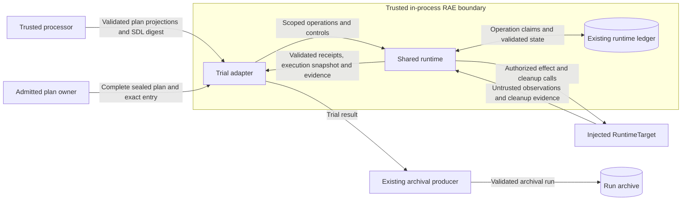

# Trial unit

The trial unit defines one local call for one admitted trial entry.
`BackendTrialUnit.execute_trial(request)` returns a `TrialUnitResult`.
These Python interfaces define an in-process handoff.
They do not install an executor or certify a backend.
The public types are in `raes_contracts.trial_unit`.
The protocol is in `raes_backend_protocols.trial_unit`.

## Composition and ownership

An embedder constructs the adapter with an explicit `RuntimeTarget`.
The target is a dependency of the adapter, not a serialized request field.
The protocol package does not import runtime or processor implementations.
The adapter uses shared RAE processor and runtime functions.
It does not interpret SDL itself.

The processor calls `realize_admitted_trial_entry()` first.
The caller passes three processor plans into `TrialUnitRequest`.
The caller also passes the instantiated SDL digest.
The request carries the complete admitted plan and exact entry ID.
It also carries a distinct execution attempt ID.
Request construction reconstructs the complete plan before entry lookup.
The request exposes the entry controls and bound cleanup plan.
It also exposes the sealed participant configurations.
There is no independently editable copy of these values.

The adapter checks the selected manifests and envelope against its injected target before effects.
The provisioning and evaluation plans keep the admitted run and instantiation IDs.
The adapter checks all projections against trusted processor output before dispatch.
Projection carriage alone proves neither derivation nor execution permission.
Configured participants require explicit backend support before effects.
The adapter never repeats configuration normalization or resolves secrets in the request.

The runtime keeps authored order and time.
It also checks participant rules, operation admission, and results.
A control-plane composition uses the explicit scope `run:<entry.run_id>`.
The backend owns native effects, observations, secret delivery, and cleanup probes.
The allocator owns placement and live isolation.
The trial unit chooses no batch order, parallelism, replacement, or fresh run identity.

## Results and failure

`execution_snapshot` records checked runtime state after the trial runs.
Cleanup has not yet changed that state.
It is distinct from the instantiated SDL digest in the request.
The adapter keeps partial observations when execution fails.
Operation receipts acknowledge submission.
They do not prove that a workflow finished.
Typed execution evidence accompanies the receipts and snapshot.

The cleanup receipt reports the trial outcome and cleanup status separately.
Cleanup evidence accompanies that receipt, including failed or unverified cleanup.
`validate_trial_unit_result()` checks cleanup obligations against the request.
It also checks the attempt identity.
It checks receipt target/run scopes and evidence run identities.
Every cleanup evidence reference must identify a record in `cleanup_evidence`.
These checks do not read evidence content.
They do not prove that native effects stopped.
The adapter checks snapshots with existing runtime validators.
Trusted resolvers check evidence before it is published.
The archive producer still uses `ExperimentRunModel`.
Its existing validators check joins between artifacts.

Timeout and cancellation use the admitted controls and existing supervision machinery.
The [trial control admission](trial-control-admission.md) checks static backend declarations during compilation.
This check covers all entries before the compiler returns a plan.
It does not add trial-derived guarantees to native operation requests.
Caller timeout does not prove backend cessation.
Unknown effects retain their reservations until the runtime's release checks pass.
Cleanup retains its own obligation budgets after execution timeout.
Cleanup failure does not erase execution evidence.
A successful trial does not imply successful cleanup.
An interrupted call can have no complete result.
The runtime ledger retains authority for recovery in that case.
The caller must reconcile it before another dispatch.

## Data flow and protection

The plan-owner boundary protects admitted identity and configuration integrity.
Whole-plan checks reject changed nested models before an entry is used.
The target boundary protects execution authority and observation integrity.
Runtime input, result, transition, and evidence checks remain necessary there.
The archive boundary protects provenance and evidence disclosure.
Run validators and access controls remain necessary there.

Requests and results are local Python values.
They add no wire contract.
Their representations omit carried configurations, plans, snapshots, and evidence.
Nested portable models retain their existing validators.
Collections have finite item bounds.
Each result collection permits at most 4096 items.
The shared runtime value limits bound both aggregates before copying.
Secrets remain non-sensitive references until an authorized backend sink resolves them.
Adapters must not log payloads, exception input, native output, or resolved secrets.
The handoff adds no network call or credential lookup.
It adds no process, listener, or store.
Trusted embedders retain P0 authorization responsibilities.

## Design basis

[ADR-036](../../decisions/adrs/adr-036-sdl-processor-runtime-module-boundaries.md) defines package dependencies.
[ADR-113](../../decisions/adrs/adr-113-reusable-execution-machinery.md) retains shared runtime authority in local composition.
[ADR-115](../../decisions/adrs/adr-115-concrete-backends-owned-outside-raes.md) assigns native realization to backend distributions.
These decisions need no amendment.
Existing policy enforces package boundaries; this interface adds no policy mechanism.
Python protocols and neutral request/result values express the architecture in code.
No published schema or operation kind changes.

The design uses Python 3.11 `typing.Protocol` and dataclasses.
The [Python documentation](https://docs.python.org/3.11/library/typing.html) explains structural typing and its runtime limits.
The [dependency injection reference](https://www.cosmicpython.com/book/chapter_13_dependency_injection.html) describes explicit composition and test doubles.
