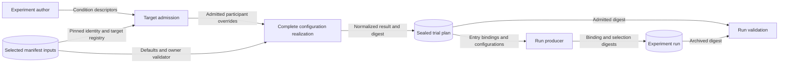

# Experiment binding contracts

These contracts bind experiment factors to three authority planes.
They state intent and validation results.
They do not change a runtime.

## Authority planes

| Plane | Canonical owner | Target |
|-------|-----------------|--------|
| `scenario` | Composed SDL scenario family | Declared variation point and its owner target |
| `participant-implementation` | Selected participant implementation manifest | Manifest `configuration_registry` target |
| `apparatus` | Selected processor or backend manifest | Manifest `configuration_registry` target |

Each descriptor names its source factor, level, and condition.
Every condition factor and level must belong to that experiment's declarations,
in both `descriptive` and `explicit-required` modes.
Authors or their tools choose those declarations; RAE supplies no domain catalog.
This local validation does not resolve an ontology or prove treatment execution.
`ExperimentSpecModel` also checks each descriptor's source joins in `explicit-required` mode.
That mode rejects legacy `required_parameters`.
Those parameters remain descriptive data in other modes.

A target belongs to one plane.
The same name in another plane grants no authority.
A missing participant target cannot become a scenario or backend target.

## Target registries

An owner registry declares canonical target ids and bounded aliases.
It defines exact scalar types and allowed value kinds.
It also defines sensitivity, defaults, and the contract and validator versions.

Aliases are input spellings, not identities.
Admission resolves them before it builds a result or digest.
Two inputs for one canonical target fail.
This rule also rejects equal duplicate values.

A manifest can add targets or validator versions through its registry.
A new authority plane needs a versioned contract change.

## Participant configuration realization

`realize_participant_configuration()` accepts a selected manifest and overrides.
It resolves the whole list and applies defaults.
It requires every target without a default.
It enforces strict types.
A trusted `ParticipantConfigurationValidator` can check the complete configuration.
Failure returns no partial result.

The result sorts values by canonical target id.
Each value retains its default or override origin.
`participant-configuration-result-v1` records the manifest, validator, and normalized values.
Its `canonical_contract_digest()` uses RFC 8785/JCS.
Alias spelling and input order do not affect that digest.

## Participant bindings on trial entries

Each entry carries the participant descriptors for its condition.
This applies to factorial designs and explicit condition descriptors.
Participant bindings need no scenario selection-policy reference.
Two conditions can differ only in participant configuration.
Their `required_bindings` record that difference without invented `required_refs`.

Admission checks each target against the selected manifest.
The compiler realizes the complete configuration once, before entry sealing.
Entry and plan digests cover the result.
One-entry realization passes the sealed result to the run producer.
Run validation compares the archived digest with the admitted result.



Author input crosses the manifest-owner boundary at target admission.
Unknown targets or wrong owners produce no plan.
Missing required values or owner rejection also produce no plan.
Compiler errors exclude values and owner exception text.
Secret references remain references throughout this flow.
A matching digest proves configuration identity only.
The run producer must still prove execution.

## Scalar and secret posture

The scalar types are string, integer, number, Boolean, and null.
Values must retain their types.
Boolean does not satisfy integer.
Numeric strings remain strings.
NaN and infinity are invalid.

A secret reference is distinct from a string literal.
Portable artifacts carry only its non-sensitive reference identity.
They have no resolved-secret field.
They do not resolve environment variables, files, commands, or private locators.
The digest covers the reference identity, never resolved secret material.

## Lifecycle integration

- `experiment-authoring-input-v1` carries descriptors and checks their source joins.
- The public SDL authority resolves scenario targets.
- Each selected manifest owns its target registry.
- `participant-configuration-result-v1` holds the complete normalized result.
- `experiment-run-v1` can archive the descriptor, origin, and configuration digest.

## Factorial designs and randomized allocation

An experiment can declare `factorial_design` with the `factorial-bindings-v1` profile.
It names `factor_ids`, a `condition_bound`, and `target_runs_per_condition`.
Each `level_bindings[factor_id][level_id]` holds typed target/value/owner templates.
Two scenario path levels and two participant temperature levels produce four conditions.
Two replicates produce eight entries.
A factor can affect both planes.
Unnamed factors are not crossed.

The loader generates allocation, condition `required_bindings`, and descriptors.
It rejects supplied records that differ from the generated result.
It retains the design intent when serialized.
Scenario targets must cover every family variation point.
Their outcomes must be scalar literals.
Factorial generation cannot also declare selection policies.

Participant targets resolve against selected manifests.
The complete results include defaults and digests.
Normalization cannot change declared binding values.
Missing targets, alias collisions, or incomplete results fail admission.
Distinct conditions must also have distinct effects after owner resolution.
Comparison includes all effective defaults across the design's selected participants.
Equal values compare the same, regardless of default or override origin.
The one-entry result carries admitted configurations with the processor plans.

Select the order through the run plan:

```yaml
allocation_policy:
  kind: randomized
  policy_id: treatment-order
  algorithm_profile: fisher-yates-allocation-v1
  stochastic_control_ref: allocation-control
```

The control needs `role: randomization` and an executable binding.
Use `blake3-xof-v1` / `random-stream-profile/v1` with a namespace and public seed.
Compilation seals the policy, order, and bounded plan-scope draws.
Dispatch and receipt checks use that same order.
Reconstruction checks the whole record.
A seed, free-text method, or blocking-factor list alone does not activate this behavior.

When input uses aliases, archive canonical admitted descriptors as study criteria.
Runs must preserve every admitted binding and configuration digest.
They must also preserve the selected manifest and allocation control.
Retain actual apparatus evidence and deviations for model/API or host drift.
Random order reduces confounding; it does not prove unchanged conditions.

See the [normative generation rules](../../../specs/formal/experiment-core/README.md#factorial-condition-generation-exp-719),
[allocation procedure](../../../specs/formal/scenario-variation-trial-realization/README.md#designed-compiler-and-allocation-profiles-exp-719),
and [architecture guardrails](../../decisions/issue-275-exp-719-treatment-controlled-variation-preflight.md).

## Typed factorial scenario selections

The `factorial-treatments-v1` contract combines scalar bindings and typed selections.
Its `level_effects[factor_id][level_id]` contains `bindings`, `selections`, or both.
Factor and level identifiers come from the experiment author.
A level can affect several participants and scenario points.
Selection-only and participant-only designs need no invented scalar target.

A selection names the family, its digest, a variation point, its canonical target, and its owner.
Its `outcome` reuses the existing selection types.
For example, `{kind: member, member_id: baseline}` selects an authored SDL alternative.
The family can define that alternative as node presence with coupled scheduled jobs.
The member retains that typed identity through generated criteria and archival records.
The experiment does not embed the node definition or encode the member as a scalar binding.

Node settings use declared scalar parameters or the reviewed
[structural slots](../../../specs/sdl/variation-points.md#4-typed-target-slots).
These slots cover node presence and declared runtime inventory collections.
They do not permit arbitrary packages, environment entries, filesystem entries, or nested patches.
New slots need review at the owning SDL model.
Model settings use participant manifest targets.
Prompt and instruction choices use the existing pinned control-context targets below.
Secret configuration retains opaque secret references.

Every condition must select every family point exactly once.
Invariant points can use existing fixed policies with `purpose: fixed-configuration` and `output_bound: 1`.
These policies cannot carry binding claims.
Other accompanying policy kinds and duplicate points fail.
The full Cartesian design fails if any combination violates SDL constraints, references, owner rules, or participant applicability.
No condition is silently removed or relabelled.
Different labels cannot disguise equal effective scenario and participant configurations.

`required_selections`, admitted `treatment` records, and run `realized_selections` share exact descriptors.
They preserve factor, level, condition, family, point, target, owner, and typed outcome.
Plan-aware archival checks reject missing or changed descriptors.
The plan's optional `treatment_profile` explicitly identifies these semantics.
Existing scalar profiles and identity formulas remain unchanged.

The contract limits combined effect work to 10000 units across logical runs.
Nested subset and order members and repeated fixed choices consume this budget.
Expanded serialization has an 8 MiB bound.
The public input loader retains its 64 KiB bound.
See the [normative profile](../../../specs/formal/experiment-core/README.md#typed-factorial-treatments-factorial-treatments-v1) for exact rules.

Issue #1665 publishes the contract and record validation.
The current compiler explicitly rejects the new profile.
Issue #1666 implements compilation, owner admission, and lifecycle verification.
Record acceptance alone does not prove execution support.

## Participant control-context factors

A participant configuration target can declare a typed `control_context` domain.
It names a `slot_id` and exact SDL declaration references with ACT-620 pins.
The factor value is a literal reference string.
The trusted owner must implement contextual validation and `for_scenario()`.
Trial compilation binds that validator to the concrete selected scenario.
It checks the participant's scope and rejects direct or reusable slot conflicts.
Missing validation rejects the whole plan.

The realized value retains `control_context_selection` inside the configuration digest.
The sealed entry and public trial result retain that exact pin across reload.
The run producer consumes this retained selection, without resolving a current catalog again.
The selection remains authored intent; ACT-620 lifecycle and exposure checks still apply before use.
See [SDL control context](../../../specs/sdl/participant-control-context.md).
