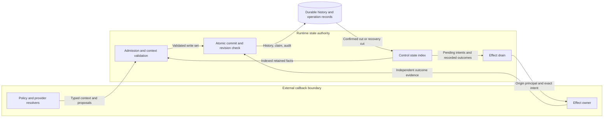
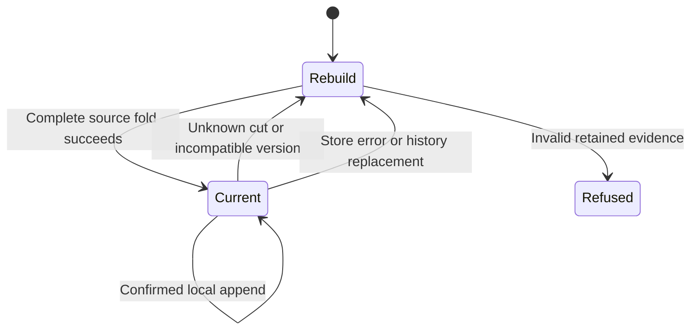

# Incremental control state

The performance boundary includes storage and execution of authorized actions.
It includes snapshot construction, validation, record retrieval, and history persistence.
A saved decision can permit an action.
The runtime must then run that action through its owner.
A retry must find its prior result.
It must not search all past decisions to do so.

## Authority and boundaries

Durable history remains the authority for participant control.
The runtime maintains derived indexes for crossing admission, causal use, provider state, and effect processing.
These indexes do not grant permission.
The existing context validators, owner receipts, operation claims, and snapshot revision checks still decide admission.

ADR-104 owns atomic store publication and recovery.
ADR-108 owns independent effect admission.
ADR-111 owns applicability and provider state.
API-409 and API-423 retain their recorded occurrence meanings.
API-424 retains each record's recorded version.
The public schemas and policy gates stay unchanged.
The provider-private SQLite and PostgreSQL storage versions advance.
This implementation needs no new deployment component or ADR.

## Data flows



The store boundary separates proposed facts from committed facts.
The callback boundary separates supplied claims from stored evidence.
The index stays inside the existing runtime owner.
It introduces no external data transfer or background service.

## Index lifecycle

Each index has an internal reducer version.
Its history prefixes identify its source.
It also retains participant history positions and identities.
These coordinates identify the cut that supplied its state.
They do not replace the store's revision check.



Startup rebuilds the indexes from the recovered store cut.
A successful local commit applies only its appended records.
A refused commit adds no projected facts.
A repeated operation adds no second use or dispatch claim.
An unknown revision, replacement, truncation, or reducer version resets the index.
Rebuild uses each record's original parser and reducer.
Prepared records retain their original meaning and never become dispatchable through an index.

The index is process memory, not a second durable journal.
Crash recovery therefore has no separate index checkpoint to reconcile.
After a lost acknowledgement, the runtime reads the store before it uses projected state.
An incomplete transaction supplies no committed suffix.
An unresolved effect claim retains the existing recovery barrier.

## Indexed state

Crossing indexes retain event and stage identities for exact predecessor joins.
Admission validates the new suffix against these indexes.
Changed external context still requires validation of affected retained facts.
Transformation checks retain the existing conflict and cycle rules.

Causal indexes separate run roots and participant-local legacy roots.
They retain claims, firing epochs, attempts, and declared use watermarks.
A retained v2 record makes the root's shared use visible across participants.
Refused records can consume attempts without admitting effects.
Realization records do not spend the original attempt twice.

Provider indexes use the existing run, sharing scope, participant, and episode key.
They retain state edges and the unique current state.
Only touched scopes need extension checks.
Conflicting writers, forks, cycles, and disconnected versions remain errors.

Effect indexes resolve the full intent under its original committed evaluation.
Claims remain bound to the originating actor, parent operation, and logical key.
Pending selection excludes settled plans.
Recorded outcomes remain available for repeated drain responses.
Unsupported, withheld, and indeterminate work remains pending when existing semantics permit later resolution.
Cancellation retains its separate priority pass.
Cached outcomes retain the original dependency and history order among pending results.

## Security and verification

| Asset or threat | Existing boundary and control | Verification |
| --- | --- | --- |
| Historical meaning changes | Version-specific parsing and complete-fold rebuild | Mixed-version differential tests |
| Stale or speculative permission | Atomic store commit and exact revision fence | Refused, lost-acknowledgement, and incomplete-commit tests |
| Budget reset or repeated effect | Retained causal claims and scoped operation idempotency | Accepted, refused, duplicate, and continuation tests |
| Foreign outcome substitution | Full intent, actor, origin receipt, and recovery-carrier joins | Wrong-principal and wrong-intent tests |
| Provider state fork | Existing scoped state-chain validation | Fork, cycle, stale-read, and sharing tests |
| Unbounded historical scans | Incremental indexes and pending selection | Deterministic work counts with disclosed active state |

The complete-fold functions remain independent reference checks.
Targeted tests compare projected values with these functions after each operation.
The checks include rebuild after process loss and an interrupted store commit.

## Performance boundary

Index work follows the appended suffix and the touched active state.
Causal reads still depend on the selected root's retained claims and watermarks.
Provider extension checks can depend on the touched scope's state chain.
Effect processing depends on pending plans and the returned outcome count.
External validation context can also grow with retained subjects and evidence.

Read-only history sequences share validated prefixes across snapshots.
Only new records require freezing, identity checks, and payload validation.
A history map exposes a read-only mapping.
Record reads return detached JSON objects.
Internal records use read-only mapping views and tuples.
No mutable wrapper is treated as a trusted resource value.
Python base-container methods cannot change a retained prefix through those objects.
Persistent integer indexes retain exact prefix digests without copying the prefix.
The implementation reuses the installed `rpds-py` persistent map.
Mutable input still requires isolation.
Runtime admission still requires complete record validation.
The store may retain opaque legacy records for its original runtime refusal checks.
Database reconstruction preserves these records after restart and checks their integrity.
Their JSON stays immutable.
Only histories whose records pass the existing validators can skip repeated shape checks.
JSON isolation alone grants no validation shortcut.

Durable stores separate history records from the current snapshot header.
History rows retain their field, participant, sequence, payload, and integrity digest.
The same transaction commits the history suffix, header, operation, and audit.
An older store rebuilds its original snapshot before migration in a transaction.
Portable snapshot exports retain the existing complete JSON form.

Confirmed operation changes have their own sequence.
The sequence advances for operation-only updates as well as snapshot commits.
Runtime indexes consume changed operation records without loading unrelated records.
Transaction triggers advance a private history generation on history or header changes.
A cached snapshot must match that generation, its header digest, and its read-only history roots.
The cache uses the same value-free credential format as the stored header.
Retry checks compare that format and retain the immutable history prefixes.
The generation is read in the same transaction as the header.
Unknown store changes reset affected cached state.
Older store implementations retain the exhaustive read path through capability admission.

SQLite storage version 11 accepts version 10 and the established older migrations.
PostgreSQL storage version 4 accepts versions 1 through 3.
Admission checks target and run scope before migration.
A rejected SQLite scope creates no private history or change-journal schema.
Migration writes separate history on the first snapshot write.
Rollback retains the previous source form.
Older software cannot open the new private storage versions.

Complete snapshot export and initial rebuild still require complete history reads.
Active context, retained duplicate-check identities, and returned results can also grow.
The measurements disclose history count, active roots, claims, provider state versions, pending effects, and output size.
They establish no end-to-end latency bound or backend capacity claim.

### Exploratory baseline

The existing in-memory effect fixture shows growth at the repeated drain boundary.
The fixture returns one outcome for one logical effect.
Each row follows a warm-up drain.
Admission between rows creates real retained records and operation records.

| Retained records | Returned outcomes | Operation-map loads | Total records returned by those loads | Drain time |
| --- | --- | --- | --- | --- |
| 2 | 1 | 8 | 32 | 26.90 ms |
| 9 | 1 | 36 | 396 | 609.19 ms |
| 33 | 1 | 132 | 4620 | 8797.32 ms |

The timings are single local observations on 2026-10-27.
The counts measure store map reads during the complete drain call.
They do not count unique operation records.
The fixture uses `governed_effect_runtime_fixtures.effect_plane()` and an in-memory store.
The measurement does not report memory, provider-chain size, or durable-store performance.
It establishes a baseline defect, not an improved scaling result.

### Measured saving and execution calls

Run the reproducible workload from the repository root:

```sh
PYTHONPATH=implementations/python/tests uv run --project implementations/python --frozen python implementations/python/tests/issue_1373_workload.py
```

The execution rows measure the complete public effect-processing call after one warm-up call.
Each row has one causal root, one retained claim, no provider state edges, no pending effects, and one returned outcome.
Retained operation counts are 4, 11, and 35.
Each measured call visits zero old history records, loads zero complete operation maps, and parses zero records.
The counters include indexed reads as well as iteration.

| Store | Retained control records | Execution time |
| --- | --- | --- |
| Memory | 2 / 9 / 33 | 2.045 / 1.369 / 1.787 ms |
| SQLite | 2 / 9 / 33 | 252.394 / 48.750 / 46.460 ms |

The saving rows measure the actual atomic participant-transition store call.
Operation-only commits also compare retained histories without serializing their old records.
The call commits one new evaluation-history record, a terminal operation, the snapshot header, and audit.
Setup, initial rebuild, and claim admission occur before timing.
Each measured call visits zero old history records and loads zero complete operation maps.

| Store | Retained history records | Atomic append time |
| --- | --- | --- |
| Memory | 8 / 64 / 512 | 0.073 / 0.056 / 0.078 ms |
| SQLite | 8 / 64 / 512 | 43.401 / 39.480 / 38.907 ms |

Each time is one local result from 2026-10-27.
Other checks ran at the same time.
Tests assert the record visit counts.
The times have no pass threshold.
The workload holds active state and output size constant.
It does not measure arbitrary policy callbacks, growing provider chains, fresh effect execution, or PostgreSQL latency.
Resident storage still grows with retained JSON, indexed identities, roots, claims, provider state versions, and recorded outcomes.
Snapshots share prefixes; indexes retain additional references and typed records.
No fixed-memory claim is made.

### Acceptance evidence

- [x] Issue: incremental crossing admission, provider causal state, and pending effect selection use the original contract owners. See `participant_crossing_prefix.py:23`, `participant_control_projection.py:17`, and `test_issue_1373_control_projection.py:11`.
- [x] Issue: history remains the source of truth; replacement, version changes, commit failure, and recovery reset or rebuild indexes. See `control_plane_durability.py:20`, `control_plane_store_history_rows.py:71`, and `test_issue_1373_durable_history.py:53`.
- [x] Issue: differential tests cover accepted and refused records, duplicate admission, incomplete records, and rebuild. See `test_issue_1373_control_projection.py`, `test_issue_1373_occurrence_prefix.py`, and the existing effect-recovery tests.
- [x] Issue: measurements cover actual atomic saves and public execution with fixed active state and disclosed retained state. See `issue_1373_workload.py` and `test_issue_1373_effect_work.py:34`.

## Reference basis

- [Python 3.11 collections](https://docs.python.org/3.11/library/collections.html): standard indexed containers and temporary mapping overlays.
- [Materialized View pattern](https://learn.microsoft.com/en-us/azure/architecture/patterns/materialized-view): derived read indexes and source authority.
- [Event Sourcing pattern](https://learn.microsoft.com/en-us/azure/architecture/patterns/event-sourcing): read-only history, rebuild, and versioned meaning.
- [ASD-STE100 guidance](https://www.asd-ste100.org/STE_faq.html): Issue 9 terminology, active voice, and one meaning per term.
- [SQLite transactions](https://www.sqlite.org/lang_transaction.html): atomic history, snapshot, operation, and audit writes.
- [PostgreSQL transaction isolation](https://www.postgresql.org/docs/18/transaction-iso.html): consistent multi-query reads under the existing owner lock.
- [rpds.py documentation](https://rpds.readthedocs.io/en/latest/): immutable indexed prefixes using the existing 0.30.0 dependency.

The document uses short descriptive sentences and established project technical nouns.
The review covers terminology, sentence length, and separation of architecture from implementation tasks.
The prose checker supplements this review.
It does not certify compliance with the complete STE dictionary.
