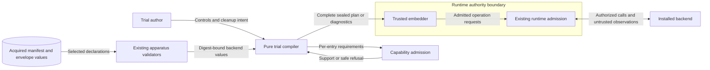

# Trial control admission

The trial compiler checks backend support before it returns a plan.
One unsupported entry rejects the complete plan.
The rule covers replacement entries.
It also covers each backend selected by a mixed composition.
Unused manifests cannot supply support.

## Controls and declarations

The compiler derives the required guarantees from entry controls and the bound cleanup plan.
Timeout disposition `cancel` requires `cancellation`.
More than one permitted attempt requires `cessation-evidence`.
If repetition forbids prior effects, admission also requires `effect-observation`.
The cleanup check covers required actions and probes.
It also checks support for reusable state and residual-state disclosure.
Best-effort cleanup keeps its weaker checks.

A backend can declare these guarantees in `operation_supervision`.
Its terms use the existing operation contract vocabulary.
This field requires the backend operation contracts.
An absent declaration supplies no guarantees.
A manifest that omits the field keeps its digest.
The admitted entry keeps its existing shape.
No second guarantee list is stored there.

The compiler uses the selected, digest-bound manifest and realization envelope.
Capture and control checks use the same backend values.
Each backend must support the required controls on its own.
An empty backend selection fails admission.
Failures use a stable compiler diagnostic without backend payloads or exception details.

## Data flow and protection

The manifest boundary protects the controls.
A missing claim must not imply support.
Existing checks protect this boundary.
They check identity, digest, envelope, and contract support.
The compiler returns no partial plan.
Thus, an earlier entry cannot start when a later entry fails admission.
The compiler makes no provider calls and resolves no secrets.
It adds no network surface, credential source, process, or persistent store.
Safe diagnostics protect configuration and backend details.

A declaration does not prove implementation, current willingness, or cessation.
Runtime admission still checks the installed provider and each operation before effects.
Timeout does not prove that effects stopped.
Retry and resource reuse still require the existing runtime evidence checks.
Execution timeout and cleanup obligation budgets remain separate.
This admission change does not implement timers, cleanup, or retries.

## Design basis

[ADR-036](../../decisions/adrs/adr-036-sdl-processor-runtime-module-boundaries.md) defines package boundaries.
[ADR-113](../../decisions/adrs/adr-113-reusable-execution-machinery.md) retains shared execution authority.
[ADR-115](../../decisions/adrs/adr-115-concrete-backends-owned-outside-raes.md) retains backend ownership of native effects.
These decisions need no amendment.
Existing policy enforces the package boundaries without a new policy mechanism.
Typed contracts and the compiler backend map express the design in code.
The backend manifest schema and its publication ledger describe the added declaration.

The design uses Pydantic 2 model validation and bounded collections.
The [official model documentation](https://docs.pydantic.dev/latest/concepts/models/) describes nested validation and unchecked model copying.
The [dependency injection reference](https://www.cosmicpython.com/book/chapter_13_dependency_injection.html) supports explicit dependencies and pure composition.
Tests cover refusal and whole-plan failure.
They check selected backends and manifest conversion.
Schema checks compare the published contract with the reference implementation.
