# Scenario family admission

An experiment needs an admitted `ExpandedScenario` family.
SDL without imports normally parses as a `Scenario`.
`admit_scenario_family(scenario)` connects these phases.

## Architecture

The function checks a normalized `Scenario` with no imports.
It builds a new model from current data.
The `Scenario` model checks all local names first.
The expanded model cannot relax those checks.
A previous validation flag is not proof.
Wrong phases and unresolved imports cause an error.

Edits to omitted default fields also cause an error.
Such edits require the caller to reparse SDL.
This rule prevents a dump from losing current content.
It also keeps omitted defaults distinct from authored values.

The function removes `module`, `imports`, and `realization` after their checks.
The existing helpers carry realization intent in `ExpansionProvenance`.
The import record list stays empty.
Field presence and source locations are retained.
The full semantic validator checks the result before return.
Advisories and source diagnostics remain available.

An error returns no admitted family.
The four experiment APIs accept a successful result.
These APIs validate selections, resolve targets, select scenarios, and compile trials.
Admission binds no parameters and grants no right to execute.
The parser return types stay unchanged.
Imports still use `parse_sdl_file` and its trust controls.

## Data flows and trust

```mermaid
flowchart LR
    author[Caller: SDL author]
    source[(Caller-owned SDL source)]
    parser[Bounded SDL parser]
    subgraph boundary[Family admission boundary]
        shape[Reconstruct local Scenario]
        convert[Convert phase and preserve provenance]
        semantics[Validate expanded semantics]
    end
    consumers[Experiment APIs]
    author -->|Authored SDL bytes| source
    source -->|SDL text or file bytes| parser
    parser -->|Normalized Scenario| shape
    shape -->|Structurally valid local declarations| convert
    convert -->|Expanded content and provenance| semantics
    semantics -->|Admitted ExpandedScenario| consumers
```

The source store belongs to the caller.
Family admission uses memory only.
It makes no file or network request.
The diagram also shows component dependencies.
No new component is deployed.
A separate deployment diagram is unnecessary.

## Security and verification

The protected assets are scenario meaning, phase identity, and derivation evidence.
The caller controls the input and can edit it after parsing.
The result is independent of that input.
Python callers can still use unsafe model construction or edit the result.
They must admit the input again after edits.
ADR-078 states the limits of these dynamic phase checks.

The fresh model checks nested input shapes and local names.
This prevents stale flags and forged names from granting expanded privileges.
The full semantic gate rejects invalid references and variation targets.
Phase checks stop derived descriptions from becoming authoring authority.
Import checks prevent trust checks from being bypassed.
Provenance conversion retains realization constraints.

Tests cover these controls and all four consumers.
Runtime tests cover secret classification and private outputs.
Warnings cannot disclose invalid input during reconstruction.
Errors use the existing bounded SDL diagnostics.
No new authentication, tenant, persistence, or logging interface is added.

The existing models and validator enforce the design.
No new policy check or infrastructure definition is needed.
ADR-078 and ADR-084 already define the phase and experiment boundaries.
No new phase, exchange schema, or ADR is needed.

## References

- [Pydantic models](https://docs.pydantic.dev/2.12/concepts/models/), version 2.12: validating data and model copies.
  Fresh validation checks mutable input instead of trusting old flags.
- [OWASP Input Validation](https://cheatsheetseries.owasp.org/cheatsheets/Input_Validation_Cheat_Sheet.html), current guidance: syntax and semantic validation.
  The boundary checks both shape and meaning before use.
- [ASD-STE100](https://www.asd-ste100.org/), Issue 9: writing rules, sections 1, 5, and 6.
  The document uses consistent technical nouns and short sentences.
