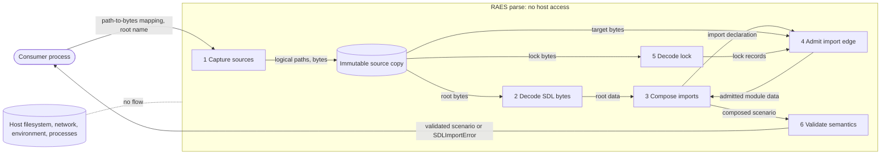
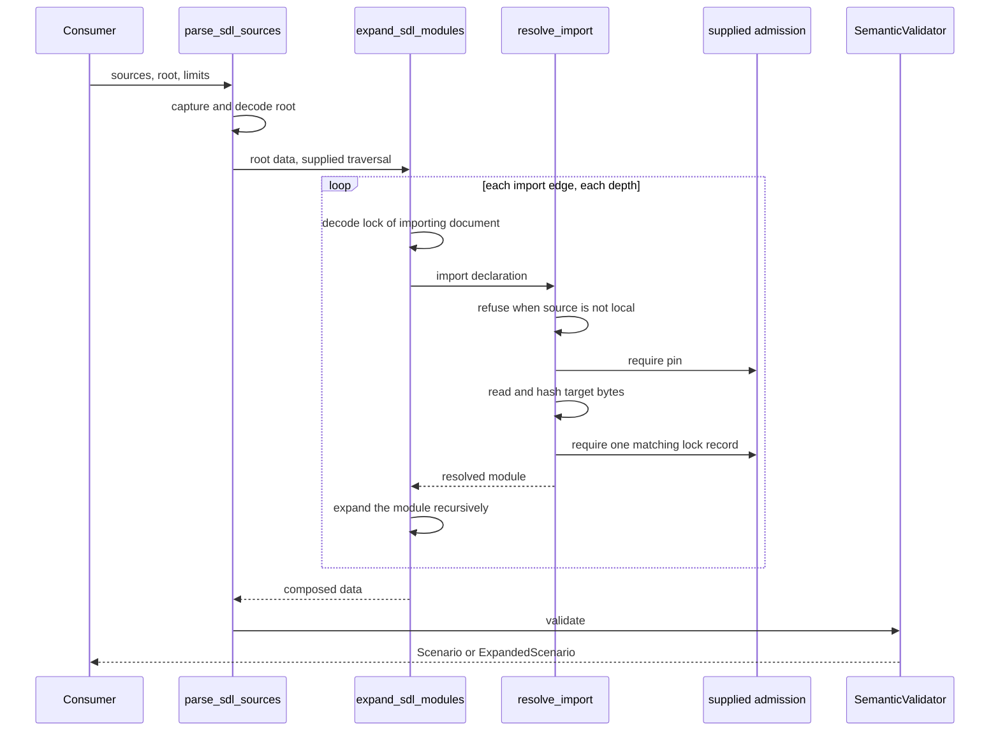

# Supplied-Source Parsing

`parse_sdl_sources()` parses SDL from bytes that the caller supplies.
It is the parse operation for untrusted consumers, such as a pack checker.
[ADR-119](../../decisions/adrs/adr-119-consumer-parse-of-supplied-sdl-sources.md) records the decision.
[Parser Behavior](parser.md) shows the API.

## Components

| Component | Module | Function |
| --- | --- | --- |
| Consumer operation | `raes.parser.parse_sdl_sources` | Captures the sources, decodes the root and starts a supplied-source traversal. |
| Source context | `raes._supplied_sources.SuppliedSources` | Holds an immutable copy of the bytes. Resolves logical paths lexically. Finds the lock of a directory. |
| Traversal | `raes._composition_budget.CompositionTraversal` | Carries the source context, the ancestry and the shared budget through each import. |
| Composition | `raes.composition.expand_sdl_modules` | Selects the lock of each importing document and expands each import. |
| Resolution | `raes.module_registry.resolve_import` | Refuses non-local sources. Reads the target bytes from the source context. |
| Admission | `raes.module_registry._supplied_admission` | Requires the digest pin and exactly one matching lock record. |
| Lock decoder | `raes.module_registry.decode_lockfile` | Decodes `raes-lock/v1` JSON with strict bounds. |
| Validator | `raes.validator.SemanticValidator` | Runs full semantic validation of the composed scenario. |
| Refusal | `raes._errors.SDLImportError` | Carries an `SDLImportErrorCode` and one diagnostic. |

The operation adds no composition engine, lock schema or scenario type.

## Data Flow

The trust boundary is the call boundary.
All data inside the boundary comes from the caller mapping.
No data flows between the parse and the host.

## Sequence

## Security

| Asset | Protection need |
| --- | --- |
| Host filesystem, network, environment and processes | The parse must not touch them. |
| Integrity of each imported module | Its bytes must agree with the pin and with the lock. |
| Consumer error handling | Each import failure must have a stable code. |

| Threat | Control | Verification |
| --- | --- | --- |
| A pack trusts a registry and starts a network fetch. | The operation never reads `raes-trust.yaml`. It refuses each non-`local:` source at each depth before resolution. | Root and nested `oci:` and `locked:` tests with network traps. |
| A path escapes the pack, or names a host file. | Lexical resolution inside the source copy. Absolute, drive and NUL paths and escapes are refused. | Path tests. Filesystem traps on each test. |
| A module changes after the lock was made. | The pin, the lock content digest and the digest of the parsed bytes must be equal. | Digest mismatch tests. |
| An attacker removes a pin or a lock record. | Pins and records are mandatory in this operation. | Missing pin, lock and record tests, also for nested imports. |
| A forged or stale lock record. | Exactly one record, and each resolved field must agree. | Ambiguous and mismatched record tests. |
| A malformed lock exhausts resources. | Strict bounded JSON decoding. Lock bytes count toward the byte budget. | Duplicate member, version and budget tests. |
| The caller changes the mapping during the parse. | The operation copies the mapping before use. | Mutation test. |
| A refusal message leaks an authored value. | New refusals use fixed messages. | Message tests. |

Residual risks:

- The parse does not authenticate the root document or the publisher (ADR-071).
- The returned model is mutable. It is not a durable admission token.
- The caller owns secure capture of the bytes and the decision to execute the scenario.
- The first call in a process loads modules. Module loading reads files, and Pydantic reads one environment variable when it creates a model class.
