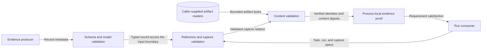

# Required capture admission migration

Issue #1237 adds a process-local content proof to authoritative run validation.
The proof is immutable.
The validator snapshots and revalidates metadata before reader callbacks.
Consumers must retain that proof.
They must reject it after task/run content changes.
Revalidate from bytes after serialization or a process boundary.

Evidence validation admits at most 1024 items per invocation.
This limit applies to artifacts, capture specs, capture requirements,
records, and reader entries.
Declared artifact bytes have a 256 MiB aggregate limit and a 64 MiB per-artifact limit.
The validator reads shared artifacts once.
Each capture requirement receives its own checks.
These checks cover relations, metadata, integrity, output contracts, and field selectors.
Artifact locators remain inert.
The validator rejects credential userinfo, secret query fields, fragments, host
paths, and `file:` URIs.
Published relative artifact paths remain supported.
Proof bindings retain only a locator identity digest.

Issue #1112 changes capture support from descriptive capability discovery to a
fail-closed execution contract.

Backend manifests that may execute SDL `evidence_requirements` or experiment
capture specs must publish `capabilities.observation.capture_offers`.
Each offer is atomic.
It binds the output contract and fields to the supported capture terms.
These terms cover artifact, media, capture, source, scope, channel, window,
integrity, sensitivity, availability, fidelity, disclosure, retention, and export.
Legacy `supported_*` lists remain discovery summaries.
They are not an admission fallback.
A manifest with no matching offer is rejected before effects.
The in-repo stub manifest publishes no capture offers.
Its runtime does not implement the promised artifact production path.
Tests that exercise admission declare narrow, scenario-specific offers explicitly.

Offers for SDL requirements that use `scope_refs` must enumerate the exact
authored targets in `scope_refs`; `*` is rejected. Trial compilers resolve
scenario-family variables before matching these and all other capture terms.

SDL authors should add `output_contract` and `field_selectors` whenever an
authored evidence requirement is intended to execute. Existing requirements
that omit both fields remain structurally readable, but they cannot make a
field-level output promise. Precise installation declarations do not imply a
capture requirement.

Trial compilers must acquire every referenced capture-spec payload and include
its digest in `admitted-trial-plan-v1.input_refs.capture_spec_refs`. Missing,
substituted, ambiguous, or unsupported capture specs fail admission. Trial
realization supplies the same exact payloads and rechecks the selected backend.

Run consumers that make evidence-satisfaction claims use
`validate_experiment_run_evidence()` with exact capture specs, evidence records,
and bounded byte readers. The validator does not fetch URIs.
It checks artifact identity, byte count, checksum, media, role, and required integrity.
It checks the authoritative `output_contract` schema and owning semantic model.
It also checks RFC 6901 field selectors and required redaction state.
Sensitivity must agree across the requirement, record, and artifact.
Study conditions that require evidence consume the same
validated requirement-to-artifact bindings.
Historical `satisfies_refs`, payload summaries, and backend assertions remain
metadata; they are not proof of emitted content.

## Capture-spec reference versions (issue #1547)

An evidence record identifies its capture spec through `capture_spec_ref`.
The reference kind must be `capture-spec`.
The reference id must equal the supplied spec's `capture_spec_id`.
The published record schema permits an omitted or null `ref_version`.
These forms place no version condition on the supplied spec.
An explicit `ref_version` must equal the supplied spec's `spec_version`.
This rule uses the same reference matcher as run and apparatus references.

The caller supplies the spec through the capture-spec mapping.
An unversioned reference does not prove a particular version or a content digest.
The validator still checks the complete supplied spec and artifact bytes.
The resulting proof retains the supplied spec's actual version.
Producers that need a version condition must supply `ref_version`.

Record metadata crosses the producer-to-validator trust boundary.
A wrong capture-spec id or explicit version fails before artifact reads.
Byte limits, checksums, schemas, field selectors, and capture-window checks protect
the content boundary.
Metadata alone cannot create a proof.
The version correction adds no network access, storage, credential use, or runtime effects.

The published optional field is the compatibility authority.
Making the field required would reject existing valid records.
Leaving the strict comparison would preserve the schema/runtime mismatch.
ADR-055's experiment-core boundary remains applicable.
No schema, policy rule, deployment model, or new architecture decision is required.
The existing reference matcher and content-proof tests enforce this boundary.

The design follows JSON Schema Draft 2020-12's
[required-property rule](https://json-schema.org/understanding-json-schema/reference/object)
and NIST SP 800-160 Volume 1 Revision 1's
[systems security principles](https://csrc.nist.gov/pubs/sp/800/160/v1/r1/final).
The former governs optional fields.
The latter informs the separate identity and content checks at each trust boundary.

## Media-type coherence (issue #1401)

Required capture uses JSON-based content proof.
The eligible media types are `application/json` and the registered array-root
`application/jsonl` encoding.
Other encodings need a separately governed byte contract and verifier.

Reject the whole SDL `media_types` or experiment `expected_media_types` list
if any member is unsupported.
A supported choice must not mask an impossible one.
`text/plain`, `application/x-ndjson`, and PCAP are invalid required capture declarations.
This tightens earlier SDL authoring behavior, including the PCAP example in DSL-124.
The author receives an explicit diagnostic.
An omitted SDL media-type list adds no media-type constraint.

The authority is
`raes_contracts.evidence_output_validation.evidence_output_registrations()`.
The registry links each output-contract id to its published schema, semantic
validator, and JSON root.
These define the supported encodings.
An explicit SDL or capture-spec `output_contract` must resolve there.
Each declared media type must be valid for that contract.

An SDL requirement without an output contract still expresses intent only.
Its media types must belong to the union of eligible encodings.
`application/jsonl` cannot describe the object-root `experiment-evidence-record-v1`.
That record contract cannot authorize unrelated JSON or text bytes.
An `application/json` label cannot authorize them either.

SDL, capture-spec, offer, and content validators share one eligibility rule.
Model validators report an explicit unsupported-media or incompatible-contract error.
The published SDL, capture-spec, and backend-manifest schemas follow the same rule.
Their semantic-invariant metadata must not imply broader eligibility.

The atomic offer matcher and admission diagnostics remain required.
The bounded byte reader still checks checksums and locators.
Schema, semantic, and RFC 6901 field checks remain required.
The process-local proof object remains the satisfaction authority.
Field selectors address the decoded JSON document.
For JSON Lines, they address the decoded array.

Field selectors do not address arbitrary text.
An evidence-record envelope cannot replace artifact bytes.
This decision governs required-capture proof.
It does not govern legacy `supported_media_types` summaries or runtime capture.
It does not define storage, export, or a generic non-JSON contract framework.

A future encoding needs a registry-owned contract and encoding rule.
It needs a bounded byte parser and content proof.
Publication and conformance evidence must precede authoring or offer eligibility.
This design adds no URI fetch, credential handling, or serialized proof token.

## Shared proof and extension points

Issue #1237 adds a proof return value to `validate_experiment_run_evidence()` and
`validate_experiment_run_against_task()`.
They return `ValidatedRunEvidence` from `raes_contracts.contracts.evidence_satisfaction`.
Task observations, metric artifact relations, study allocation, and evidence
conditions consume that proof.
Its bindings retain immutable capture, record, and artifact identities.

Canonical task/run content digests prevent proof reuse for another run.
They also prevent reuse after validated inputs change.
Callers must validate the exact content again to obtain a new proof.
Reference tuples and serialized metadata cannot construct a proof.
Structural-only validation does not produce evidence bindings.

Evidence output eligibility uses the same registry as authoring.
Each entry names a published schema from the contract corpus.
It also names the owning semantic validator and JSON root.
JSON Lines requires an array root.
Offers and emitted content fail closed if the schema or semantic owner is missing.
Schema references resolve offline.

`contracts/schema-publication-manifest.json` remains the publication ledger.
Capture extensions use `raes_contracts.capture_dimensions.CAPTURE_DIMENSIONS`.
Each dimension declares its authored projection and collection representation.
It also declares its comparison rule and diagnostic.
The Pydantic offer and protocol dataclass retain explicit fields.

Additions must cover both authored projections and manifest round trips.
They need independent matching and diagnostic cases.
They also need shared pre-effect conformance tests.
Exact scope targets and wildcard subsets retain different meanings.
Media overlap, availability, fidelity, and disclosure also retain distinct semantics.
