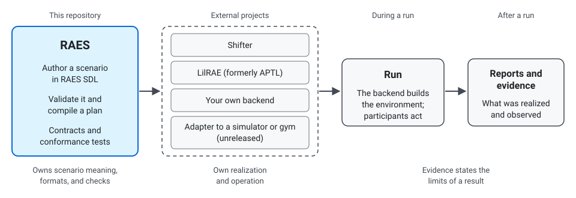

# Describe a reproducible agentic environment

To get started and run a scenario, see [LilRÆ](https://github.com/openrae/lilrae).

RAES, the Reproducible Agentic Environments System, helps you describe an
agentic environment, check it before anything runs, and keep evidence about
what a run realized. RAES SDL is its YAML language for authored scenarios.

A RAES scenario records the nodes, links, participants, objectives, workflows,
variation, and evidence needs of an environment. RAES checks the scenario
against published rules. A backend that supports the features it needs can
then run it. The backend's reports show what was realized and observed.



How a scenario reaches a run:

1. Author a scenario in RAES SDL. RAES validates it and compiles a plan.
2. Choose an external backend that supports what the scenario needs. Shifter
   and LilRAE (formerly APTL) are examples. You can also write your own
   backend. Simulator and gym adapters are unreleased.
3. The backend builds the environment, and participants act in it.
4. Reports and evidence describe what was realized and observed.

## Validate your first scenario

Complete the [quickstart](quickstart.md) first. You install RAES, validate a
small SDL file, and print its name. You need standard CPython 3.14. You do not
need a backend or a repository checkout. The exercise creates no infrastructure.

To explore research questions, read the [research context](research.md). To
cite RAES in your work, use the [citation guide](citation.md).

## Choose what you need

- **Tutorials (learn):** Complete the [quickstart](quickstart.md). Then
  [inspect and format a scenario](tutorials/first-scenario.md). This second
  tutorial needs a repository checkout.
- **How-to guides (do a task):** Use the
  [Python guide](guides/python.md) or the
  [command-line guide](guides/cli.md). To write and check a larger scenario,
  [validate, compile, and inspect a scenario plan](sdl/validate-compile-plan.md).
- **Reference (look up facts):** Use the [API reference](api/index.rst), the
  [SDL specifications](https://github.com/OpenRAE/rae/tree/main/specs/sdl), and
  the [published contracts](https://github.com/OpenRAE/rae/tree/main/contracts).
- **Explanation (understand):** Read the [core concepts](concepts.md), the
  [research context](research.md), and the [current limits](limitations.md).

## Choose your route

- **Scenario authors:** Start with the [SDL guide](sdl/index.md). Browse the
  [worked examples](https://github.com/OpenRAE/rae/tree/main/examples/scenarios).
- **Pack authors:** Follow the env-packs
  [quickstart](https://github.com/OpenRAE/env-packs/blob/main/docs/public/quickstart.md).
- **Python and CLI users:** Use the [Python guide](guides/python.md), the
  [command-line guide](guides/cli.md), and the
  [API reference](api/index.rst). To serve the runtime over HTTP, read
  [serve the runtime control plane](guides/control-plane.md).
- **Participant control:** Use the
  [participant-control guide](participant-control.md)
  to govern participant input and output.
- **Backend and adapter implementers:** Read the
  [backend and conformance guide](backends.md)
  and see [OpenRAE/adapters](https://github.com/OpenRAE/adapters).
  To admit tool calls inside a participant invocation, read
  [admit participant tool actions](guides/invocation-tool-actions.md).
- **Shifter and LilRAE users:** Install and run each backend from its own
  documentation: [Shifter](https://github.com/Brad-Edwards/shifter) and
  [LilRAE](https://openrae.github.io/lilrae/).
- **Researchers:** Review the [research context](research.md),
  [current limits](limitations.md), and [citation guide](citation.md).
- **Contributors:** Follow
  [CONTRIBUTING.md](https://github.com/OpenRAE/rae/blob/main/CONTRIBUTING.md),
  the [governance model](https://github.com/OpenRAE/rae/blob/main/GOVERNANCE.md),
  and the
  [developer documentation index](https://github.com/OpenRAE/rae/blob/main/docs/README.md).
- **Help:** See [get help](support.md) for issues and private security
  reports.

## What RAES provides

RAES owns the meaning of an authored scenario and the formats around it:

- the RAES SDL language, its specifications, and published schemas;
- published contracts for the data that tools and backends exchange;
- validation and processing that check a scenario and compile plans;
- conformance tests that check whether a backend honors a stated boundary;
- reference tools: the Python package, the `raes` command, examples, and
  test doubles for backend authors; and
- evidence structures that record what was requested, realized, and observed.

These parts make scenario intent portable, checkable, and shareable. They also
tie that intent to evidence about what a backend realized.

Cyber, AI security, AI safety, testing, research, and evaluation are
non-exhaustive application areas. Additional domains can add their own
profiles, assets, examples, vocabularies, backends, and evidence rules.

## Run a scenario on a backend

This repository includes contracts, stubs, and conformance tests. It does not
include a concrete deployment backend or a managed environment service.
External backends realize scenarios outside this repository:
[Shifter](https://github.com/Brad-Edwards/shifter),
[LilRAE](https://github.com/OpenRAE/lilrae), or your own backend. To write a
backend, start with the [backend and conformance guide](backends.md).
[OpenRAE/adapters](https://github.com/OpenRAE/adapters) holds adapter projects
for simulators and cyber gyms. None is released. Each adapter's own conformance
reports and evidence records state what it can run.

Shifter, LilRAE, and the adapters are separate projects with their own
documentation. This repository does not ship or certify them. A backend's own
reports and conformance evidence state what it supports.

## Package and share scenarios

[OpenRAE/env-packs](https://github.com/OpenRAE/env-packs) owns environment
pack structure, schemas, templates, and the tools to author, validate, and
release packs. A pack carries RAES SDL scenarios and other reusable assets.
RAES remains authoritative for the SDL, concept, and reusable-asset
trust-policy meanings a pack relies on. Catalogs make packs easier to find.
They do not add SDL semantics.

## Know the limits

An authored scenario records intent. A backend may realize only the parts it
supports. Reports and evidence show what was accepted, changed, observed, or
left unsupported.

RAES can support a bounded reproduction attempt. It does not promise
deterministic runtime behavior, equal outcomes, exact replay, scientific
validity, or reproducibility. Read the [current limits](limitations.md) before
choosing RAES for a study or integration.

## Cite RAES

Use the [citation guide](citation.md). It gives the software citation. Also
record the release or commit, scenario, backend, and run evidence that you used.

RAES is released under the
[MIT License](https://github.com/OpenRAE/rae/blob/main/LICENSE). Third-party
notices are in
[THIRD_PARTY_NOTICES.md](https://github.com/OpenRAE/rae/blob/main/THIRD_PARTY_NOTICES.md).

```{toctree}
:hidden:
:maxdepth: 2

quickstart
concepts
tutorials/first-scenario
sdl/index
participant-control
guides/python
guides/cli
guides/control-plane
guides/experiment-records
guides/assigned-trials
guides/supervised-execution
guides/external-injects
guides/invocation-tool-actions
backends
research
limitations
contributing
support
citation
api/index
```
