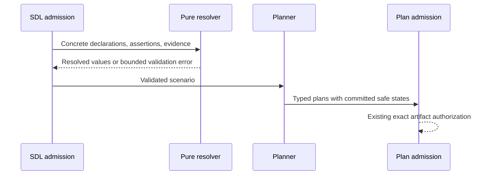

# Authored safe state

The SDL declares a desired safe state for nodes and services.
RAE resolves each declaration and its proof before plan admission.
The backend owns the mechanism and the observations.
Declaration validation does not establish physical safety or authorize an effect.

This design applies [ADR-113 section 4](../../decisions/adrs/adr-113-reusable-execution-machinery.md).
The [preflight](../../decisions/issue-1987-safe-state-preflight.md) gives the admission boundaries.
No new ADR or runtime controller is required.

## Declaration and scope

The optional `safe_state` section has a `default` and a bounded list of `scopes`.
Each scope has a semantic `scope`, a lexical `namespace`, and a complete `state`.
An empty scope names the scenario or the specified module.
`/nodes` denotes the node collection.
Node and service scopes use the existing semantic address rules.
Service collection members use stable identities, not list positions.

Each state has version `safe-state/v1`, a `kind`, and nonempty `assertion_refs`.
The kinds are `safe-hold`, `controlled-stop`, and `continue`.
Only `continue` requires a nonempty `continuing_mode`.
The assertions specify the observable conditions for that mode or state.
They use existing governed properties and typed predicates.
Native commands and arbitrary expressions are excluded.

The nearest lexical scope supplies the complete state.
Fields from different declarations never combine.
Equal-scope duplicates, unresolved scopes, namespace escapes, and empty target sets are errors.
Imported defaults become module defaults.
Composition uses its symbol map.
It rewrites proof references and target names.

Private and repeated imports retain separate bindings.

The reference eligibility policy owns the target set.
It includes nodes, named node services, and top-level database, DNS, file, mail, and datastore services.
Runtime children, unnamed ports, and backend-discovered objects are excluded.
One scope declaration can cover several targets.
Each target needs its own proof.
Omission introduces no declaration and changes no legacy validation result.

## Proof

Each referenced assertion must be a positive postcondition.
Its proposition must use `observed_state` and the `all` subject quantifier.
The proposition must include the exact target among its resolved subjects.
Its evidence requirements must cover that target through their source or scope references.
Evidence for another node or service cannot establish this target's safe state.
Every assertion in the selected state must apply to the target.

The plan retains the complete assertion, proposition, canonical subjects, and evidence requirements.
The existing proposition and assertion models move to `raes_contracts.propositions`.
Their generated-value reference also moves below the language boundary.
Callers use these canonical owners under ADR-121.
Former owners provide no compatibility exports.
This shares the typed predicates without a second evaluator or an upward package dependency.

Existing evaluation semantics still determine truth, uncertainty, and unsupported observations.
A manifest claim or acknowledgement alone does not satisfy an observed-state postcondition.

## Components and interfaces

| Owner | Interface and responsibility |
| --- | --- |
| `raes_contracts.safe_state` | Closed declaration, scope, proof, and resolved-state models; shared plan-field validation. |
| `raes.observation_scope` | Public scope and proof resolver. |
| `raes.validator` | Ordered safe-state pass; uses the same resolver during parsing and final admission. |
| `raes.composition` | Lexical rewriting and merging through the existing expansion seam. |
| `raes_processor.compiler.pipeline` | Resolves all affected targets into `RuntimeModel.safe_states`. |
| `raes_processor.planner.core` | Copies the resolved collection into each native phase plan. |
| `raes_contracts.planning` | Retains declarations independently of operation changes, including no-op plans. |
| `raes_contracts.contracts.plan_projection` | Publishes the typed values and includes them in canonical plan commitments. |
| `raes_runtime.control_plane_api_models` | Preserves values during HTTP reconstruction and exact plan authorization. |

Each phase carries the same resolved collection.
This rule covers effects across domains.
It needs no new map from services to operations.
It includes unchanged resources.
It does not apply new defaults to deleted resources.

Recovery retains the submitted plan value.
It does not consult newer source declarations.
The experiment trial entry also retains the resolved collection for its selected scenario.
Sealing includes this collection in the entry digest.

## Data flows and trust boundaries

```mermaid
flowchart LR
    Author[Scenario author] -->|Untrusted SDL| Parse[Bounded parser]
    subgraph RAE[RAE validation and planning boundary]
        Parse -->|Closed declaration| Compose[Composition and instantiation]
        Compose -->|Concrete targets and proof| Resolve[Semantic resolution]
        Resolve -->|Resolved collection| Plans[Native plans and trial entries]
        Plans -->|Canonical commitment| Store[(Admitted plan store)]
    end
    Store -->|Authenticated retained plan| Consumer[Backend consumer]
    Consumer -->|Separate observed results| Evidence[(Existing evidence store)]
```

The evidence store is outside declaration resolution.
No device contact, network request, environment lookup, or secret resolution occurs during resolution.
The backend consumer remains responsible for effect admission and observation.

## Security and verification

| Threat and boundary | Control | Verification |
| --- | --- | --- |
| Malformed source at parser ingress | Closed models, bounded collections, canonical pointers, existing source limits | Invalid-shape and schema tests |
| Wrong target or module during resolution | Explicit eligibility, exact subject and evidence joins, namespace ownership | Wrong-subject, import, scope, and sibling tests |
| False safety claim at proof boundary | Observed positive postconditions for every target; no evaluation during declaration admission | Declared-state and incomplete-coverage rejection tests |
| Tampering during plan transport | Typed reconstruction, existing authorization, canonical plan and entry digests | Round-trip and changed-commitment tests |
| Disclosure of private intent | Existing authenticated inspection and participant projection boundaries | Existing admission and projection checks |

Existing parser budgets bound input work.
The resolved list has a fixed size bound.

`PLAN_VALUE_LIMITS` bounds the total work and size of expanded proofs.
Resolution checks source bindings before it copies proofs.
It then checks canonical bindings before it builds resolved models.
Native plan validation checks the collection before serialization.

Trial compilation counts the bytes in each entry.
It checks `max_plan_bytes` before it stores more entries or seals the plan.
It preserves canonical failure selection across coordinate orders.

Targets have a fixed order.
Declaration fields contain references and typed conditions.
They contain no credentials or executable code.
Errors use existing SDL findings and bounded messages without raw declaration values.

Backend capability, current willingness, interlocks, shared equipment, and operator authority remain separate execution obligations.
No physical compatibility or safety certification claim follows from these checks.

Published SDL and affected plan schemas own the portable fields.
Their reference generators, fixtures, adapters, and semantic annotations must agree.
No separate schema publication identity is needed for edits to existing schemas.
Existing import rules and schema checks supply architecture-as-code and policy-as-code coverage.

The resolver uses the existing scope owner to avoid a new import cycle.
The existing policy validation mixin hosts the ordered safe-state pass without adding an ancestor.
No new enforcement tool, role, endpoint, dependency, or authority ledger is required.

## Reference basis

- [Pydantic 2.12 validators](https://docs.pydantic.dev/2.12/concepts/validators/) supplies model validation and nested revalidation patterns.
- [JSON Schema 2020-12 validation](https://json-schema.org/draft/2020-12/json-schema-validation) supplies closed shapes and conditional mode constraints.
- [NIST SP 800-160 volume 1 revision 1](https://csrc.nist.gov/pubs/sp/800/160/v1/r1/final) supplies the system boundary and protection-needs approach.

The design follows the repository documentation guide and the pinned documentation skill.
Review checks sentence length, consistent technical terms, preserved obligations, and this page's explanation purpose.
Style checks do not establish full ASD-STE100 conformance.
