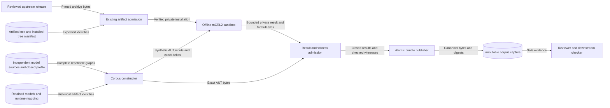

# Participant-Crossing Counterexample Corpus

Requirements: SEM-232, ASR-535, SEM-230, GOV-913. Classification: FM3.

Status: implementation and captured negative evidence under review for #973.

## Scope

The corpus contains deliberate faults in copies of the complete single-operation models.
The baseline is `participant-crossing-dpbb-finite-v1@rev2`.
Both model revisions are `rev2`.
The projection is `participant-crossing-projection@rev1`.
The relation catalog is `raes-behavioral-relations@rev8`.

The corpus supplies negative evidence for the selected relation.
It does not establish positive equivalence or a mathematical proof.
Runtime realization, backend conformance, noninterference, and opacity remain separate claims.
Time, probability, concurrency, fairness, and controller handoff remain outside this profile.
SEM-232 remains DRAFT.

## Components and data flows

The independent model constructors retain their existing transition authorities.
The corpus constructor changes copies of their graphs.
Each mutation records its semantic selector and exact edge changes.
The checker adapter supplies decisions from the admitted mCRL2 installation.
The witness checker independently reads the exact AUT inputs.
The bundle publisher writes only validated, canonical artifacts.

The upstream archive crosses a supply-chain boundary at artifact admission.
The sandbox cannot access the network, user home, credentials, or repository.
Only copied synthetic inputs cross its input boundary.
Raw checker output remains private until result and witness admission completes.
The publication boundary accepts no arbitrary diagnostic text.

The corpus uses GOV-913's existing `evidence_artifact` role.
Checksums establish byte integrity against an independently retained repository pin.
They do not establish authenticity, independent review, semantic correctness, or current runtime coverage.
Review records bind the exact mutation and expectation digest.
The [GOV-913 preflight boundary](../../../docs/decisions/issue-973-crossing-counterexample-preflight.md#gov-913-integrity-authenticity-and-review-authority)
defines policy selection and separates raw-file checksums from canonical JSON identity.
Unsigned evidence remains explicitly unsigned.
A consumer requiring authenticity must refuse evidence without verified signatures under its selected signer policy.
This corpus introduces no signing service or credentials.

## Mutation contract

The baseline exporter verifies closure before mutation.
A mutation must change at least one reachable transition selected through the synthetic state map.
An independent delta check permits only the declared changes.
Each specimen retains the baseline state numbering.
Additional states have explicit synthetic descriptions.
The manifest distinguishes stored state counts from reachable state counts.
Stranded states cannot remove a reachable counterexample from the comparison.

| Case | Declared fault | Required evidence |
| --- | --- | --- |
| Hidden denial | Rename a reachable denial to `internal` in the specimen. | Negative DPBB decision; checked auxiliary formula when supported. |
| Hidden observation | Rename the occurrence label to `internal`. | Negative DPBB decision despite absent payload. |
| Added divergence | Add a reachable internal self-loop after a request. | Negative DPBB decision and independent prefix/cycle verification. |
| Removed delivery | Remove an enabled delivery after transformation. | Negative DPBB decision; bounded witness for the lost choice when supported. |
| Later-cut replay | Admit the retained p0 result after visible advancement to p1. | Negative DPBB decision with the original request and input preserved. |

Separate small calibration pairs distinguish finite internal steps, weak versus branching choice, and divergence preservation.
These pairs are not instances of the governed crossing carrier.
Structural deadlock means no outgoing transition.
The rev2 `terminal` phase completes a crossing and still permits retry or cut advancement.
AUT has no separate successful-termination predicate.
Unsupported error labels are rejected instead of being classified as hidden steps.

## Checker and witness contracts

The four comparison modes are `bisim`, `weak-bisim`, `branching-bisim`, and `dpbranching-bisim`.
Each invocation hides exactly `internal`.
The result parser accepts the selected tool's Boolean output only after successful process completion.
Missing tools, timeouts, resource failures, malformed output, and unsupported modes produce no decision.
A process exit code alone is never an equivalence result.
Error categories follow ADR-116.
Command-line handlers report expected operational and evidence failures.
Programming defects reach the shared application boundary instead of becoming a comparison decision.

The selected release is mCRL2 `202607.0` for Linux x86_64.
Its archive and complete installed tree belong in the existing tooling lock.
Acquisition uses the maintained client and the existing verified installation transaction.
The upstream Debian archive requires an additional admitted archive format.
The standard `dpkg-deb --fsys-tarfile` command exposes its data archive without installing packages or executing maintainer scripts.
The existing tree validator then checks every member, path, link, count, and byte limit.
The original archive digest and the complete installed-tree digest both remain mandatory.
Existing tar.gz identities and installation behavior remain unchanged.

The runner uses a fixed executable, fixed arguments, a cleared environment, and a network-disabled bubblewrap sandbox.
CPU, memory, wall time, output files, and diagnostic files have fixed bounds.
The parent terminates the process group after timeout or failure.
The runner never falls back to an unsandboxed process.

The hosted replay uses Ubuntu 26.04 in the existing canonical verification workflow.
GitHub publishes this runner as a supported image.
The job installs standard native prerequisites from the signed distribution sources.
It does not change AppArmor policy, namespace restrictions, or other host security controls.
Replay must fail when the host cannot create the required sandbox.
Ubuntu 22.04 lacks the selected binary's runtime-library baseline.
Ubuntu 24.04 can restrict Bubblewrap through its default AppArmor policy.
The existing Isabelle job retains its separate host and prerequisites.

The diagnostic parser accepts a closed, bounded Hennessy-Milner syntax and the declared labels.
It checks truth in the first input and falsity in the second input after the declared hiding operation.
It then renders canonical syntax without paths, payloads, or process details.
A stronger-relation formula retains its actual comparison mode.
It cannot replace the selected DPBB decision.
An unsupported formula remains explicitly unsupported.
Formula admission bounds syntax depth, node count, and evaluation work as well as bytes.
Failure to produce a supported formula never supplies the selected relation decision.

The independent divergence check consumes AUT bytes instead of the mutation name or reported verdict.
It checks a reachable finite prefix, a nonempty internal cycle, and the absence of all abstract internal transitions.
This last condition restricts the check to the selected rev2 model pair.
An arbitrary pair with abstract divergence requires a different argument.

## Security and verification

| Threat and boundary | Control | Verification |
| --- | --- | --- |
| Substituted upstream or cached executable | Existing raw and full-tree identity checks precede execution. | Changed archive, executable, and library bytes are refused. |
| Unsafe archive member | Standard Debian reader feeds existing bounded tree admission. | Traversal, unsafe links, special files, duplicate members, excess counts, and extraction failures are refused. |
| Tool reads host data or contacts a service | Restricted mounts, cleared environment, isolated network. | Fixed command tests and an actual isolated checker run. |
| Diagnostic leaks model or host data | Closed syntax, label set, resource limits, and canonical output. | Payload strings, paths, unknown labels, malformed syntax, and oversized outputs are refused. |
| Tool failure is recorded as a negative result | Separate execution status and semantic decision. | Timeout, nonzero exit, absent output, and conflicting output produce no decision. |
| Ineffective or misleading mutation | Reachability, semantic selector, exact delta, and independent review. | Empty, unreachable, and undeclared changes fail validation. |
| False witness or changed inputs | Independent witness evaluation over exact pinned bytes. | Reversed formulas, invalid cycles, changed prefixes, and digest drift are refused. |
| Partial or rewritten evidence | Existing atomic publication and immutable capture identity. | Interrupted publication leaves no accepted partial bundle. Existing drift is refused. |

The trusted host supplies the kernel, system runtime libraries, bubblewrap, and Debian package reader.
Their host boundary remains explicit.
The finite witness checker does not constitute an independent general bisimulation engine.
Independent mutation review remains necessary after automated checks pass.

The corpus manifest binds subject sources only.
These are the model sources, the mutation and witness modules, and the corpus module.
Each run checks the tool-admission code, locks, and other apparatus for stability.
Native replay must reproduce every artifact byte.
The retained model construction record keeps its own historical source digests.
The [evidence identity design](../../../docs/decisions/issue-976-crossing-evidence-identity-design.md) records this split.

## Existing authorities

[ADR-100](../../../docs/decisions/adrs/adr-100-participant-crossing-bisimulation.md) continues to select the relation, tool, and claim boundary.
The [preflight](../../../docs/decisions/issue-973-crossing-counterexample-preflight.md) supplies binding implementation constraints.
The [model specification](participant-crossing-models.md) remains unchanged.
The [runtime mapping](participant-crossing-runtime-mapping.md) remains a separately pinned dependency.
Historical model and mapping artifacts retain their bytes and classifications.

The tooling lock, its schema, and the existing admission checks express the additional archive format.
The issue scope assigns each changed file to its requirement owner.
The ASR-535 governance phase permits only the named corpus, witness, test, and research files.
The corpus inventory, delta checks, and witness checks express the formal architecture as executable constraints.
No new runtime policy, public schema, store, service, or workflow is required.
Formal and specification research captures use the existing content-addressed recorder when source evidence changes.

## References and document review

- [mCRL2 202607.0 ltscompare](https://www.mcrl2.org/web/user_manual/tools/release/ltscompare.html): comparison modes, hiding, result protocol, and formula capability.
- [mCRL2 202607.0 basic modelling](https://www.mcrl2.org/web/user_manual/fundamentals/basic_modelling.html): labelled transition systems and Hennessy-Milner semantics.
- [Debian dpkg-deb manual](https://manpages.debian.org/trixie/dpkg/dpkg-deb.1.en.html): filesystem archive extraction without package installation.
- [Bubblewrap reference architecture](https://github.com/containers/bubblewrap/blob/main/README.md): explicit mounts, namespaces, and sandbox responsibility.
- [ASD-STE100 Issue 9](https://www.asd-ste100.org/assets/files/ASD-STE100_ISSUE9.pdf): approved terminology, sentence length, and document purpose.
- [GitHub runner images](https://github.com/actions/runner-images/blob/main/README.md): supported Ubuntu 26.04 runner and host qualification boundary.
- [Bubblewrap Ubuntu host issue](https://github.com/containers/bubblewrap/issues/632): Ubuntu 24.04 namespace restrictions.

The document uses one subject per sentence and consistent formal technical nouns.
The review applies STE rules 1, 4, 5, and 6, including the 20-word and 25-word limits.
The architecture description remains separate from implementation tasks and delivery evidence.
