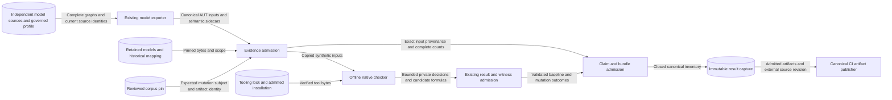

# Finite participant-crossing machine check

Requirements: SEM-232, ASR-535, SEM-230, API-423, RUN-319. Classification: FM3.

## Subject and claim boundary

The subject is `participant-crossing-dpbb-finite-v1@rev2`.
The abstract and concrete models use revision `rev2`.
The projection is `participant-crossing-projection@rev1`.
The catalog is `raes-behavioral-relations@rev8`.
The selected relation is `divergence-preserving-branching-bisimulation`.

The check starts at both declared initial states.
It covers every reachable state and edge.
It permits no sample or depth limit.
It permits no reused identity or missing state.
The five declared mediation classes map to `internal`.
Every other declared action remains visible.

A positive result supports only a finite model-check claim.
It supplies no proof certificate or checked abstraction-map witness.
Runtime realization remains a separate claim.
So do backend conformance, noninterference, opacity, and independent reproduction.
The result has no time or probability claim.
It excludes concurrency, fairness, handoff, and other profiles.
The historical mapping keeps its known gaps.
It keeps each recorded mismatch.
SEM-232 stays DRAFT.
The separate reproduction and publication work must finish first.

## Components and interfaces

`implementations.formal.participant_crossing.machine_check` owns result production and admission.
Its public interfaces are `build_bundle`, `admit_bundle`, `publish`, and `load_retained`.
The command-line interface supplies `record`, `check`, and `replay` operations.
The module uses existing tools.
These include the exporter, corpus, claim validator, and checker adapter.
`machine_check_evidence` owns closed metadata construction within the same formal package.
`machine_check_publication` admits results and stages a fixed CI inventory with separate execution provenance.
`tools.nox_support.machine_check_lane.run_machine_check` owns the offline nox command.
The named nox session uses an installed Python closure without dependency synchronization or network acquisition.
The corpus has a fixed comparison inventory.
The complete producer and CI job have explicit time limits.
The producer permits at most 47 native comparisons within 2,160 seconds.

`export.build_bundle` constructs both models from independent transition authorities.
It checks every enabled edge and reached state.
It checks the initial states, source bytes, and profile contract.
The exporter must reproduce the retained AUT bytes.
Only then can the checker receive those bytes.
The retained corpus supplies a separate trusted pin.
It also fixes the subject for mutation review.
A fresh run repeats every required mutation.
It repeats each control and relation calibration.
The results must match the retained corpus.
Only then can the baseline decision support a claim.

The result binds complete domain counts, state counts, transition counts, and semantic sidecars.
It binds current sources separately from retained construction-time sources.
It binds the historical mapping manifest and case bytes without claiming current runtime coverage.
It records the archive checksum.
It records the executable and installed-tree identities.
It records the fixed command and resource limits.
Canonical JSON identity and exact file-byte identity retain their existing meanings.
The manifest does not include its own digest.

Positive evidence contains the existing `BehavioralClaimBindingModel`.
`validate_behavioral_claim_binding` checks its exact catalog, profile, projection, and carrier joins.
The assurance axis and evidence scope are `model-check`.
The assurance status is `model-checked`.
The quantifier covers all admitted inputs of this named complete finite profile.

A negative decision has no positive relation claim.
A checked auxiliary branching formula can explain a negative result for the actual ordered inputs.
Its recorded relation remains branching bisimulation.
Unsupported witnesses and operational failures produce no publishable result.
Raw process diagnostics remain private.

## Data flows and trust boundaries

The native sandbox forms a trust boundary.
It receives synthetic model files.
It receives the verified tool tree.
Both mounts are read-only.
It receives no network, repository, home directory, credentials, or runtime authority.
Existing CPU and memory limits apply.
So do time, file-size, and descriptor limits.
The parent terminates remaining child processes after failure or completion.

The publication boundary accepts only the closed result inventory.
It enforces per-file and total byte limits before atomic publication.
Existing captures retain their bytes.
A separate repository pin selects an accepted capture.
Unsigned evidence cannot satisfy a consumer policy that requires authenticity.
Checksums establish integrity against that pin, not independent review or authenticity.

## Security and verification

| Threat and boundary | Control | Verification |
| --- | --- | --- |
| Shared model authority or truncated carrier | Existing independent-source, closure, reachability, and exact-byte checks | Shared successor function, missing transition, wrong initial state, and altered sidecars are refused. |
| Changed projection or hidden visible action | Closed profile and existing AUT codec | Profile drift and unexpected labels are refused before checker execution. |
| Substituted native tool | Existing raw archive and complete-tree admission | Changed tool identities and missing installation produce no decision. |
| Checker always accepts | Fresh mutation and calibration replay | Every mandatory negative case must fail its declared relation. |
| False result or claim promotion | Closed evidence reconstruction and existing claim validation | Changed counts, fields, inputs, outcome, proof status, and carrier joins are refused. |
| Unsafe diagnostic or false witness | Existing bounded syntax and independent formula evaluation | Invalid labels, paths, formulas, and unsupported witnesses prevent publication. |
| Source, mapping, or artifact drift | Current source pins and independently selected retained identities | Changed provenance and jointly replaced candidate artifacts are refused. |
| Host data disclosure or partial publication | Existing sandbox, safe readers, bounded inventory, and atomic publisher | Unsafe paths, excess bytes, operational failure, and incomplete bundles are refused. |

The trusted host supplies the kernel and native libraries.
It supplies bubblewrap, prlimit, and the Debian reader.
The qualified CI host remains `model-check-ubuntu-26.04-x86_64`.
An unavailable sandbox fails the check.
Host security controls remain enabled.

## Architecture and policy constraints

ADR-100 remains the semantic decision authority.
ADR-117 governs module interfaces and import structure.
The check needs no new public schema.
It needs no service, store, registry, route, or signing system.
Existing executable validators express the architecture constraints.
The issue scope assigns exact files to existing requirements.
The existing canonical model-check job owns native replay and bounded artifact publication.
Publication uses the repository's existing CI artifact destination and pinned actions.
The CI source revision accompanies the artifact digest outside reproducible result bytes.
The execution record names the observed runner image and host profile.
It records native package versions and Python closure identity.
Existing bootstrap host probes qualify the hosted image.
The producer checks source stability before and after native execution.
The tooling gate owns the shared validation-source inventory.
Both native evidence producers bind that inventory.
It covers the selected-policy validators, their shared readers, and governing schemas.
Only a trusted writer can change the checkout or tool tree.
No other writer may change them during the run.
Public and scientific claim surfaces wait for issues 975 and 976.

The separate multi-operation profile requires its own result, limits, inventory, and witness capability.
This check cannot silently extend the single-operation carrier.

## References and document review

- [mCRL2 202607.0 ltscompare](https://www.mcrl2.org/web/user_manual/tools/release/ltscompare.html): equivalence modes, explicit hiding, input formats, and supported formula modes.
- [Bubblewrap reference architecture](https://github.com/containers/bubblewrap/blob/main/README.md): explicit namespace and mount policy.
- [ASD-STE100 Issue 9](https://www.asd-ste100.org/assets/files/ASD-STE100_ISSUE9.pdf): technical names, sentence structure, and descriptive writing.
- [Architecture preflight](../../../docs/decisions/issue-974-finite-crossing-bisimulation-preflight.md): repository interfaces, claim joins, and evidence limits.

The document review applies STE sections 1, 4, 5, and 6.
It checks consistent technical names, one fact per sentence, sentence limits, and document purpose.
Architecture descriptions remain separate from implementation tasks and delivery records.
