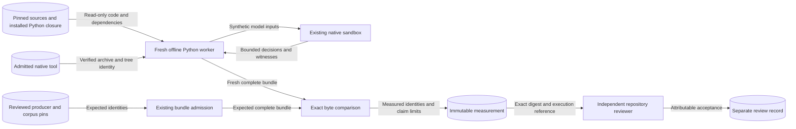

# Participant-crossing reproduction

Requirements: SEM-232, ASR-535. Classification: FM3.

## Subject and evidence

The subject is the separately pinned finite machine-check capture.
Its profile is `participant-crossing-dpbb-finite-v1@rev2`.
The relation is divergence-preserving branching bisimulation.
Both models remain at rev2, with projection rev1 and taxonomy rev8.
The original result and its claim remain unchanged.

The formal package owns the reproduction controller and its measurement record.
The public interface is `reproduction.measure`.
It uses the existing producer and admission interfaces.
These are `machine_check.load_retained`, `admit_bundle`, and `build_bundle`.
The existing exporter supplies complete model construction and counts.
The existing corpus supplies every mutation, calibration, control, and checked witness.
The existing native adapter supplies the fixed comparison command.
No second model or relation checker is needed.

The controller checks the expected bundle.
A separately selected digest fixes that subject.
It starts the reviewed producer in a fresh Python process.
The worker constructs actual bytes without reading the machine-check result directory.
Each output file must match exactly.
It records the expected and actual manifest, result, claim, and artifact digests.
It keeps every count and mutation outcome.
It keeps the command and original claim limits.
No candidate command or path controls execution.

Measurement does not authenticate a reviewer.
A separate review must name the record digest.
It must name the mutation review subject.
The review must name its reviewer.
It must state their role and separation from the original producer.
An implementation agent may perform that review.
The repository review authority owns that acceptance record.
A caller-supplied name, second CI job, or producer approval cannot replace it.
Missing acceptance leaves independent reproduction incomplete.
Unsigned evidence cannot satisfy a policy that requires authenticity.

## Execution boundary and data flows

The Python worker has a separate network namespace and a cleared environment.
Only declared source, dependency, and tool mounts are available.
The worker receives no home directory, Git credentials, result cache, or ambient import path.
Its temporary state and output directory are private and fresh.
The machine-check result directory is absent from the worker.
The existing native sandbox remains inside this boundary.
Source and tool mounts are read-only.
Source stability is checked before and after execution.
An exclusive trusted writer remains necessary during setup.

The whole worker has a fixed deadline.
Its process group is killed and reaped on exit.
The native adapter retains its CPU, memory, output, and descriptor limits.
The worker permits no acquisition or unsandboxed fallback.
Acquisition and Python environment preparation occur before verification.
Missing inputs or isolation produce no completed decision.
A different valid result fails reproduction.
No partial measurement is published.

## Security and verification

| Threat and boundary | Control | Verification |
| --- | --- | --- |
| Substituted expected result | Caller-selected reviewed digest and existing admission | A candidate and replacement checksum cannot change the selected subject. |
| Reused result or stale workspace | Fresh worker, hidden producer results, private temporary state | Actual output must come from fresh construction and native comparisons. |
| Ambient network, imports, or credentials | Network namespace, fixed mounts, cleared environment | Synthetic environment and host-file sentinels remain inaccessible. |
| Source or tool substitution | Existing source, archive, executable, and complete-tree checks | Drift fails before publication. |
| Altered counts, hiding, mutations, or claim limits | Complete bundle comparison and existing validators | Each altered field or omitted case fails admission. |
| Unsafe artifact paths or diagnostics | Existing bounded readers and fixed output inventory | Links, excess bytes, extra files, and operational failure are refused. |
| Self-approved reproduction | Measurement and reviewer acceptance remain separate | A measurement alone never establishes independent acceptance. |

Keep result bytes separate from host records.
CI keeps its approved host and Python closure.
The new run records its own approved host fields.
Local observations do not impersonate the qualified hosted environment.
No environment dump or absolute source path enters the public record.

## Architecture constraints

ADR-100 remains the semantic authority.
ADR-071 keeps integrity, review, and authenticity separate.
ADR-117 governs the existing public package interfaces.
No new ADR, public schema, runtime interface, store, or service is needed.
Existing profile, claim, source, and tooling validators supply policy as code.
Exact inventory and digest joins supply the executable architecture constraints.
The canonical CI graph owns any hosted execution and approved artifact upload.
It must retain exact revisions, pinned actions, and required-job aggregation.

The result supplies no live-runtime realization or backend conformance.
It supplies no noninterference, opacity, unbounded proof, or broader profile result.
Historical runtime-mapping gaps remain explicit.
SEM-232 remains DRAFT until its remaining delivery obligations are met.
Issue 976 owns subsequent public and scientific claims.

## References and document review

- [mCRL2 202607.0 ltscompare](https://www.mcrl2.org/web/user_manual/tools/release/ltscompare.html): relation, explicit hiding, input order, and witness capabilities.
- [Bubblewrap reference architecture](https://github.com/containers/bubblewrap/blob/main/README.md): explicit filesystem, process, and network isolation policy.
- [ASD-STE100 Issue 9](https://www.asd-ste100.org/assets/files/ASD-STE100_ISSUE9.pdf): sections 1, 4, 5, and 6.
- [Architecture preflight](../../../docs/decisions/issue-975-independent-crossing-reproduction-preflight.md): exact subject, reviewer authority, and existing module boundaries.

The review checks technical names, sentence limits, and one fact per sentence.
It keeps architecture descriptions separate from implementation tasks.
