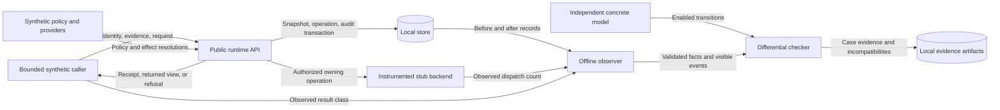

# Participant-crossing runtime mapping

Issue: #972. Mapping requirement: SEM-232. Runtime rejection requirement: API-404.
Status: bounded execution mapping; no equivalence or complete realization result.
Detailed reuse/security guardrails:
[preflight](../../../docs/decisions/issue-972-runtime-crossing-mapping-preflight.md).

## Boundary

The target is `participant-crossing-dpbb-finite-v1@rev2`.
The concrete model remains `api-423-run-319-crossing-kernel@rev2`.
The observation projection is `participant-crossing-projection@rev1`;
the relation catalog is `raes-behavioral-relations@rev8`.
The profile permits one fresh operation and its retries.
It excludes identity reuse, concurrency, time, probability, and controller handoff.

Mapping checks compare observed runtime facts with the existing concrete model.
They do not construct the runtime facts from that model.
A matching case is evidence for that case only.
It does not establish bisimulation, backend conformance, or a whole-runtime result.

## Components and contracts

The public `RuntimeControlPlane` entry points own admission, projection, and effect dispatch.
Installed resolvers and providers supply bounded synthetic inputs.
The real runtime owns identity authorization, validation, ordering, and durable outcomes.
Embedded identities are supplied by the trusted host; HTTP authentication is a separate boundary.
The store retains snapshots, operation records, and audit events.
Offline test helpers observe these facts around each public call and at existing owner seams.
They compare them with the independent concrete transition authority.
Read-only wrappers observe identity, policy, support, decision, preparation, and commit functions.
Each wrapper calls its original function once and retains the result.
The checker consumes the observed order without inserting hidden events.
Each witness has an ordinal and belongs to a recorded witness count.
A missing witness produces an observation gap.
A complete witness sequence that contradicts the model produces an incompatibility.

Each call starts from its observed policy cut and retained logical result.
A retained refusal requires exact history, operation, and audit joins before it maps to `terminal` at `h1`.
Unknown prior state remains unmapped.
The checker never resets a retry to an empty history.

The observer checks exact participant, episode, audience, and controller bindings.
It checks policy cuts separately from history heads.
It checks subject identity, transformation predecessors, and effective capability support.
It checks operation outcomes against the retained crossing and caller result.
It never treats an accepted receipt as successful execution.

## Data flows and trust boundaries



Caller input crosses the runtime identity and authorization boundary.
Provider output crosses the runtime validation boundary.
Persistence crosses the transaction boundary.
The observer crosses an assurance boundary when it interprets runtime records.
No observed payload, credential, or host path enters published case evidence.
Runtime safety checks apply before model compatibility is considered.
They compare the full expected snapshot, operation record, revision, and audit event at each observed commit.
The integrity checker preserves every pre-call operation record except its witnessed owning transition.
Each commit and final readback must retain the exact earlier audit prefix.
They preserve all existing history rows and reject changes to another participant during refusal.
A safety failure stops evidence publication, even when the operation is also incompatible with the model.
A stale-cut marker never exempts a refused call's effects or state changes.
Unexplained changes remain failed evidence obligations.

The fixtures retain their explicit legacy composition.
Their operating profile is `None`, which establishes no P0, P1, or P2 guarantee.
The evidence records this value and the actual store capability declarations.
The existing API-404 clause map governs operating-profile conformance.

## State and transition map

| Runtime fact | Concrete coordinate or event | Admission condition |
| --- | --- | --- |
| Bound participant, audience, controller, episode | Singleton domains | Exact declared binding; no identity recycling |
| Request commitment and idempotency key | `request-0` | One logical request; unchanged content on retry |
| Resolved policy reference | `p0` or `p1` | Exact declared cut; history movement is separate |
| API-423 requested occurrence | `crossing.request`, intent | Typed occurrence and matching operation context |
| Independent semantic and support gates | gate, capability | Required unresolved support cannot become permit |
| API-423 decided occurrence | visible decision, decision | Deny first; supported declared decision class |
| Transformation occurrence | change event and result subject | Exact subject and predecessor joins |
| Atomic crossing result batch | `h0` to `h1`, last | Snapshot, status, and audit agree |
| Actual delivery and observation evidence | delivery and observation events | Disclosure alone proves neither |
| Same-cut retry | retained result | No second logical commit or backend execution |
| Later-cut retry | replay rejection | Recorded result remains unchanged |

Mapping validation allows only the five hidden mediation classes declared by the profile.
It retains visible errors and additional outcomes as incompatibilities.
It does not merge extra runtime decisions into one model decision.
It does not infer an observation from a returned view.
Intermediate phases need observed evidence, not a path reconstructed from expected successors.
Each case reports a match, a demonstrated incompatibility, an observation gap, or an unexercised obligation.
Expected model choices do not prove that the runtime enables those choices.

Public execution must cover v2 surface admission with forwarded `ParticipantSubmissionOptions`,
installed API-424 providers through effect composition and actual owner dispatch,
and final-sink success/refusal through participant retrieval.
Effect-owner operations, fresh ingress after a transform, and permit-then-final-refusal paths
can exceed this carrier; they remain explicit incompatibilities where no mapping exists.
No gate can be disabled to make them fit.

## Security and failure behavior

Protected assets are identity bindings, state cuts, audit integrity, and assurance claims.
A false identity alias could hide an authorization failure.
Exact binding checks and negative public API cases address this threat.
A partial commit could claim an outcome absent from durable state.
Snapshot, operation, and audit comparisons address this threat.
A refusal could change protected participant state.
Before and after comparisons exclude only the permitted refusal evidence.

Projection could erase an error, a second operation, or a controller change.
Such facts produce incompatibility rather than hidden transitions.
Timing-sensitive requests cannot receive an untimed mapping result.
Instrumented stub execution provides no concrete backend claim.
An authorized backend can return an unsuccessful result and commit a failed operation.
This is an additional model outcome, not proof of a crossing refusal.
The mapping retains that failure as an incompatibility and checks its authorization and commit independently.
Unknown commit outcomes use authoritative store readback and existing recovery/readiness rules.
A failed call does not prove rollback, and an authorized independent consequence can follow parent refusal.

## Architecture and policy decisions

ADR-100 already separates model construction, runtime mapping, and equivalence.
This work applies that decision without changing its accepted text.
The governed profile, model sources, schemas, and observation projection retain their identities.
Incompatible behavior requires a separate governed profile decision.

Existing contract validators remain the policy authority.
No runtime authorization policy or deployment architecture changes.
Future mapping checks must enforce these boundaries with existing canonical JSON,
bounded JSON/file ingress, contextual validators, store transactions, and redacted error envelopes.
Portable diagnostic shape validation does not sanitize callback exception messages.
The v2 rejection boundary must use a fixed diagnostic for untrusted callback errors.
Regression evidence must check the caller response and durable diagnostic.
Mapping adds no production observer, policy engine, exception hierarchy, public DTO, or service.

The extension seam is an offline case binding with exact profile/model/projection pins,
runtime identity/cut bindings, public entry and sink, store profile, final-sink setting,
installed support, and exclusions. A separately governed profile uses distinct evidence;
it does not edit rev2 or inherit a result from these cases.

## Evidence and review

Evidence binds source, profile, model, mapping, test, and artifact digests.
Read-only drift checks compare exact consumed source and artifact identities with retained pins.
Historical model bundles remain immutable.
The evidence names its tested cases and unsupported dimensions.
It makes no complete-runtime or complete-carrier exploration claim.
Formal equivalence, runtime realization, backend conformance, noninterference,
and predicate opacity remain separate claims under ADR-100.
Full-carrier equivalence checking, negative-result corpus, independent reproduction,
new schemas and expanded carriers remain excluded.

The writing review uses ASD-STE100 Issue 9 rules for words, descriptive sentences, and paragraph purpose.
Project identifiers retain their technical meanings.
This document describes the architecture; the issue plan contains execution tasks.

## Reproduction

The local driver uses the repository Python environment.
It executes public calls before it compares the retained evidence.
It does not change runtime admission or transaction results.

```sh
PYTHONPATH=. RAES_REQUIREMENT_UID=SEM-232 \
  implementations/python/.venv/bin/python \
  implementations/python/tests/crossing_runtime_cases.py

RAES_REQUIREMENT_UID=SEM-232 implementations/python/.venv/bin/python -m pytest \
  implementations/python/tests/test_issue_972_runtime_mapping.py \
  implementations/python/tests/test_issue_972_mapping_export.py \
  implementations/python/tests/test_issue_972_mapping_ownership.py -q
```

The retained bundle is `runtime-mapping/rev1` beside this document.
Its manifest binds the source inventory, profile, historical model artifacts, and observed cases.
The source inventory includes runtime packages, contracts, test drivers, formal code, configuration, and the Python lockfile.
The read-only command rejects source or artifact drift.
The initial producer uses `--write` and refuses to replace a different bundle.

The cases cover both policy cuts and all five input classes.
They retain a single runtime and store across each retry sequence.
They exercise delivered v2 admission, installed providers, actual effect-owner dispatch, and final egress.
Separate tests inject missing phase evidence, incomplete publication, changed protected state, stale callbacks, and lost acknowledgements.

Matching refusal cases establish only their witnessed state and transition correspondence.
Transformed ingress retains its extra request and decision.
Separate effect-owner operations exceed the single-operation carrier.
Final egress refusal retains the failed operation and the earlier permit.
A returned view without observation evidence remains an observation gap.
No case invents delivery, observation, a silent error, or a second logical commit.

## Reference basis

- [Python documentation](https://docs.python.org/3.12/library/unittest.mock.html), Python 3.12, wrapping calls: observation retains the original callable.
- [mCRL2 tool reference](https://www.mcrl2.org/web/user_manual/tools/release/ltscompare.html), 202607.0, equivalence and hiding: trace comparison is separate from bisimulation.
- [NIST systems security engineering](https://csrc.nist.gov/pubs/sp/800/160/v1/r1/final), volume 1 revision 1, trustworthy systems: evidence remains bound to its system boundary.
- [ASD-STE100](https://www.asd-ste100.org/assets/files/ASD-STE100_ISSUE9.pdf), Issue 9, writing rules: short sentences and consistent technical names.
