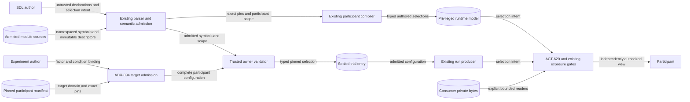
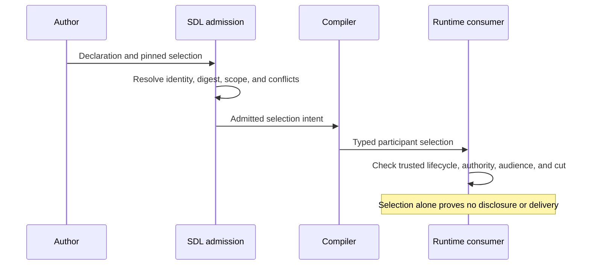

# Participant control-context references

Status: normative. Requirement: DSL-118. Issue: #299.

## Architecture and ownership

`control_context_assets` is an optional SDL declaration map.
Each value is the existing ACT-620 `ParticipantControlContextAssetModel`.
The map supplies local symbols, without creating a registry or lifecycle authority.
Asset content remains an inert artifact reference.
SDL contains no private instruction bytes.

An agent or behavior specification can declare a `control_context` map.
Each map key identifies an authored selection slot.
Each value contains `declaration_ref`, the ACT-620 `asset_ref` triple, and `disposition`.
The dispositions are `selected` and `withheld`.
They express authored intent, without asserting authorized selection or delivery.
The default disposition is `selected`.

`declaration_ref` resolves through the existing declaration index.
The resolved declaration must be a control-context asset.
The `asset_ref` must equal `control_context_asset_reference()` of that descriptor.
Its identity, exact opaque version, and canonical descriptor digest must agree.
The content checksum remains part of the descriptor commitment.
Versions have no inferred ordering or fallback.

Compilation retains typed selections on existing participant and behavior projections.
Each selection retains its slot, participant address, declaration address, exact asset reference, and disposition.
Declarations without selections create no participant projection.
A selection creates no content placement, action permission, or exposure.

## Scope and conflicts

Direct selections apply to their owning agent.
Reusable selections use the existing `select_participants()` rule.
Each resulting participant must satisfy the descriptor's declared applicability.
Exact canonical participant addresses and effective role values are alternative matches.
`Agent.effective_role()` supplies authored roles.
Unresolved authored roles defer their applicability check until instantiation.
Trusted role membership and live authorization still require ACT-620 validation.

Two declarations for the same asset identity and version must have identical descriptors.
Two effective selections for one participant and slot are invalid, including equal duplicates.
There is no precedence between direct, reusable, and experiment selections.
Different slots can select different assets without an implicit order or composition rule.

Imports namespace local symbols and authored references through existing symbol maps.
They preserve the complete ACT-620 descriptor and exact reference triple.
Descriptor applicability, provenance, and locators are external immutable data.
They receive no namespace rewrite or variable substitution.
Descriptors containing substitution tokens are invalid.
Imported descriptors must name final canonical participants or applicable effective roles.
Authored references cannot access private exports through `__private` spellings.
Existing safe YAML, composition budgets, and post-instantiation admission remain mandatory.

## Experiment participant binding

ADR-094 participant configuration targets can declare a `control_context` selection domain.
The domain contains a `slot_id` and bounded `references` map.
Each reference key is an exact SDL declaration address.
Each value is the existing ACT-620 asset reference triple.
The target admits literal strings only and declares scalar type `string`.
Domain references use exported canonical names.
Slot and reference syntax rejects line endings and private namespace segments.
A value selects exactly one domain entry.
Secret references and serialized asset objects are invalid selections.

The existing complete-configuration validator provides trusted contextual validation.
For these targets it must also validate the participant, slot, declaration, and exact asset pin.
Absent contextual validation fails admission.
Trial compilation binds the owner validator to the concrete selected scenario through `for_scenario()`.
The SDL adapter reuses the declaration index, scope checks, and conflict rules.
It performs no acquisition and changes no shared scenario family.

Each realized configuration value retains a typed `control_context_selection`.
That selection contains the slot, declaration address, and exact ACT-620 reference.
The existing configuration digest, sealed trial entry, and plan digest cover it.
The public trial result carries it to the run producer.
Consumers use the retained pin, never a current catalog's replacement for the string.
An invalid coordinate rejects the whole plan.
Existing run validation preserves configuration and manifest provenance.
Live lifecycle eligibility still requires an authorized consumer check at use time.

## Data flow and trust boundaries

Author input crosses the parser boundary without acquiring authority.
The manifest-owner boundary admits only declared targets and exact selections.
The sealed-plan boundary preserves admitted selections across serialization.
The participant boundary remains the existing authenticated exposure and delivery path.
Private bytes and withheld metadata stay behind that boundary.

## Systems security and verification

| Threat and boundary | Control | Behavioral evidence |
| --- | --- | --- |
| Stale descriptor or substituted bytes | Exact descriptor digest; existing content checksum commitment | Changed descriptor and stale pin refusal |
| Cross-participant selection | Canonical participant or effective-role applicability | Wrong participant and role refusal; imported scope cases |
| Ambiguous or competing selection | Existing declaration index; one effective owner per slot | Missing, ambiguous, wrong-kind, and duplicate selection cases |
| Import alters a pinned descriptor | Descriptor excluded from rewrite and substitution | Two-import identity preservation; token refusal |
| Forged current-catalog resolution | Manifest domain pins and typed sealed configuration selection | Reload preserves exact triple; changed descriptor refusal |
| Missing trusted owner validation | Required contextual validation for context targets | Absent validator rejects the complete trial plan |
| Private content leaks through diagnostics | Closed reference-only shapes and coarse bounded errors | Rejected content and diagnostic sentinel cases |
| Authored selection becomes disclosure | No placement or delivery from a selection | Withheld and unselected declarations create no participant exposure |

Static checks establish authored agreement only.
They do not prove byte availability, lifecycle state, participant compliance, or authorization.
ACT-620 owns trusted lifecycle, content, and authority validation.
Issue #300 owns decision-time exposure integration.
No new network request, filesystem reader, subprocess, credential, or environment binding is required.

## Policy, architecture, and compatibility

Policy-as-code uses closed models, exact semantic checks, and existing direct-artifact admission.
Architecture-as-code uses existing SDL schemas, configuration contracts, and publication records.
Changed schemas remain draft contracts under ADR-061.
Publication entries record every changed schema hash and contract-facing change.
The reference schema bundle must match the published schemas.
Empty optional fields retain historical serialization and canonical identity.

ADR-053, ADR-076, ADR-094, ADR-095, ADR-108, and ACT-620 already govern these boundaries.
No new ADR is required.
No runtime IAM, transport, asset store, or executable policy language changes are required.
The existing binding owner and versioned validator admit future assets without another authority plane.

## References and document review

- [Pydantic models](https://raw.githubusercontent.com/pydantic/pydantic/v2.12.5/docs/concepts/models.md), version 2.12.5: closed models and validation.
- [RFC 8785](https://www.rfc-editor.org/rfc/rfc8785), sections 3.2 and 5: canonical identity and its security limits.
- [NIST SP 800-162](https://csrc.nist.gov/pubs/sp/800/162/upd2/final), 2019 update: subject, object, operation, and environment authority.
- [ASD-STE100](https://www.asd-ste100.org/assets/files/ASD-STE100_ISSUE9.pdf), Issue 9: sections 1, 6, and 9.

Review applies approved word meanings and consistent project technical nouns.
Descriptive sentences contain at most 25 words.
The document describes contracts and boundaries.
Implementation tasks remain in the issue plan.
