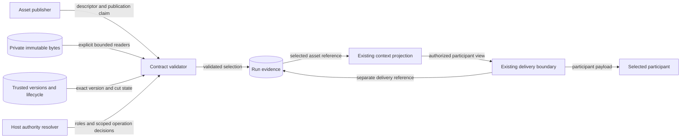
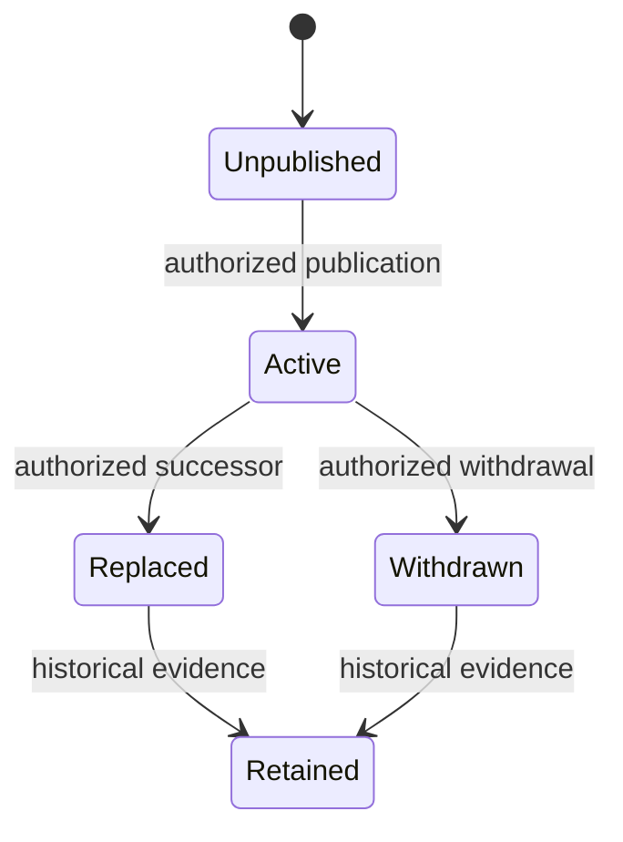

# Participant control-context assets

Status: normative. Requirement: ACT-620. Issue: #302.

## Asset contract

An instruction, directive, policy, or guidance asset contains execution-guiding
context. Content grants no action authority and executes no control mechanism.
ADR-108 owns mechanisms. Issue #299 owns SDL references.

`participant-control-context-asset-v1` defines one immutable asset version.
It carries `asset_id`, `asset_version`, `kind`, an existing
`ExperimentArtifactRefModel` content descriptor, applicability, publication
authority, retention policy, and provenance references.
Applicability names participants, roles, or both. Either list can match.
Role membership MUST come from trusted context at the selection cut.
Applicability alone grants no disclosure permission.

The asset reference contains its identity, exact version, and descriptor digest.
The digest is `canonical_contract_digest()` of the complete asset model.
The helper uses RFC 8785 and the complete JSON model, including null fields.
The content checksum separately identifies exact payload bytes.
Manifest identity, set digest, artifact identity, and asset identity remain distinct.
Versions are opaque strings. Consumers MUST NOT infer order or select `latest`.
Changing a descriptor under an existing identity and version is a conflict.

Private bytes stay in consumer-controlled storage.
Portable records contain references and digests only.
Consumers MUST authorize metadata export, including asset existence and digests.
Free text, locators, and provenance identifiers can also disclose information.
The contract does not certify that arbitrary identifiers contain no secrets.

## Lifecycle contract

`participant-control-context-change-v1` records publication, replacement, or
withdrawal within an explicit authority scope.
Each change names the asset, actor, authority, effective state cut, reason,
evidence, and provenance. Replacement also names its exact successor.

The consumer resolves lifecycle state at an exact cut in that scope.
Unknown or incomparable cuts fail closed.
The host supplies cut precedence for distinct selection, derivation, and delivery cuts.
The validator does not infer that relation from unrelated integer order fields.
Publication requires an unpublished version and publication authority.
Replacement requires an active predecessor and a distinct published successor
with the same logical asset identity.
Withdrawal requires an active version.
Replacement and withdrawal require separate operation-specific authority.
They prevent new selection and disclosure of the predecessor after their effective cut.
They MUST NOT rewrite old selections, deliveries, or observations.

Historical descriptors and evidence remain available under the retention policy.
Private byte retention and deletion follow the consumer's authorized policy.
Missing bytes prevent verified replay; historical references alone do not prove replay.
Withdrawal does not erase participant knowledge or prove memory reset.

## Selection and delivery evidence

`participant-control-context-record-v1` binds one selected version to an explicit
scope, run, participant, episode, generation, audience, actor, and selection cut.
It records selection authority separately from its current disposition.
The dispositions are `selected`, `withheld`, `disclosed`, and `delivered`.

A selected record contains no disclosure or delivery reference.
A withheld record adds withholding authority and no participant-facing reference.
Withholding changes neither asset lifecycle nor another participant's selection.
A disclosed record names an existing v2 decision surface and exposed item.
A delivered record additionally names that surface's actual delivery occurrence.
The record cut identifies the evidence occurrence. It is separate from selection.
Later evidence uses a distinct record identity and retains the original selection reference.

Full validation requires explicitly supplied trusted context.
That context fixes the scope, run, participant, episode, generation, audience,
and record cut. Its resolvers provide immutable versions, lifecycle state,
role membership, authorization decisions, prior selections, and decision surfaces.
Portable claims MUST NOT supply their own trusted context.
Historical validation uses authentic historical context, never current state relabelled as history.

All dispositions require exact asset resolution and selection authorization.
Later dispositions MUST retain their trusted original selection fields.
Disclosure joins the asset source to the existing ADR-095 exposure binding.
The binding source is `urn:sha256:<asset descriptor digest hex>`.
This source binds the exact version descriptor, including its content checksum.
The content URI alone cannot establish that binding.
The binding MUST match participant, episode, audience, source, and derivation cut.
Delivery rechecks lifecycle and disclosure authority at the delivery cut.
The delivered surface MUST match the trusted record, participant-view digest,
delivery occurrence, audience, episode, and exposed item.
Decision epoch does not substitute for a state cut.

A transformed or redacted result has its own item identity and view digest.
Its exposure binding retains the source content reference and transformation rule.
It MUST NOT claim that transformed bytes equal the original content checksum.
Selection, disclosure, delivery, and participant understanding remain separate facts.

## Content binding and interfaces

The reference validator reuses `validate_associated_artifact_manifest()`.
The caller supplies the concrete supported parent, manifest, and bounded readers.
The asset content descriptor MUST exactly match its manifest entry.
Full manifest validation checks parent identity, set identity, checksum, and size.
Validation performs no acquisition, credential lookup, file traversal, or execution.

Existing context-view transformations and v2 exposure bindings own projection.
The context-view source-layer vocabulary adds `participant_control_context_asset`.
This explicit source kind prevents misclassification as an observation or snapshot.
The resolved participant-visible context view MUST bind that source and its transformed item.
Its participant, episode, audience, view reference, and payload MUST match the surface.
Existing v2 decision surfaces own participant views and delivery evidence.
Existing experiment evidence and associated manifests carry the new records as artifacts.
An evidence artifact attaches to its explicit run; attachment does not imply delivery.
Serialization MUST preserve selections and delivery references independently.
No existing wire contract changes meaning.

## Data flow and trust boundaries

The publisher boundary admits untrusted descriptors, never authorization.
The private-store boundary admits only bounded explicitly supplied readers.
The host boundary supplies authority independently of the portable records.
The participant boundary releases only an independently authorized view.
Assurance records, withheld metadata, and private source bytes stay behind that boundary.

## Security and verification

| Threat and boundary | Control | Verification |
| --- | --- | --- |
| Changed bytes at the private-store boundary | Existing bounded manifest and byte validation | Stale checksum and parent mismatch cases |
| Forged version or changed descriptor | Exact trusted version and canonical digest agreement | Unknown version and same-version conflict cases |
| Unauthorized publication or change | Operation-specific authority at the exact scope and cut | Publish, replace, and withdraw refusal cases |
| Wrong recipient or stale evidence | Trusted run, participant, episode, generation, audience, and cut joins | Cross-scope and stale-cut refusal cases |
| Disclosure after withdrawal | Lifecycle and authority recheck at delivery | Withdrawal between selection and delivery case |
| Provenance leaks private content | Closed reference-only records and coarse diagnostics | Raw content rejection and safe error cases |
| False delivery claim | Existing trusted v2 surface and delivery joins | Selected, withheld, undelivered, and forged delivery cases |

The host remains responsible for authenticated caller binding and atomic release.
The validator checks agreement; it does not install a reference monitor.
Bounded checks do not establish universal noninterference or participant compliance.

Policy-as-code uses closed models, contextual checks, and existing conformance registration.
Architecture-as-code uses the existing schema bundle and publication inventory.
ADR-077, ADR-083, ADR-095, and ADR-108 already govern these boundaries.
No new ADR, IAM surface, registry, transport, or storage service is required.

## References and document review

- [Pydantic models](https://raw.githubusercontent.com/pydantic/pydantic/v2.12.5/docs/concepts/models.md), version 2.12.5:
  closed nested models and model validation.
- [RFC 8785](https://www.rfc-editor.org/rfc/rfc8785), sections 3.2 and 5:
  canonical descriptor identity remains separate from authorization.
- [NIST SP 800-162](https://csrc.nist.gov/pubs/sp/800/162/upd2/final), 2019 update,
  access-control model: subject, object, operation, and environment checks.
- [ASD-STE100](https://www.asd-ste100.org/assets/files/ASD-STE100_ISSUE9.pdf),
  Issue 9, sections 1 and 9: technical nouns, approved meanings, and consistent terminology.

Review uses short descriptive sentences and consistent project technical nouns.
Normative statements describe the contract. Implementation tasks stay in the issue plan.
